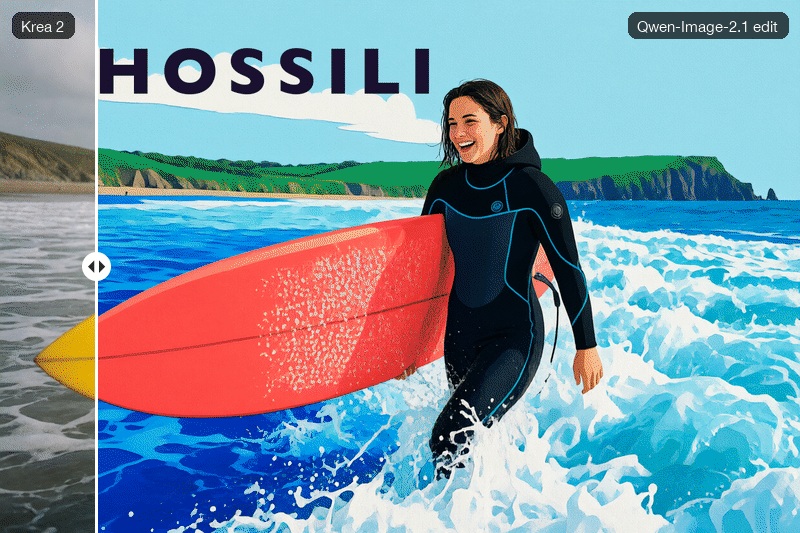
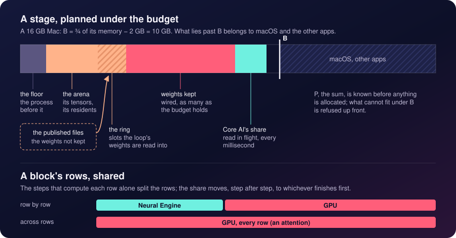
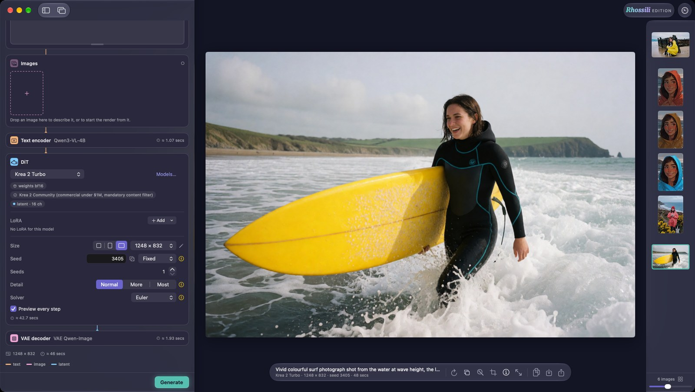

[English](README.md) · Français

  

<h1 align="center">Siliconed</h1>

  <b>Gros modèles d'images, petit Mac, et Core AI d'Apple qui porte le plus lourd.</b> 
  Cinq modèles récents à poids ouverts, qui génèrent et retouchent des images sur votre Mac, sans Python, sans serveur, sans cloud.

  
  
  
  
  

  
  
  
  

  
  
  

*Une photo de Krea 2 Turbo, repeinte en affiche ferroviaire des années 1930 par Qwen-Image-2.1 en une phrase, comparée sous le rideau : rien n'a bougé que le style. Le nom est de nous, posé par-dessus. Édition 0.30 · Rhossili.*

## Core AI porte le plus lourd

Siliconed portait ses propres noyaux Metal, réglés puce par puce. Depuis la 0.30, il calcule sur **Core AI**, le runtime qu'Apple livre avec macOS 27 : Apple écrit et règle les noyaux pour chaque puce, le GPU comme le Neural Engine, et Siliconed garde ce qui est à lui — les modèles, leur mémoire, leur preuve.

- **Apple écrit les noyaux ; Siliconed écrit les modèles.** Chaque modèle est quelques fonctions Core AI écrites en Swift et la boucle qui les appelle. Aucun noyau à nous à entretenir, aucune table de puces, rien à mesurer avant le premier rendu : un Mac neuf ou un macOS neuf, et Core AI apporte ce qui lui va. [Le moteur](docs/ENGINE.fr.md#core-ai).
- **Le Neural Engine met la main à la pâte, sur les cinq modèles.** Sa part de chaque bloc se trouve pendant que l'image se calcule, pas après pas, et passe à l'unité qui finit la première. La Standard s'en sert aussi, ses poids bf16 arrondis une fois en f16 — le moteur chronomètre les deux façons sur votre Mac et garde la plus rapide.
- **Les fichiers des éditeurs, lus tels quels.** Les bf16 de l'éditeur pour la Standard, des int8 publiés pour la Compact, à moitié moins de disque. Une installation est un téléchargement ; rien à convertir, jamais.
- **Compilé une fois, et c'est parti.** Core AI compile une fonction pour ses formes : le premier rendu à une taille neuve le paie une fois, et la Chaîne le dit. Z-Image sur un M1 Pro de 16 Go : 93 s la première fois, 76 s ensuite.
- **Les LoRA à côté des poids, jamais fondues dedans**, pour que leurs petites retouches survivent aux codes int8.

## Gros modèles, petit Mac

Un modèle de 12,8 milliards de paramètres sur un Mac de 16 Go, ça sent la mauvaise idée. Siliconed ne se donne jamais plus que les ¾ de la mémoire du Mac moins 2 Go (réglable) : chaque rendu se planifie sous cette limite avant qu'un octet soit alloué. Un modèle trop gros pour elle garde les poids qui tiennent et lit les autres du disque pendant qu'il calcule ; ce que Core AI tient pour ses fonctions se lit en vol, chaque milliseconde ; une grande image se décode par bandes ; et ce qui ne tient vraiment pas est poliment refusé d'emblée. [Comment](docs/ENGINE.fr.md#la-mémoire-et-le-budget).

| 1024², 8 pas | Mac mini M5 Pro, 64 Go | M1 Pro, 16 Go · Compact |
|---|---:|---:|
| Z-Image Turbo | 23,8 s | 75,9 s |
| Anima Turbo | 7,9 s | 33,6 s |
| Krea 2 Turbo | 43,2 s | 128,1 s |
| MOSS-Image | 25,7 s | 76,4 s |
| Qwen-Image-2.1 Turbo | 29,7 s | 97,7 s |

*Le Mac mini en Standard, le M1 Pro en Compact sous sa limite de 10 Go ; le modèle chargé, la compilation faite. Les deux versions, les premiers rendus et comment prendre les vôtres : [Les chiffres](docs/ENGINE.fr.md#les-chiffres).*

## Ce que fait l'app

- **Dessine à partir de texte, et retouche sur instruction.** Qwen-Image-2.1 Turbo prend 1 à 3 images et une phrase (« remplace le ciel nuageux par un ciel bleu ») et ne change que ce que vous avez nommé. Quel modèle pour quoi, avec licences et tailles : [Les modèles](docs/APP.fr.md#les-modèles).
- **Nomme vos sujets.** Désignez un manteau, un chien ou un visage dans une image, donnez-lui un nom, et écrivez « she wears @raincoat » (Qwen-Image-2.1).
- **Part d'une image.** Z-Image, Anima, Krea 2 et MOSS-Image prennent une image de départ et une force.
- **Bracketing, comme un appareil photo.** Faites varier un mot, la graine, la force d'une LoRA, des LoRA, le Détail ou l'image de départ : une image finie par case, côte à côte sur le canevas.
- **Écrit vos prompts, si vous le demandez** (bêta). L'Atelier de prompts réécrit une idée courte dans le style que chaque modèle aime, ou décrit une image que vous y déposez, avec un modèle que vous avez déjà.
- **Prend vos propres modèles.** Déposez sur la fenêtre une LoRA ou un fine-tune de Civitai ou de Hugging Face : reconnu à ce qu'il contient, lu tel quel.
- **Montre son travail.** Le panneau Chaîne dessine la mémoire du rendu dans le temps, contre la limite, étage par étage, avec les parts du GPU et du Neural Engine.
- **Local et privé.** Le rendu se fait sur votre Mac, sans filtre de contenu ajouté par l'app et sans rien envoyer de votre historique. Elle parle anglais, français, allemand, espagnol, italien, japonais et chinois simplifié.
- **Calcule sur un autre Mac.** Un MacBook calcule sur le Mac mini de la pièce d'à côté, appairé une fois par un code, chiffré ([comment](docs/APP.fr.md#calculer-sur-un-autre-mac)).
- **Scriptable.** `silicontrol` pilote l'app ouverte depuis un terminal, pour les scripts et les agents de code ([détails](docs/REMOTE-CONTROL.fr.md)).

La visite de l'app : [docs/APP.fr.md](docs/APP.fr.md).

## Vérifié contre les modèles d'origine, avec un brin de manie

Un développeur et une règle têtue : un résultat qu'on ne peut pas comparer au code d'origine n'est pas livré. Chaque étage est comparé, canal par canal, à l'implémentation de référence (diffusers / transformers) dans l'arithmétique des poids, et la Compact aux produits int8 de ComfyUI. Les barres se fixent avant la mesure et ne bougent pas. Refaites les contrôles vous-même : [VERIFY.fr.md](docs/VERIFY.fr.md).

## Télécharger (un .dmg, rien d'exotique)

L'app est distribuée en `.dmg` sur la page [Releases](https://github.com/gwenn-ha-dev/Siliconed/releases) ; la même image, octet pour octet, est sur [Hugging Face](https://huggingface.co/gwenn-ha-dev/Siliconed). Prérequis : macOS 27 ou plus, Apple silicon. Rien n'est préinstallé : vous choisissez les modèles depuis l'app, vous lisez chaque licence, et c'est seulement ensuite qu'un octet se télécharge. Pour la construire vous-même : [Construire depuis les sources](docs/ENGINE.fr.md#construire-depuis-les-sources) ; Xcode 27 ou plus est requis.

## Documentation

- [docs/APP.fr.md](docs/APP.fr.md) : l'app en détail : créer, éditer, écrire des prompts, séries, gérer les modèles, réglages, vie privée.
- [docs/ENGINE.fr.md](docs/ENGINE.fr.md) : le moteur : Core AI, la mémoire et sa limite, les chiffres, la vérification, la construction depuis les sources.
- [docs/VERIFY.fr.md](docs/VERIFY.fr.md) : vérifier les résultats contre la référence sur votre Mac.
- [docs/REMOTE-CONTROL.fr.md](docs/REMOTE-CONTROL.fr.md) : `silicontrol`, protocole et fonctionnement interne.
- [docs/RELEASE-NOTES.fr.md](docs/RELEASE-NOTES.fr.md) : ce qui change à chaque version.
- Les issues : [bug, idée](https://github.com/gwenn-ha-dev/Siliconed/issues/new/choose) (en anglais). Les temps de votre Mac sont les bienvenus, ceux des 8 Go d'abord : [une commande, un formulaire](https://github.com/gwenn-ha-dev/Siliconed/issues/new?template=times.yml).

## Crédits

Les modèles appartiennent à leurs éditeurs (listés dans [Les modèles](docs/APP.fr.md#les-modèles)), chacun sous sa propre licence. Les implémentations de référence sont [diffusers](https://github.com/huggingface/diffusers) et [transformers](https://github.com/huggingface/transformers), de Hugging Face, et [ComfyUI](https://github.com/comfyanonymous/ComfyUI) pour les produits int8 ; les poids int8 des Compact sont ceux de [Comfy-Org](https://huggingface.co/Comfy-Org), de [Bedovyy](https://huggingface.co/Bedovyy/Anima-INT8) et de [Disty0](https://huggingface.co/Disty0/Z-Image-Turbo-SDNQ-int8) ; le rééchantillonnage des images reproduit le Lanczos de [Pillow](https://github.com/python-pillow/Pillow) au bit près. Les LoRA et les fine-tunes viennent de la communauté, sur [Civitai](https://civitai.com) et [Hugging Face](https://huggingface.co) ; la recette en 8 pas de MOSS-Image est la [LoRA DMD](https://huggingface.co/lodestones/MOSS-Image-SFT-8-steps-dmd) de lodestones.

## Licence

Le code est sous [licence Apache 2.0](LICENSE). Les poids des modèles ne font pas partie de ce dépôt : chacun est téléchargé par vous, sous sa propre licence, que l'app affiche avant de l'installer.
