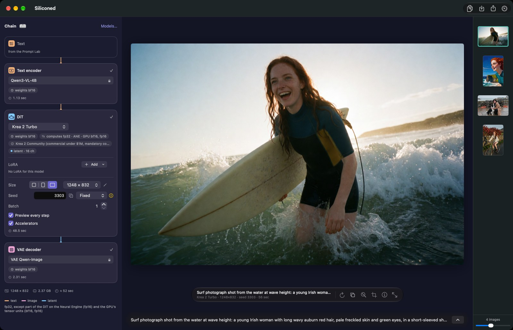

[English](README.md) · Français

# Siliconed

**Générer et éditer des images sur votre Mac, en local, avec des modèles récents aux poids ouverts : calculées en pleine précision, vérifiées contre le code d'origine, et sans jamais prendre plus de mémoire qu'un budget fixe.**

Siliconed est une app macOS libre et gratuite pour la **génération d'images à partir de texte et l'édition d'images, en local**, sur les Mac Apple silicon (M1 et suivants). Elle fait tourner des modèles de diffusion récents — [Krea 2 Turbo](https://huggingface.co/krea/Krea-2-Turbo), [Z-Image Turbo](https://huggingface.co/Tongyi-MAI/Z-Image-Turbo), [Qwen-Image-2.1 Turbo](https://huggingface.co/Qwen/Qwen-Image-2.1-Turbo), [Anima Turbo](https://huggingface.co/circlestone-labs/Anima) et [MOSS-Image](https://huggingface.co/OpenMOSS-Team/MOSS-Image-SFT) (bêta : sa recette en 8 pas est celle de la communauté) — en natif, en Swift et Metal : ni Python, ni serveur, ni cloud, rien ne quitte votre Mac. Elle marche hors ligne une fois le modèle installé.

Un développeur, un MacBook Pro de 16 Go et une règle têtue : un résultat qu'on ne peut pas comparer au code d'origine n'est pas livré. Le reste, c'est la joie toute simple de voir tourner un modèle de 12,9 milliards de paramètres sur un portable qui, sur le papier, n'a rien à faire là.

*Une photo de Krea 2 Turbo, éditée par Qwen-Image-2.1 avec une phrase (« Convert this photo to a western comic book style with cel shading », graine 42), comparées sous le rideau.*

## Télécharger (un .dmg, rien d'exotique)

L'app est distribuée en `.dmg` sur la page [Releases](https://github.com/gwenn-ha-dev/Siliconed/releases) ; la même image, octet pour octet, est sur [Hugging Face](https://huggingface.co/gwenn-ha-dev/Siliconed). Prérequis : macOS 26 ou plus, Apple silicon. Rien n'est préinstallé : vous choisissez les modèles depuis l'app, vous lisez chaque licence, et c'est seulement ensuite qu'un octet se télécharge. Pour la construire vous-même : [Construire depuis les sources](docs/ENGINE.fr.md#construire-depuis-les-sources) ; Xcode 26 ou plus est requis (les seuls Command Line Tools ne suffisent pas à construire l'app).

## Ce que fait l'app

- **Dessine à partir de texte, et retouche sur instruction.** Qwen-Image-2.1 Turbo prend 1 à 3 images et une phrase (« remplace le ciel nuageux par un ciel bleu ») et ne change que ce que vous avez nommé. Quel modèle pour quoi, avec licences et tailles : [Les modèles](docs/APP.fr.md#les-modèles).
- **Bracketing, comme un appareil photo.** Faites varier un mot, la graine, la force d'une LoRA, des LoRA, le Détail ou l'image de départ : une image finie par case, côte à côte sur le canevas, chacune celle-là même que donne un rendu seul.
- **Écrit vos prompts, si vous le demandez** (bêta). L'Atelier de prompts réécrit un prompt court dans le style que chaque modèle aime, ou décrit une image que vous y déposez. Il se sert d'un modèle déjà installé, et jamais pendant un rendu.
- **Prend vos propres modèles.** Importez des LoRA et des fine-tunes depuis Civitai ou Hugging Face.
- **Local et privé.** Le rendu se fait sur votre Mac, sans filtre de contenu ajouté par l'app et sans rien envoyer de votre historique. Elle suit la langue du système (anglais, français, allemand, espagnol, italien, japonais ou chinois simplifié).
- **Calcule sur un autre Mac.** Un MacBook calcule sur le Mac mini de la pièce d'à côté, appairé une fois par un code, chiffré ([comment](docs/APP.fr.md#calculer-sur-un-autre-mac)).
- **Scriptable.** `silicontrol` pilote l'app ouverte depuis un terminal, pour les scripts et les agents de code ([détails](docs/REMOTE-CONTROL.fr.md)).

Le tour de l'app : [docs/APP.fr.md](docs/APP.fr.md).

## Pourquoi s'embêter

- **Rapide, sans rogner.** Sur un Mac mini M5 Pro de 64 Go, en 1024², avec les 8 évaluations (passages du modèle) que demandent leurs recettes, toutes en pleine taille : Z-Image Turbo en 18,8 s, Qwen-Image-2.1 Turbo en 21,3 s, Krea 2 Turbo en 32,0 s, dans la Compact que l'app recommande (le modèle en poids 8 bits, moitié moins de disque ; [les trois versions](docs/APP.fr.md#la-gestion-des-modèles)). Chaque calcul va au GPU, à l'unité matricielle du CPU ou au Neural Engine selon ce que ce Mac a mesuré. Avec les poids bf16 de l'éditeur : 24,8 s, 29,2 s et 45,4 s. [Tous les chiffres](docs/ENGINE.fr.md#les-chiffres).
- **Gros modèles, petit Mac.** 34 Go de modèle sur un Mac de 16 Go, ça sent la mauvaise idée. Les poids sont lus sur le disque au moment où ils servent, et Siliconed ne prend jamais plus que les ¾ de la mémoire du Mac moins 2 Go : un budget qu'il ne dépasse pas, jamais. Chaque rendu calcule ce qu'il lui faut avant de commencer ; au-delà du budget, il est poliment refusé d'emblée. [Comment c'est mesuré](docs/ENGINE.fr.md#la-mémoire-et-le-budget).
- **Même sur un MacBook Neo de 8 Go.** Celui à puce d'iPhone (A18 Pro) : avec la 0.19, Anima Turbo y fait un carré de 1024² en moins d'une minute, en Compact, toutes les évaluations en pleine taille. Nous n'avons plus de Neo pour le chronométrer en règle : si vous en avez un, ou un Mac que nous n'avons jamais vu, [envoyez-nous vos chiffres](docs/ENGINE.fr.md#sur-un-macbook-neo).
- **Vérifié contre les modèles d'origine, avec un brin de manie.** Chaque étage est comparé, canal par canal, à l'implémentation de référence (diffusers / transformers en fp32 sur CPU), et ce qui ne se vérifie pas n'est pas livré. Refaites les contrôles chez vous : [VERIFY.fr.md](docs/VERIFY.fr.md). La CI passe les étages CPU des noyaux chaque fois que le moteur change ; son GPU est virtuel, les étages GPU se jugent sur votre Mac.
- **Connaît votre Mac.** Avant le premier rendu, en une minute environ (cinq au plus) et sans aucun modèle, il mesure ce que calcule chaque moteur de votre Mac — le GPU, l'unité matricielle du CPU, le Neural Engine —, seul et avec les autres, et vérifie chaque résultat contre le résultat exact ; il calcule ensuite, pour chaque produit et chaque attention d'un rendu, comment répartir les lignes entre les moteurs qui ont calculé juste. [Comment](docs/ENGINE.fr.md#un-moteur-mesuré-sur-votre-mac).

## Documentation

- [docs/APP.fr.md](docs/APP.fr.md) : l'app en détail : créer, éditer, écrire des prompts, séries, gérer les modèles, réglages, vie privée.
- [docs/ENGINE.fr.md](docs/ENGINE.fr.md) : le moteur : la mesure du Mac, le Neural Engine, les chiffres, le rendu plus rapide, la mémoire, le diagnostic communautaire, la vérification, la construction depuis les sources.
- [docs/VERIFY.fr.md](docs/VERIFY.fr.md) : vérifier les résultats contre la référence sur votre Mac.
- [docs/REMOTE-CONTROL.fr.md](docs/REMOTE-CONTROL.fr.md) : `silicontrol`, protocole et fonctionnement interne.
- [docs/RELEASE-NOTES.fr.md](docs/RELEASE-NOTES.fr.md) : ce qui change à chaque version.
- Les issues : [rapport de diagnostic, bug, idée](https://github.com/gwenn-ha-dev/Siliconed/issues/new/choose) (en anglais).

## Crédits

Les modèles appartiennent à leurs éditeurs (listés dans [Les modèles](docs/APP.fr.md#les-modèles)), chacun sous sa propre licence. Les implémentations de référence sont [diffusers](https://github.com/huggingface/diffusers) et [transformers](https://github.com/huggingface/transformers), de Hugging Face ; le rééchantillonnage des images reproduit le Lanczos de [Pillow](https://github.com/python-pillow/Pillow) au bit près. Les LoRA et les fine-tunes viennent de la communauté, sur [Civitai](https://civitai.com) et [Hugging Face](https://huggingface.co) ; la recette en 8 pas de MOSS-Image est la [LoRA DMD](https://huggingface.co/lodestones/MOSS-Image-SFT-8-steps-dmd) de lodestones.

## Licence

Le code est sous [licence Apache 2.0](LICENSE). Les poids des modèles ne font pas partie de ce dépôt : chacun est téléchargé par vous, sous sa propre licence, que l'app affiche avant de l'installer.
