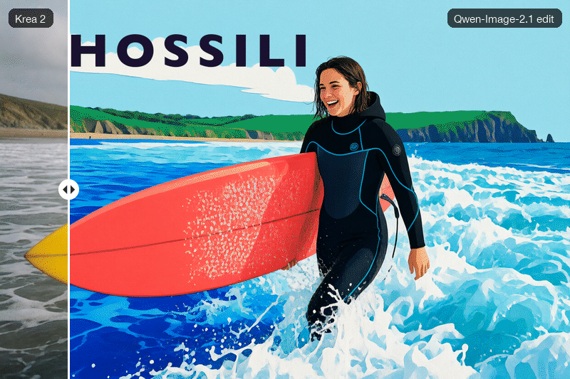
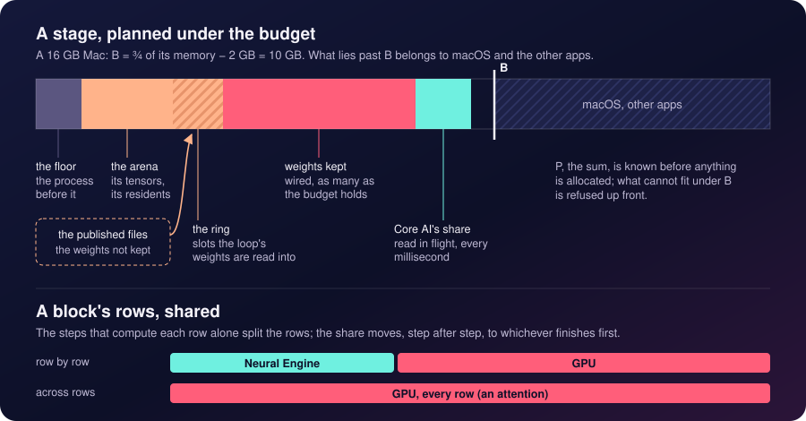
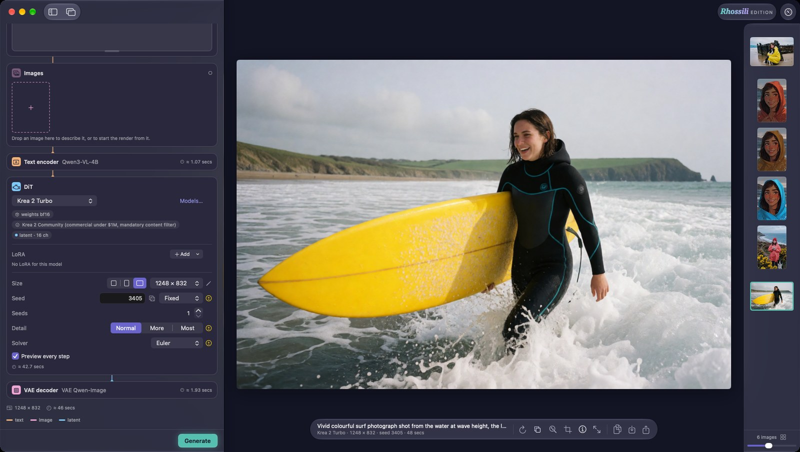

English · [Français](README.fr.md)

  

<h1 align="center">Siliconed</h1>

  <b>Big image models, small Mac, and Apple's Core AI doing the heavy lifting.</b> 
  Five recent open-weight models, generating and editing images on your Mac, with no Python, no server and no cloud.

  
  
  
  
  

  
  
  
  

  
  
  

*A photo from Krea 2 Turbo, repainted as a 1930s railway poster by Qwen-Image-2.1 with one sentence, compared under the curtain: nothing moved but the style. The name is ours, set on top. Edition 0.30 · Rhossili.*

## Core AI does the heavy lifting

Siliconed used to carry its own Metal kernels, tuned chip by chip. Since 0.30 it computes on **Core AI**, the runtime Apple ships with macOS 27: Apple writes and tunes the kernels for every chip, the GPU and the Neural Engine alike, and Siliconed keeps what is its own — the models, their memory, their proof.

- **Apple writes the kernels; Siliconed writes the models.** Each model is a few Core AI functions written in Swift and the loop that calls them. No kernel of ours to maintain, no table of chips, nothing to measure before the first render: a new Mac or a new macOS, and Core AI brings what suits it. [The engine](docs/ENGINE.md#core-ai).
- **The Neural Engine pitches in, on all five models.** Its share of each block is found while the image renders, step after step, and moves to whichever unit finishes first. The Standard uses it too, its bf16 weights rounded once to f16 — the engine times both ways on your Mac and keeps the faster.
- **The publishers' files, read as they are.** The publisher's bf16 for the Standard, published int8 for the Compact, at half the disk. An installation is a download; there is nothing to convert, ever.
- **Compiled once, then off it goes.** Core AI compiles a function for its shapes: the first render at a new size pays for it once, and the Chain says so. Z-Image on a 16 GB M1 Pro: 93 s the first time, 76 s after that.
- **LoRAs beside the weights, never melted into them**, so their small touches survive the int8 codes.

## Big models, small Mac

A 12.8-billion-parameter model on a 16 GB Mac sounds like a bad idea. Siliconed never grants itself more than ¾ of the Mac's memory minus 2 GB (adjustable): every render is planned under that limit before a byte is allocated. A model too large for it keeps the weights that fit and reads the others from disk while it computes; what Core AI holds for its functions is read in flight, every millisecond; a large image is decoded in bands; and what truly does not fit is politely refused up front. [How](docs/ENGINE.md#memory-and-the-budget).

| 1024², 8 steps | Mac mini M5 Pro, 64 GB | M1 Pro, 16 GB · Compact |
|---|---:|---:|
| Z-Image Turbo | 23.8 s | 75.9 s |
| Anima Turbo | 7.9 s | 33.6 s |
| Krea 2 Turbo | 43.2 s | 128.1 s |
| MOSS-Image | 25.7 s | 76.4 s |
| Qwen-Image-2.1 Turbo | 29.7 s | 97.7 s |

*The Mac mini in Standard, the M1 Pro in Compact under its 10 GB limit; the model loaded, compilation done. Both versions, the first renders and how to take your own: [Numbers](docs/ENGINE.md#numbers).*

## What it does

- **Draws from text, and edits by instruction.** Qwen-Image-2.1 Turbo takes 1 to 3 images and a sentence (“replace the cloudy sky with a blue sky”) and changes only what you named. Which model for what, with licenses and sizes: [Models](docs/APP.md#models).
- **Names your subjects.** Point at a coat, a dog or a face in an image, give it a name, and write “she wears @raincoat” (Qwen-Image-2.1).
- **Starts from an image.** Z-Image, Anima, Krea 2 and MOSS-Image take a starting image and a strength.
- **Brackets, like a camera.** Vary a word, the seed, a LoRA's strength, LoRAs, Detail or the starting image: one finished image per cell, side by side on the canvas.
- **Writes your prompts, if you ask** (beta). The Prompt Lab rewrites a short idea in the style each model likes, or describes an image you drop on it, with a model you already have.
- **Takes your own models.** Drop a LoRA or a fine-tune from Civitai or Hugging Face onto the window: recognized by what it holds, read as it is.
- **Shows its work.** The Chain panel draws the render's memory in time, against the limit, stage by stage, with the GPU's and the Neural Engine's shares.
- **Local and private.** Rendering happens on your Mac, with no content filter added by the app and no history sent anywhere. It speaks English, French, German, Spanish, Italian, Japanese and Simplified Chinese.
- **Renders on another Mac.** A MacBook computes on the Mac mini of the next room, paired once with a code, encrypted ([how](docs/APP.md#render-on-another-mac)).
- **Scriptable.** `silicontrol` drives the running app from a terminal, for scripts and coding agents ([details](docs/REMOTE-CONTROL.md)).

The tour of the app: [docs/APP.md](docs/APP.md).

## Checked against the original models, a bit obsessively

One developer and a stubborn rule: if a result cannot be checked against the original code, it does not ship. Every stage is compared, channel by channel, with the reference implementation (diffusers / transformers) in the arithmetic of the weights, and the Compact with ComfyUI's int8 products. Bars are set before the measurement and do not move. Run the checks yourself: [VERIFY.md](docs/VERIFY.md).

## Download (it is a .dmg, nothing exotic)

The app ships as a `.dmg` on the [Releases](https://github.com/gwenn-ha-dev/Siliconed/releases) page; the same image, byte for byte, is mirrored on [Hugging Face](https://huggingface.co/gwenn-ha-dev/Siliconed). Requirements: macOS 27 or later, Apple silicon. Nothing comes preinstalled: you pick the models from inside the app, read each license, and only then does a byte download. To build it yourself: [Building from source](docs/ENGINE.md#building-from-source); Xcode 27 or later is required.

## Documentation

- [docs/APP.md](docs/APP.md): the app in detail: creating, editing, writing prompts, series, managing models, settings, privacy.
- [docs/ENGINE.md](docs/ENGINE.md): the engine: Core AI, memory and its limit, the numbers, verification, building from source.
- [docs/VERIFY.md](docs/VERIFY.md): checking the results against the reference on your Mac.
- [docs/REMOTE-CONTROL.md](docs/REMOTE-CONTROL.md): `silicontrol`, protocol and internals.
- [docs/RELEASE-NOTES.md](docs/RELEASE-NOTES.md): what changed in each version.
- Issues: [bug, idea](https://github.com/gwenn-ha-dev/Siliconed/issues/new/choose). Times from your Mac are welcome, the 8 GB ones first: [one command, one form](https://github.com/gwenn-ha-dev/Siliconed/issues/new?template=times.yml).

## Credits

The models belong to their publishers (listed under [Models](docs/APP.md#models)), each under its own license. The reference implementations are [diffusers](https://github.com/huggingface/diffusers) and [transformers](https://github.com/huggingface/transformers) by Hugging Face, and [ComfyUI](https://github.com/comfyanonymous/ComfyUI) for the int8 products; the Compacts' int8 weights are those of [Comfy-Org](https://huggingface.co/Comfy-Org), [Bedovyy](https://huggingface.co/Bedovyy/Anima-INT8) and [Disty0](https://huggingface.co/Disty0/Z-Image-Turbo-SDNQ-int8); the image resampling reproduces [Pillow](https://github.com/python-pillow/Pillow)'s Lanczos to the bit. LoRAs and fine-tunes come from the community, on [Civitai](https://civitai.com) and [Hugging Face](https://huggingface.co); MOSS-Image's 8-step recipe is lodestones' [DMD LoRA](https://huggingface.co/lodestones/MOSS-Image-SFT-8-steps-dmd).

## License

The code is under the [Apache License 2.0](LICENSE). The model weights are not part of this repository: each is downloaded by you, under its own license, which the app shows before installing it.
