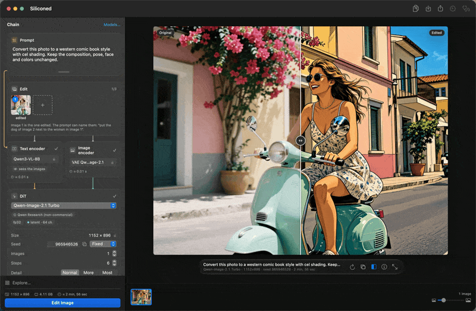

English · [Français](README.fr.md)

# Siliconed

**Generate and edit images on your Mac, locally, with recent open-weight models: computed in full precision, checked against the original code, and never using more memory than a fixed budget.**

Siliconed is a free, open-source macOS app for **local text-to-image generation and AI image editing** on Apple silicon Macs (M1 and later). It runs recent diffusion models — [Krea 2 Turbo](https://huggingface.co/krea/Krea-2-Turbo), [Z-Image Turbo](https://huggingface.co/Tongyi-MAI/Z-Image-Turbo), [Qwen-Image-2.1 Turbo](https://huggingface.co/Qwen/Qwen-Image-2.1-Turbo), [Anima Turbo](https://huggingface.co/circlestone-labs/Anima) and [MOSS-Image](https://huggingface.co/OpenMOSS-Team/MOSS-Image-SFT) (beta: its 8-step recipe is the community's) — natively in Swift and Metal: no Python, no server, no cloud, nothing leaves your Mac. It works offline once a model is installed.

*A photo from Krea 2 Turbo, edited by Qwen-Image-2.1 with one sentence (“Convert this photo to a western comic book style with cel shading”, seed 42, 215 s on an M1 Pro), compared under the curtain.*

## Download

The app ships as a `.dmg` on the [Releases](https://github.com/gwenn-ha-dev/Siliconed/releases) page. Requirements: macOS 15 or later, Apple silicon. Models install from inside the app; you choose which ones. To build it yourself: [Build from source](docs/ENGINE.md#build-from-source).

## What it does

- **Generates images from text and edits them by instruction.** Qwen-Image-2.1 Turbo takes 1 to 3 images and a sentence (“replace the cloudy sky with a blue sky”). Which model for what, with licenses and sizes: [Models](docs/APP.md#models).
- **Explores before it commits.** A grid of quick sketches across seeds, steps, LoRA strengths or models; the cell you pick becomes the finished image.
- **Takes your own models.** Import LoRAs and fine-tunes from Civitai or Hugging Face.
- **Local and private.** Rendering happens on your Mac, with no content filter added by the app. It follows the system language (English, French, German, Spanish or Italian).
- **Scriptable.** `silicontrol` drives the running app from a terminal, for scripts and AI agents ([details](docs/REMOTE-CONTROL.md)).

More about the app: [docs/APP.md](docs/APP.md).

## What sets it apart

- **Fast, without cutting corners.** Z-Image Turbo at 1024² in 83 s on a MacBook Pro M1 Pro with 16 GB, with the 8 evaluations (passes of the model) its recipe calls for, by default the first three at half size, in the Compact the app recommends (the model in 8-bit weights, half the disk; [the three versions](docs/APP.md#model-management)). In full precision, the publisher's bf16 weights computed in fp32: 82 s. Full precision costs almost nothing. [All the numbers](docs/ENGINE.md#numbers).
- **Large models on a 16 GB Mac.** 34 GB of model run on a 16 GB Mac: weights are read from disk as they are needed, and Siliconed never takes more than ¾ of the Mac's memory minus 2 GB. Each render works out what it needs before it starts; one beyond the budget is refused up front. [How it is measured](docs/ENGINE.md#memory-and-the-budget).
- **Checked against the original models.** Every stage is compared, channel by channel, with the reference implementation (diffusers / transformers in fp32 on CPU), and what cannot be checked does not ship. Run the checks yourself: [VERIFY.md](docs/VERIFY.md). The CI runs the kernels' CPU stages each time the engine changes; its GPU is virtual, so the GPU stages run on your Mac.
- **Tuned to your Mac.** Before the first render, in about a minute and without any model, it times its kernels on your chip and checks every result against the exact one; a kernel turns on only if it computed right and beat the default. [What it decided on an M1 Pro](docs/ENGINE.md#an-engine-measured-on-your-mac).
- **Measured next to Draw Things' engine** on the same Mac, with the method and every figure: [Next to Draw Things](docs/ENGINE.md#next-to-draw-things).

## Documentation

- [docs/APP.md](docs/APP.md): the app in detail: creating, editing, exploring, managing models, privacy.
- [docs/ENGINE.md](docs/ENGINE.md): the engine: measuring the Mac, the Neural Engine, numbers, Faster Rendering, Draw Things, memory, the community diagnostic, verification, building from source.
- [docs/VERIFY.md](docs/VERIFY.md): checking the results against the reference on your Mac.
- [docs/REMOTE-CONTROL.md](docs/REMOTE-CONTROL.md): `silicontrol`, protocol and internals.
- [docs/RELEASE-NOTES.md](docs/RELEASE-NOTES.md): what changed in each version.
- Issues: [diagnostic report, bug, idea](https://github.com/gwenn-ha-dev/Siliconed/issues/new/choose).

## Credits

The models belong to their publishers (listed under [Models](docs/APP.md#models)), each under its own license. The reference implementations are [diffusers](https://github.com/huggingface/diffusers) and [transformers](https://github.com/huggingface/transformers) by Hugging Face; the image resampling reproduces [Pillow](https://github.com/python-pillow/Pillow)'s Lanczos to the bit. LoRAs and fine-tunes come from the community, on [Civitai](https://civitai.com) and [Hugging Face](https://huggingface.co); MOSS-Image's 8-step recipe is lodestones' [DMD LoRA](https://huggingface.co/lodestones/MOSS-Image-SFT-8-steps-dmd).

## License

The code is under the [Apache License 2.0](LICENSE). The model weights are not part of this repository: each is downloaded by you, under its own license, which the app shows before installing it.
