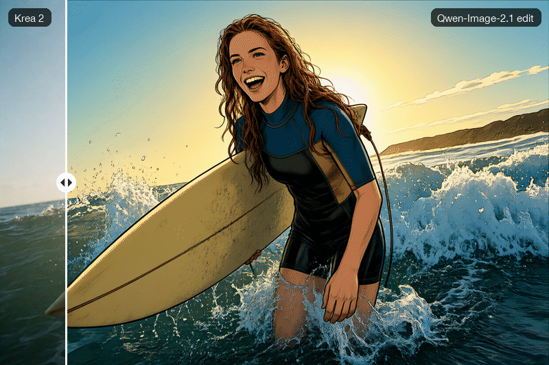
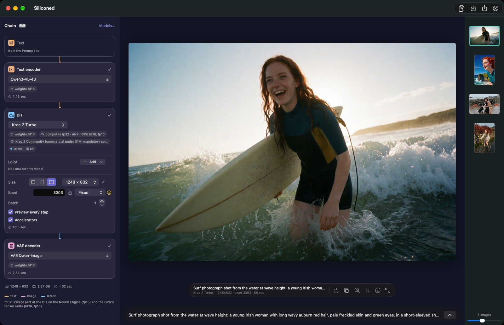

English · [Français](README.fr.md)

# Siliconed

**Generate and edit images on your Mac, locally, with recent open-weight models: computed in full precision, checked against the original code, and never using more memory than a fixed budget.**

Siliconed is a free, open-source macOS app for **local text-to-image generation and image editing** on Apple silicon Macs (M1 and later). It runs recent diffusion models — [Krea 2 Turbo](https://huggingface.co/krea/Krea-2-Turbo), [Z-Image Turbo](https://huggingface.co/Tongyi-MAI/Z-Image-Turbo), [Qwen-Image-2.1 Turbo](https://huggingface.co/Qwen/Qwen-Image-2.1-Turbo), [Anima Turbo](https://huggingface.co/circlestone-labs/Anima) and [MOSS-Image](https://huggingface.co/OpenMOSS-Team/MOSS-Image-SFT) (beta: its 8-step recipe is the community's) — natively in Swift and Metal: no Python, no server, no cloud, nothing leaves your Mac. It works offline once a model is installed.

One developer, one MacBook Pro with 16 GB, and a stubborn rule: if a result cannot be checked against the original code, it does not ship. The rest is the plain joy of watching a 12.9-billion-parameter model run on a laptop that, on paper, has no business doing it.

*A photo from Krea 2 Turbo, edited by Qwen-Image-2.1 with one sentence (“Convert this photo to a western comic book style with cel shading”, seed 42), compared under the curtain.*

## Download (it is a .dmg, nothing exotic)

The app ships as a `.dmg` on the [Releases](https://github.com/gwenn-ha-dev/Siliconed/releases) page; the same image, byte for byte, is mirrored on [Hugging Face](https://huggingface.co/gwenn-ha-dev/Siliconed). Requirements: macOS 26 or later, Apple silicon. Nothing comes preinstalled: you pick the models from inside the app, read each license, and only then does a byte download. To build it yourself: [Build from source](docs/ENGINE.md#build-from-source); Xcode 26 or later is required (the Command Line Tools alone cannot build the app).

## What it does

- **Draws from text, and edits by instruction.** Qwen-Image-2.1 Turbo takes 1 to 3 images and a sentence (“replace the cloudy sky with a blue sky”) and changes only what you named. Which model for what, with licenses and sizes: [Models](docs/APP.md#models).
- **Brackets, like a camera.** Vary a word, the seed, a LoRA's strength, LoRAs, Detail or the starting image: one finished image per cell, side by side on the canvas, each the very image a single render gives.
- **Writes your prompts, if you ask** (beta). The Prompt Lab rewrites a short prompt in the style each model likes, or describes an image you drop on it. It uses a model you already have installed, and never while an image is rendering.
- **Takes your own models.** Import LoRAs and fine-tunes from Civitai or Hugging Face.
- **Local and private.** Rendering happens on your Mac, with no content filter added by the app and no history sent anywhere. It follows the system language (English, French, German, Spanish, Italian, Japanese or Simplified Chinese).
- **Renders on another Mac.** A MacBook computes on the Mac mini of the next room, paired once with a code, encrypted ([how](docs/APP.md#render-on-another-mac)).
- **Scriptable.** `silicontrol` drives the running app from a terminal, for scripts and coding agents ([details](docs/REMOTE-CONTROL.md)).

The tour of the app: [docs/APP.md](docs/APP.md).

## Why bother, then

- **Fast, without cutting corners.** On a Mac mini M5 Pro with 64 GB, at 1024², with all 8 evaluations (passes of the model) their recipes call for at full size: Z-Image Turbo in 18.8 s, Qwen-Image-2.1 Turbo in 21.3 s, Krea 2 Turbo in 32.0 s, in the Compact the app recommends (the model in 8-bit weights, half the disk; [the three versions](docs/APP.md#model-management)). Each computation goes to the GPU, the CPU's matrix unit or the Neural Engine as this Mac measured them. With the publisher's bf16 weights: 24.8 s, 29.2 s and 45.4 s. [All the numbers](docs/ENGINE.md#numbers).
- **Big models, small Mac.** 34 GB of model on a 16 GB Mac sounds like a bad idea. Weights are read from disk as they are needed, and Siliconed never takes more than ¾ of the Mac's memory minus 2 GB, a budget it does not exceed, ever. Each render works out what it needs before it starts; one beyond the budget is politely refused up front. [How it is measured](docs/ENGINE.md#memory-and-the-budget).
- **Even on an 8 GB MacBook Neo.** The one with an iPhone chip (A18 Pro): with 0.19, Anima Turbo makes a 1024² square in under a minute on it, in the Compact, every evaluation at full size. We no longer have a Neo to time it properly: if you have one, or a Mac we have never seen, [send us your numbers](docs/ENGINE.md#on-a-macbook-neo).
- **Checked against the original models, a bit obsessively.** Every stage is compared, channel by channel, with the reference implementation (diffusers / transformers in fp32 on CPU), and what cannot be checked does not ship. Run the checks yourself: [VERIFY.md](docs/VERIFY.md). The CI runs the kernels' CPU stages each time the engine changes; its GPU is virtual, so the GPU stages run on your Mac.
- **Knows your Mac.** Before the first render, in about a minute (five at most) and without any model, it measures what each engine of your Mac — the GPU, the CPU's matrix unit, the Neural Engine — computes, alone and together, and checks every result against the exact one; it then works out, for every product and every attention of a render, how to share the rows among the engines that computed right. [How](docs/ENGINE.md#an-engine-measured-on-your-mac).

## Documentation

- [docs/APP.md](docs/APP.md): the app in detail: creating, editing, writing prompts, series, managing models, settings, privacy.
- [docs/ENGINE.md](docs/ENGINE.md): the engine: measuring the Mac, the Neural Engine, numbers, Faster Rendering, memory, the community diagnostic, verification, building from source.
- [docs/VERIFY.md](docs/VERIFY.md): checking the results against the reference on your Mac.
- [docs/REMOTE-CONTROL.md](docs/REMOTE-CONTROL.md): `silicontrol`, protocol and internals.
- [docs/RELEASE-NOTES.md](docs/RELEASE-NOTES.md): what changed in each version.
- Issues: [diagnostic report, bug, idea](https://github.com/gwenn-ha-dev/Siliconed/issues/new/choose).

## Credits

The models belong to their publishers (listed under [Models](docs/APP.md#models)), each under its own license. The reference implementations are [diffusers](https://github.com/huggingface/diffusers) and [transformers](https://github.com/huggingface/transformers) by Hugging Face; the image resampling reproduces [Pillow](https://github.com/python-pillow/Pillow)'s Lanczos to the bit. LoRAs and fine-tunes come from the community, on [Civitai](https://civitai.com) and [Hugging Face](https://huggingface.co); MOSS-Image's 8-step recipe is lodestones' [DMD LoRA](https://huggingface.co/lodestones/MOSS-Image-SFT-8-steps-dmd).

## License

The code is under the [Apache License 2.0](LICENSE). The model weights are not part of this repository: each is downloaded by you, under its own license, which the app shows before installing it.
