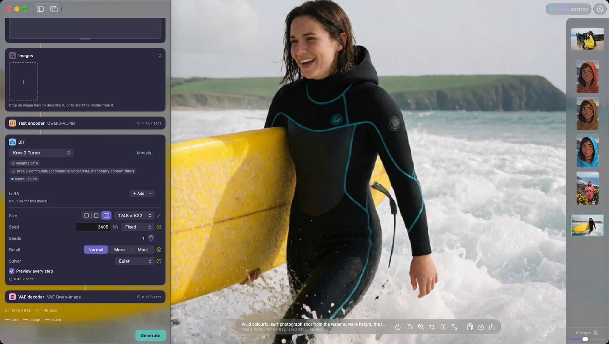
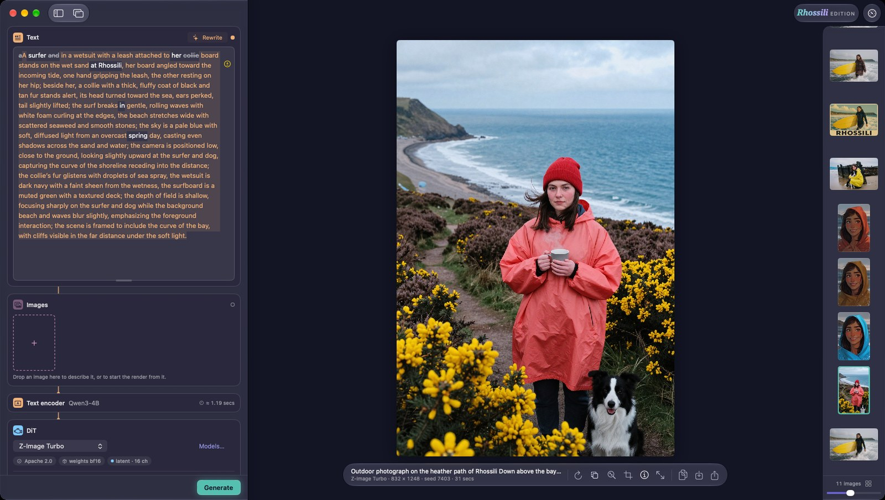
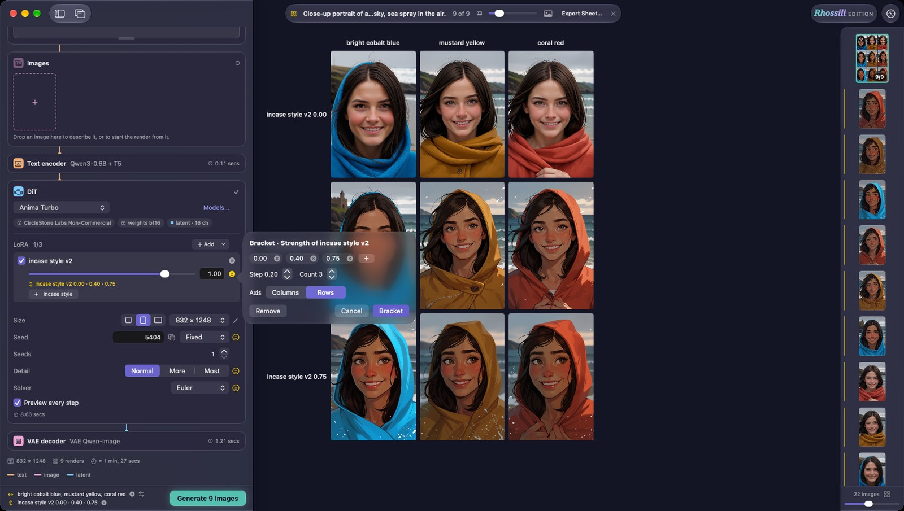
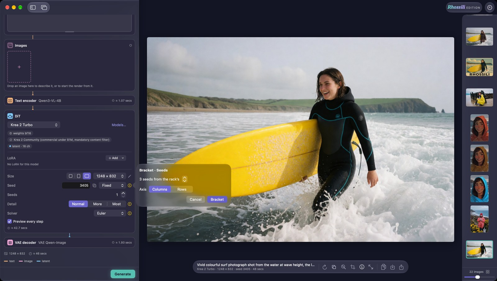

[English](APP.md) · Français

# L’app Siliconed

`Siliconed.app` transforme un prompt en image, retouche vos images quand vous lui dites quoi changer, et tient une file et un historique de tout ça. Pas de compte, pas de cloud, pas de roue qui tourne en attendant un serveur quelque part : juste votre Mac, qui travaille dur et vous dit ce qu’il fait. Elle suit la langue du système (anglais, français, allemand, espagnol, italien, japonais ou chinois simplifié).

![La fenêtre : à gauche le rack — la boîte Images, l’encodeur de texte Qwen3-VL-4B, le DiT avec Krea 2 Turbo et ses réglages (1248 × 832, graine 3405, Détail Normal, Euler), le décodeur VAE, chaque étage avec son temps — et Générer à son pied ; au milieu une photo de Krea 2 Turbo, Angharad, une jeune Galloise en combinaison d’hiver noire à capuche et liseré sarcelle, qui rit en sortant de l’écume à Rhossili, une planche de surf jaune sous le bras, le cap vert de Worms Head derrière elle ; à droite l’historique, le nom de l’édition au-dessus](images/window.jpg)

*La fenêtre, avec la photo de Krea 2 Turbo de la section [Les modèles](#les-modèles) : le rack montre la chaîne, les réglages et le temps de chaque étage ; l’historique est à droite.*

Le moteur derrière elle, avec les mesures : [Le moteur de Siliconed](ENGINE.fr.md).

## La fenêtre

Trois plans, chacun un seul rôle.

- **L’image a la fenêtre** : elle en est le fond, d’un bord à l’autre. Ajustée, elle tient entière dans la place que laissent les colonnes, rien dessus ; zoomée, elle glisse sous elles jusqu’aux bords de la fenêtre, et le rideau et la grille d’une série de même. Le zoom reste d’une image à la suivante de même taille — le même détail, graine après graine —, et repart ajusté sur une autre taille. Il va jusqu’à 16 points de l’écran pour un pixel de l’image ; au-delà d’un point par pixel, les pixels se dessinent en carrés (au plus proche voisin), pas lissés en flou.
- **À gauche, la chaîne : on y règle.** Une seule colonne de l’idée au bouton, de haut en bas : les boîtes Texte et Images (l’Atelier de prompts, [Préparer](#préparer-et-laissez-un-modèle-taper)), les encodeurs, le DiT et ses réglages, le VAE, et **Générer** épinglé à son pied. Elle se masque — le bouton de la barre d’outils, à côté des feux de la fenêtre, ou ⌥⌘R (Présentation › Masquer la chaîne) —, et son bord droit se tire. Le bouton suivant la détache dans une fenêtre flottante à elle, à côté de l’image ou sur un autre écran, l’image prenant toute la fenêtre ; fermer cette fenêtre la ramène à sa place.
- **À droite, le temps** : la file, en tuiles fantômes au-dessus du rendu en cours, puis l’historique, le plus récent en haut — une colonne qui commence sous la bande du haut, dont le bout droit porte le nom de l’édition et le bouton de l’inspecteur Chaîne. L’historique s’élargit en grille par-dessus l’image (⌥⌘G, Fenêtre › Historique en grille, ou le bouton à son pied) ; un clic y choisit une image, un glisser sur les images en sélectionne plusieurs (⌘ ou ⇧ ajoute à la sélection), et sa tête les exporte, les copie ou les retire ; un double clic, Échap, ⌥⌘G ou le grand **Revenir à l’image** au pied de la grille ramènent l’image.



*Zoomée, l’image glisse sous les colonnes jusqu’aux bords de la fenêtre, et se voit à travers leur verre. Krea 2 Turbo, 1248 × 832, graine 3405.*

Ce qu’on lit sans le régler : **les détails de l’image**, un popover du ⓘ sous l’image (⌘I) — ses réglages, et pour chaque étage le temps, la mémoire et l’unité qui l’a calculé — ; et **l’inspecteur Chaîne**, un panneau flottant (⌥⌘I), le rendu étage par étage ([plus bas](#la-gestion-des-modèles)). Un clic sur un encodeur ou le VAE du rack ouvre Chaîne à cet étage.

**Le verre.** Les deux colonnes sont en verre au-dessus de l’image : une image zoomée se voit à travers. Réglages › Général › Fenêtre › Verre l’éteint, et les colonnes sont opaques : le verre se recompose chaque fois qu’une image bouge dessous, ce qui coûte un peu de temps (+0,4 % d’un rendu en 1024² sur un M5 Pro, médiane de trois ; davantage sur un petit GPU).

**Espace écarte les composants** : les colonnes et la barre sous l’image s’en vont, l’image prend la fenêtre ; Espace, Échap ou le bouton resté au pied de la fenêtre les ramènent (Image › Écarter les composants, ⌥⌘F). Il n’y a plus de plein écran à part. La fenêtre fait au moins 1140 × 680 points.

## Créer

- **Cinq modèles.** Krea 2 Turbo, Z-Image Turbo, Qwen-Image-2.1 Turbo, Anima Turbo et MOSS-Image, chacun sous sa propre licence ([Les modèles](#les-modèles)). Tous cinq lisent le prompt avec un modèle de langage.
- **La chaîne, visible.** Pas de tuyauterie cachée : le rack, la colonne de gauche, montre le pipeline de haut en bas (texte, images, encodeurs, débruiteur, décodeur), avec des fils typés et l’étage actif allumé ; chaque étage porte ses réglages et affiche son temps. Les boîtes Texte et Images sont en tête, chacune de la largeur de la colonne, leurs fils descendant vers les encodeurs qu’elles nourrissent : là s’écrit le texte du prochain rendu et se choisissent ses images ([Préparer](#préparer-et-laissez-un-modèle-taper)). Chaque modèle rend en 8 pas, le nombre pour lequel il est distillé ; une ligne Pas ne paraît dans la boîte du débruiteur que si autre chose en a mis un autre (les réglages d’un PNG repris, `silicontrol add --steps`), avec une ✕ pour revenir à 8 ; avec l’option Bêta Choisir les pas allumée (Réglages › Avancé › Bêta), la ligne est toujours là, pour une LoRA distillée à moins de pas. Qwen-Image-2.1 ne rend qu’en 8 pas : un autre nombre est refusé avant tout calcul. Descendu jusqu’aux réglages du débruiteur, la chaîne reste en tête en petit, sous les premiers mots du texte, allumée de même, le temps de chaque étage dessous ; un clic ramène ses boîtes. Sous le titre du débruiteur, de petites étiquettes disent ce qui est installé : `poids int8` ou `poids bf16`, lu dans les fichiers, et la licence du modèle.
- **Plus de détail**, avec tous les modèles : « Détail : Normal · Plus · Maximum » ajoute de la texture fine et de petits détails, sans temps en plus. Chaque modèle a son réglage, et tous n’y gagnent pas autant : Krea 2 le moins, MOSS-Image le plus.
- **Les variations** : des cousines d’une image, subtiles ou marquées, aux mêmes réglages (le bouton sous l’image, ou son menu contextuel). **Rendre à nouveau (même graine)**, ⌘R, va dans l’autre sens : les mêmes réglages et la même graine. Une graine est celle de diffusers sur les cinq modèles (le même bruit de départ, au bit près). Le nombre d’images d’un coup, c’est le champ **Graines** du rack, de 1 à 8. Le champ de la graine a **Fixe** à côté de lui, et le dé : Fixe décoché, chaque rendu tire sa graine, que le champ montre ensuite en grisé, sélectionnable pour la copier (« — » avant le premier) ; Fixe coché, la graine du champ se garde d’un rendu au suivant.
- **Agrandir ×4** avec la super-résolution de macOS : aucun prompt, rien d’ajouté, bords et textures affinés ; 1024² devient 4096². Elle prend les images jusqu’à 1920 px de côté, et une image agrandie ne s’agrandit pas une seconde fois. macOS télécharge son propre modèle, une fois. L’original reste dans l’historique.
- **Les LoRA** sur les cinq modèles, dans la boîte du débruiteur : Ajouter liste les LoRA du modèle, puis Importer… ; un fichier s’importe aussi par Fichier › Importer un modèle ou une LoRA…, par le bouton Importer… de la fenêtre Modèles, ou déposé sur la fenêtre ([La gestion des modèles](#la-gestion-des-modèles)). Une LoRA s’ajoute dans le calcul, à côté des poids : aucun fichier du modèle n’est réécrit. Chacune est une carte : une case pour l’éteindre sans la perdre, sa force (un curseur, ou le chiffre tapé), et ses mots déclencheurs, quand son fichier les donne, en bouton qui les met en tête du prompt. Clic droit : Remplacer par, Revenir à 0,8, Retirer. Trois au plus.
- **Même graine, même départ.** Même prompt, même graine, mêmes réglages : le même bruit de départ, et la même recette appliquée. L’image n’est pas promise identique au bit près pour autant : le calcul est celui de Core AI, dont les bits peuvent changer avec macOS ([Core AI](ENGINE.fr.md#core-ai)).


*Un rendu en cours, Aperçu à chaque pas coché : l’étage actif est allumé, ses pas et le temps restant dessous ; l’image se forme sur place.*


*Défilé jusqu’aux réglages du débruiteur, la chaîne reste en tête, en petit, allumée de la même façon.*

Chaque côté doit être d’au moins 512 et multiple de 16 ; la surface n’a pas de plafond fixe : la limite de mémoire décide. Le moteur planifie chaque rendu sous la limite de mémoire du Mac, jamais dépassé ([comment](ENGINE.fr.md#la-mémoire-et-le-budget)) : quand la place manque, il garde en mémoire les poids qui tiennent, lit les autres du disque à leur tour pendant qu’il calcule, et décode l’image par bandes — la même image, plus de temps —, et le journal au pied de la colonne le dit. Ce qui ne tient pas même ainsi est refusé, avec la mémoire qu’il faudrait et la limite de ce Mac. **Le moteur tourne à côté de l’app, dans un processus à lui** (`silicore-worker`, dans le paquet) : la limite le borne seul, et le garde du moteur, qui lit son empreinte comme le système la compte, l’arrête de l’intérieur dès qu’il en tient plus. L’app, elle, ne s’arrête jamais : le rendu échoue avec une phrase qui le dit, les rendus qui attendent derrière lui continuent, et le suivant lance un moteur neuf. Le sélecteur de taille propose 1536² et 2048² à côté de 1024² ; toute autre taille se tape. Sous 512² les modèles sont hors de leur domaine. Qwen-Image-2.1 veut des multiples de 32 (son VAE divise par 16), et Anima au plus 2048 px de côté (les positions que sa référence calcule) ; l’un et l’autre sont refusés avant tout calcul, de même que tout côté au-delà de 8192 px.

**Format en deux échelles** (Réglages › Avancé › Bêta, éteint par défaut) sépare en deux le menu Format du rack : une proportion (1:1, 4:5, 3:4, 2:3, 9:16 et, couchés, 5:4, 4:3, 3:2, 16:9), puis une résolution, 1K (environ 1 mégapixel) ou 2K (environ 4) ; l’app calcule les pixels, toujours multiples de 32 pour que tous les modèles les prennent. Les limites de chaque modèle ne changent pas, et le menu par défaut reste le défaut.

| Proportion | 1K | 2K |
|---|---|---|
| 1:1 | 1024 × 1024 | 2048 × 2048 |
| 4:5 | 896 × 1120 | 1792 × 2240 |
| 3:4 | 864 × 1152 | 1728 × 2304 |
| 2:3 | 832 × 1248 | 1664 × 2496 |
| 9:16 | 768 × 1344 ≈ | 1440 × 2560 |

Les paysages sont les mêmes tailles couchées (le 3:2 fait 1248 × 832 en 1K). Le ≈ : en 1K, un 9:16 exact est hors d’atteinte : un 9:16 exact en multiples de 32 ne va que par pas de 288 × 512 (576 × 1024, 864 × 1536), donc la 1K garde 768 × 1344, qui est en réalité un 4:7 (1,6 % d’écart) et s’affiche « ≈ 9:16 » ; pareil pour le 16:9 couché. En 2K, 1440 × 2560 est un 9:16 exact. Anima s’arrête à 2048 px de côté : sa 2K est le carré seul, et les autres tailles 2K sont grisées avec cette raison. `silicontrol add` et `grid` prennent les mêmes tailles écrites `3:4@2K`, option Bêta allumée ou non ([Télécommande](REMOTE-CONTROL.fr.md)).

## Éditer

- **L’édition par instruction** avec Qwen-Image-2.1 Turbo : donnez-lui 1 à 3 images et une phrase (« remplace le ciel nuageux par un ciel bleu ») ; son encodeur voit les images. Dans l’app, une édition est plafonnée à une surface de 1024².
- **Trois façons de comparer** deux images, ou une édition ou un agrandissement et son original : Rideau, Alterner ou Côte à côte, à choisir dans la barre sous l’image.
  - **Rideau** : faites glisser une ligne sur les images pour voir ce qui a changé. Zoomez vers le curseur pour regarder un détail : en pinçant, ou à la molette d’une souris (une molette horizontale déplace toujours l’image).
  - **Alterner** : les deux mêmes images, une à la fois, au même endroit et au même zoom ; cliquez sur l’image, ou appuyez sur ← pour la première et → pour la seconde.
- **Les sujets nommés** : nommez une personne, un objet ou un style à partir d’une photo, puis citez-le par `@nom` dans le texte de l’Atelier de prompts (voir Préparer, plus bas) ; le rendu reçoit le prompt traduit et les images numérotées.
- **Un historique comme dans Photos**, en colonne à droite, la file au-dessus en tuiles fantômes (chacune avec sa place, son estimation et une ✕ ; Tout arrêter en tête), le curseur et la grille à son pied : flèches, ⌫, le ✕ d’une vignette survolée et ⌘Z, sélection multiple, export, glisser-déposer, Partager. Depuis un terminal : `silicontrol remove`, `undo`, `crop`, `again`, `reuse`, `save` (PNG, JPEG, HEIC).


*Qwen-Image-2.1 Turbo, Standard : « Turn this photo into a 1930s railway travel poster: flat colours, lithograph texture, bold simple shapes, with the word RHOSSILI in large capitals at the bottom », la photo Krea 2 en image 1, 1248 × 832, graine 8802.*


*Une édition qui ne change que ce qu’on lui dit : « Replace her wetsuit with a Welsh tapestry wool coat with a red and teal geometric pattern. Keep her face, hair, surfboard, pose and the beach unchanged. », la photo Krea 2 en image 1, 1248 × 832, graine 8812.*


*Des sujets : un ciré jaune, Mot le border collie et Angharad, nommés dans une seule photo (un rendu de Z-Image Turbo près d’une épave sur le sable de Rhossili, 1248 × 832, graine 9402), puis cités par leur nom. Qwen-Image-2.1 Turbo, Standard, la photo Krea 2 en image 1, graine 8832.*


*Les mêmes sujets sans image à éditer : « A wide landscape photograph: @angharad, full body and small in the frame, walking away from the camera with @mot trotting beside her along the long rocky causeway that leads out to the headland of Worms Head at low tide… », une image neuve, 1248 × 832, graine 8844.*

## Préparer (et laissez un modèle taper)

L’**Atelier de prompts** est la tête de la chaîne : la boîte Texte et la boîte Images, en haut de la colonne de gauche, où se préparent le texte et les images du prochain rendu ; sous elles viennent les encodeurs qu’elles nourrissent, le débruiteur et le décodeur, et **Générer** est épinglé au pied de la colonne. Le champ grandit avec son texte, et son bord bas se tire pour l’agrandir ; la hauteur est gardée. **Générer**, c’est aussi ⌘↩ de partout dans la fenêtre ; quand quelque chose l’empêche, ⌘↩ affiche la colonne, où la raison est dite à côté du bouton. Au-dessus de Générer, le pied de la colonne porte ce qui varie et combien d’images le rendu ne lira pas ; ce que le moteur signale et ce qui a échoué s’y disent aussi. Ce que coûte le rendu (taille, nombre de rendus, temps) est à la chaîne, sous elle ; le temps est appris sur ce Mac, et un modèle jamais rendu ici n’en a pas encore. La file d’attente est à droite, au-dessus de l’historique. Le texte est le prompt du rack et les images sont les entrées du rack : rien à recopier ni à porter, et le rack montre ce qui partira.

- **Images** : la boîte montre d’abord les images que lit le rendu, dans l’ordre de leur numéro, puis les autres ; la poignée sous les vignettes lui donne plus de rangées, ou moins. Déposez-les sur la boîte Images ou sur le canevas, collez-en une (⌘V), ouvrez-les (+), ou envoyez-en une depuis l’historique (son menu : Envoyer à l’atelier, ou Éditer avec Qwen-Image-2.1, qui l’envoie comme image à éditer). Chaque image a un rôle, dans son menu. Avec Qwen-Image-2.1, une image prend la place suivante : la première est l’**Image à éditer** (l’image 1, qui donne le format), les suivantes des **Références**, trois images au plus avec les sujets que cite le texte ; sans image à éditer, références et sujets font une image neuve à la taille choisie au rack ; au complet, une arrivante entre **Sans rôle** et le dit. Avec Z-Image, Anima, Krea 2 et MOSS-Image, une image arrive sans rôle, avec deux boutons : **Décrire**, et **Partir de cette image** (img2img). Le rendu part alors d’elle au lieu du bruit et garde sa composition, et sa **force** (de 0 à 100 % ; pour commencer 65 % sur Krea 2, 75 % sur Z-Image et Anima, 80 % sur MOSS-Image), réglée sur sa vignette et lue au rack, dit jusqu’où il s’en éloigne ; la taille prend le format le plus proche de ses proportions (un autre reste à vous : le centre est gardé). Le PNG écrit la force, pas l’image.
- **Changer de modèle ne donne jamais de rôle et n’en change aucun en un autre** : une référence garde son rôle sous Z-Image, sans effet (sa vignette le dit), et resert de retour sous Qwen-Image-2.1 ; l’image que Qwen édite ne devient jamais le départ d’un img2img. Au pied de la colonne, « 1 image de l’atelier non utilisée » compte ce que le prochain rendu ne lira pas. Clic droit sur une image : Recadrer…, Remplacer…, Nommer…, Reprendre ces réglages (pour un PNG écrit par Siliconed : en déposer un ne change pas le rack de lui-même), Retirer.
- **Sujets** : Nommer… donne à une image un nom, un genre et un cadre, et le texte la cite par `@nom` (complété à la frappe). Un sujet ne part au rendu que si le texte le cite, après les images que les rôles envoient, dans l’ordre où le texte les nomme. Le texte garde ses `@noms` : ils sont traduits en « image N » à la mise en file, et le PNG garde les deux. Les sujets vivent en mémoire seulement (rien n’est écrit sur le disque, comme l’historique). `silicontrol subjects` agit sur les mêmes.
- **Ce qui est grisé ne part pas.** Sous un modèle qui ne lit pas d’image, le `@nom` d’un sujet est grisé et laissé hors de ce que lit le modèle (tout autre `@` reste du texte : les artistes d’Anima) ; de même un renvoi à une image que le rendu n’emporte pas (`<image3>`, `image 3` ou `Picture 3` avec deux images). Le survol dit pourquoi ; le texte les garde pour un modèle qui les lit.
- **Texte** : un seul texte, toujours modifiable à la main ; la ✕ dans son coin l’efface (⌘Z le ramène). **Réécrire** en fait un texte écrit pour le modèle du rack, que nomme l’infobulle de son bouton, et garde vos `@noms` (un nom perdu est signalé, jamais retiré en silence) ; les ajouts et les retraits sont marqués, et un clic dans le texte range les marques. **Décrire**, sur une image, écrit dans le texte ce qu’elle montre : il remplit un texte vide, sinon il s’insère au curseur ou remplace la sélection (à la fin quand le texte n’est pas à l’écran). L’un et l’autre écrivent dans le texte au fil du rédacteur. ⌘Z annule tout geste du modèle. Un `@nom` ne peut pas se trouver dans un groupe `{a|b}`. `silicontrol rewrite` et `silicontrol describe` sont ces deux mêmes gestes pour un terminal (même rédacteur, mêmes consignes, même protection des `@noms`, mêmes attentes) ; le texte revient par la socket ; `silicontrol lab rewrite` et `lab describe N` l’écrivent dans la boîte Texte, marques comprises, comme les boutons. `silicontrol lab` lit et change les deux boîtes : le texte, les images, leurs rôles.
- **En suivant un autre Mac** (voir plus bas) : Réécrire et Décrire sont éteints et le disent ; les images, les rôles et les sujets remplissent le rack que vous voyez, qui envoie ses références au Mac qui rend.
- **Réécrire et Décrire sont les seuls gestes qui ont besoin du rédacteur** (plus bas) : pendant un rendu, ou sans rédacteur, eux seuls attendent, et le reste de l’atelier marche.
- **Le rédacteur est un modèle que vous avez déjà** : l’encodeur de texte de Qwen-Image-2.1, Qwen3-VL-8B, mis à écrire. Rien d’autre à télécharger : il faut Qwen-Image-2.1 installé, et la fenêtre le dit quand il manque. Il tient dans la limite de mémoire comme un rendu : quand la version Standard n’y entre pas, l’app propose d’installer la Compact pour écrire sur ce Mac.
- **Nos consignes, une par modèle**, tirées de ce que chaque éditeur dit de ses prompts. Chaque élément de votre prompt est gardé, le texte entre guillemets mot pour mot ; rien n’est retiré, adouci ni moralisé.
- **Jamais pendant un rendu** : une image qui démarre arrête le rédacteur, et Réécrire et Décrire attendent. Décrire lit d’abord l’image, puis écrit.
- **Incognito** : textes, images et sujets restent en mémoire, sans fichier ni historique ; le rédacteur rend ses poids après chaque geste, si bien que la mémoire du Mac est libre entre deux.


*L’Atelier de prompts, en apparence claire : Z-Image Turbo, Standard, 832 × 1248, graine 7403, sur Rhossili Down.*



*Réécrire : une idée d’une ligne, « a surfer and her collie at Rhossili in spring », écrite pour Z-Image Turbo en 268 jetons, ce qui a été ajouté marqué dans le texte.*


*Décrire : le rédacteur lit l’image et écrit ce qu’elle montre dans le texte, au fil de l’eau. La photo : Z-Image Turbo, 1248 × 832, graine 9402.*

## Séries (bracketez, puis choisissez)

Tout ce qui varie fait une série, et tout ce qui peut varier porte le même ± jaune à sa droite : vide il propose, plein il varie, ses valeurs écrites dessous avec la flèche de leur axe (↔ colonnes, ↕ lignes). Un groupe `{red|blue}` dans le prompt en est une, dessiné en pastille jaune avec un point entre ses mots : un clic dessus ouvre sa bulle, et le ± à droite du texte, sous sa ✕ — ou Varier ce mot… en tête du menu du clic droit — en fait un du mot sélectionné, ou de celui où est le curseur. Graines en est une autre : au-delà de 1, des graines consécutives à partir de celle du rack, son ± sur la ligne Graine — sa bulle règle combien de graines et sur quel axe, le même nombre que le pas à pas Graines. Les molettes font le reste, par leur ± ou clic droit › Bracketer… : la force d’une LoRA, des LoRA comparées (le ± du titre LoRA, ou Ajouter › Comparer des LoRA…, quand le modèle en a deux ou plus : une ajoutée par image, et l’image sans), la force de l’image de départ, le Détail et, avec Plus de solveurs allumé, le solveur. La bulle propose trois valeurs autour de celle de la molette (une LoRA ±0,2, l’image de départ ±15 points), un pas et un nombre pour les refaire, et l’axe qu’elles prennent, colonnes ou lignes ; placé où est déjà un axe, il le remplace, et dit lequel avant le clic. Une série, c’est deux valeurs ou plus. Deux axes au plus, Graines compris : au pied de la colonne, au-dessus de Générer, une ligne par axe avec sa ✕, et ⇄ pour les échanger ; une troisième chose qui varie éteint Générer et dit pourquoi. Générer met alors en file une image finie par case, celle-là même qu’il rendrait seule, dans l’historique une à une, et le canevas les dispose en grille pendant le rendu. Graines seul est lui aussi une série, ses cases toujours rendues en une passe.

Toutes les séries de la session se gardent. Dans l’historique, sa tuile — sa grille en petit, combien de cases sont faites, une barre pendant le rendu — se tient à sa place dans le temps, ses cases dessous : des images ordinaires de l’historique, que son chevron replie (les flèches les sautent alors). Un clic sur la tuile remontre sa grille ; son menu porte Montrer la grille, Exporter la planche… et Copier la planche, Reprendre cette grille, Replier les cases, Arrêter et Retirer la série de l’historique (⌘Z ramène ses cases). Une grille s’ouvre ses cases aussi grandes que le canevas le permet, toutes en vue ; ses commandes — la taille des cases, Arrêter, Exporter la planche…, le retour à l’image — sont dans la bande du haut de la fenêtre. Pendant une série rendue en une passe, chaque case garde son dernier aperçu à sa place jusqu’à ce que son image arrive. Sur la grille, un clic sur une case dit ses réglages, un double clic montre son image. **La planche est un export**, les cases côte à côte et légendées, en fichier PNG ou dans le presse-papiers, jamais une image de l’historique ; une case retirée de l’historique y est dessinée vide, avec la raison. Les modèles, les pas et chaque image d’une édition varient depuis un terminal : `silicontrol grid` (ses axes deviennent la série de la fenêtre là où la fenêtre les a) et `silicontrol sheet g2 FICHIER|DOSSIER`.


*Une série avec Anima Turbo et la LoRA inCase, en cours : la couleur du poncho écrite en groupe dans le prompt (`{bright cobalt blue|mustard yellow|coral red}`) en colonnes, inCase bracketée à 0, 0,4 et 0,75 en lignes ; 832 × 1248, graine 5404, neuf images finies, une case après l’autre.*


*Ce qui varie, là où ça varie : le ± d’inCase dans le rack, une ligne par axe au pied de la colonne.*



*La bulle d’un réglage : ses valeurs, un pas et un nombre pour les refaire, et l’axe qu’elles prennent.*



*La bulle de Graines : combien de graines consécutives à partir de celle du rack (ici 3405), et sur quel axe.*

## La gestion des modèles

- **Rien n’est préinstallé.** Vous choisissez un modèle ; avant le premier octet téléchargé, l’app affiche sa licence et la place qu’il prend sur disque, et vous demande d’accepter. Chaque fichier est figé à une révision, avec sa taille et sa somme sha256, et vérifié. Un téléchargement s’arrête et reprend ; la fenêtre Modèles liste ceux qui sont restés en route, à finir ou à jeter.
- **Standard ou Compact.** Chaque modèle s’installe avec les poids bf16 de l’éditeur (Standard) ou avec des poids 8 bits publiés par des tiers (Compact, présélectionnée et celle que nous recommandons : 18,62 Go au lieu de 35,42 pour Krea 2, 10,79 Go au lieu de 20,53 pour Z-Image, 17,29 Go au lieu de 32,45 pour Qwen-Image-2.1, 4,11 Go au lieu de 5,64 pour Anima, 16,62 Go au lieu de 30,93 pour MOSS-Image ; une image légèrement différente). Pour Krea 2, Z-Image, Qwen-Image-2.1 et MOSS-Image, l’encodeur de texte de la Compact est lui aussi en 8 bits ; celui d’Anima reste le bf16 de l’éditeur dans les deux, faute de version 8 bits publiée. Vous choisissez avant d’installer. Les deux versions vivent côte à côte : une fois les deux installées, passer de l’une à l’autre ne télécharge rien, et chacune se retire seule. Si le disque ne peut pas tenir les deux, l’autre est retirée avant le téléchargement, et l’app le dit avant l’acceptation.
- **Vos modèles et vos LoRA.** Un fichier `.safetensors` s’importe par Fichier › Importer un modèle ou une LoRA…, par le bouton Importer… de la fenêtre Modèles, déposé sur la fenêtre, ou par `silicontrol import`. L’app le reconnaît à ses tenseurs, pas à son nom. Un modèle, c’est le DiT d’un fine-tune d’une des cinq familles, en bf16, en fp32, en fp16 ou en int8 de ComfyUI, y compris sous les préfixes d’un checkpoint ComfyUI ; il emprunte l’encodeur de texte et le VAE de sa famille. L’import ne télécharge rien : sans sa famille installée il est refusé, l’app propose de l’installer, et le fichier s’importe ensuite. Un modèle de base non distillé est refusé. Une LoRA se lit aux formats diffusers (PEFT) et kohya ; les LoKr, LoHa et DoRA, les LoRA d’encodeur de texte et les rangs qui changent d’un module à l’autre sont refusés, et l’app dit pourquoi. Une LoRA importée prend le nom de son fichier ; le nom donné par son auteur et ses mots déclencheurs s’affichent en infobulle. Les modèles importés ont leur liste dans la fenêtre Modèles, avec Utiliser et la corbeille.
- **Une ancienne bibliothèque.** Les fichiers laissés par la version 0.21 sont listés à part dans la fenêtre Modèles, avec **Libérer…** : rien n’en est repris, et le bouton rend leur place après confirmation.
- **L’inspecteur Chaîne.** Un panneau flottant (⌥⌘I, Fenêtre › Inspecteur de la chaîne, ou le bouton de la barre d’outils) : où en est le rendu, puis une ligne par étage — son module, ses poids et son latent, son temps, ce que Core AI a compilé pour lui (« Compilation Core AI : … », au premier rendu d’un modèle ou d’une taille), sa mémoire — le socle que son plan a écrit avant toute allocation (« socle »), son empreinte au plus haut (« crête ») et la limite de mémoire (« limite », réglée dans Réglages › Mac) : au-delà du socle, le moteur garde des poids en mémoire tant que la limite le permet —, combien de ses groupes de poids sont restés en mémoire, les autres lus sur le disque à chaque usage, et une barre de qui l’a calculé : les parts du GPU et du Neural Engine de son travail, comptées par le modèle, pas estimées —, ce qui reste pour la file, la dernière image et la session. La mémoire est l’empreinte du processus pendant que vivaient les étages du moteur, lue comme le système la compte. Rien n’est estimé d’après une constante : un modèle ou un format jamais rendu ici n’a pas d’estimation, et le panneau le dit. Ce que le moteur apprend de ce Mac — ce que Core AI tient pour une fonction jamais lancée ici, la part du Neural Engine d’un étage — il l’apprend dans le premier rendu d’un modèle, à l’allure de ce rendu ; pendant que Core AI compile une fonction, le rendu dit « Compilation Core AI… ». La dernière image a la même barre pour tout le rendu.

Les modèles vivent dans `~/Library/Application Support/Siliconed` (modifiable avec `SILICONED_ROOT`). Pour libérer le disque interne, Réglages › Déplacer la bibliothèque… les déplace sur un autre — un disque externe, un partage réseau : chaque fichier est copié, vérifié, puis effacé du Mac. Siliconed ne copie alors sur le Mac que les modèles que vous rendez, le temps de la session, et les efface en quittant ; les licences acceptées et les réglages de ce Mac restent sur le Mac. Débranché, le disque est signalé : rien ne se rend avant son retour. Depuis un terminal : `silicontrol library move DOSSIER` (sans `--yes`, elle dit ce qui serait copié et la place qu’il y a).


*La fenêtre Modèles, ici avec une bibliothèque déplacée dans `~/Pictures/Siliconed` et les deux versions de chaque modèle installées côte à côte : la taille de chaque ligne est celle des deux (celles de chaque version sont dans le texte ci-dessus).*

## Les modèles

Seulement des modèles récents dont l’encodeur de texte est un modèle de langage — ni Stable Diffusion, ni SDXL, ni Flux.1.

| Modèle | Éditeur | Ce qu’il fait | Licence |
|---|---|---|---|
| [Krea 2 Turbo](https://huggingface.co/krea/Krea-2-Turbo) | Krea | texte vers image (des images esthétiques, de la photographie à la peinture), image de départ, LoRA | Krea 2 Community : usage commercial sous 1 M$ de chiffre d’affaires annuel, un filtre de contenu obligatoire au déploiement |
| [Z-Image Turbo](https://huggingface.co/Tongyi-MAI/Z-Image-Turbo) | Tongyi-MAI | texte vers image, image de départ, LoRA | Apache 2.0 |
| [Qwen-Image-2.1 Turbo](https://huggingface.co/Qwen/Qwen-Image-2.1-Turbo) | Qwen | texte vers image, édition par instruction avec 1 à 3 images, LoRA | Qwen Research (non commerciale) |
| [Anima Turbo v1.1](https://huggingface.co/circlestone-labs/Anima) | CircleStone Labs × Comfy Org | texte vers image (illustration, peinture, anime ; pas de photoréalisme, par choix de l’éditeur), image de départ, LoRA | CircleStone Labs Non-Commercial ; ses images sont utilisables commercialement |
| [MOSS-Image](https://huggingface.co/OpenMOSS-Team/MOSS-Image-SFT) | OpenMOSS, sous la LoRA 8 pas de lodestones | texte vers image, image de départ, LoRA ; bêta | Apache 2.0 |

### Krea 2 Turbo, le plus gros des cinq

[Krea 2 Turbo](https://huggingface.co/krea/Krea-2-Turbo), de Krea, a le plus gros DiT des cinq, pour des images esthétiques, de la photographie à la peinture. Il lit le prompt avec Qwen3-VL-4B et fait sa recette de 8 évaluations sur les poids bf16 de l’éditeur (temps et écarts : [Les chiffres](ENGINE.fr.md#les-chiffres)), dans la limite de mémoire de ce Mac. Il s’installe en Standard ou en Compact (tailles : [La gestion des modèles](#la-gestion-des-modèles)), depuis des copies ouvertes prouvées identiques aux fichiers de Krea (voir plus bas), sous la licence Krea 2 Community (tableau ci-dessus).


*Krea 2 Turbo, Standard, 1248 × 832, 8 pas, graine 3405 : « Vivid colourful surf photograph shot from the water at wave height, the light behind the camera: a young Welsh woman in her late twenties with shoulder-length dark brown hair, hazel eyes, a few freckles and cold-reddened cheeks, in a black hooded winter wetsuit with bright teal trim, walking out of the shore break laughing, her bright yellow surfboard under her arm, at Rhossili Bay on a cold spring morning. Behind her the long beach and the green headland of Worms Head under a pale grey sky with white clouds. Deep saturated North Atlantic ocean blue sea, bright white foam, crisp clear light on her face and on the water, rich colours, Kodak Ektar 100, 35 mm. »*

Krea 2 Turbo ne télécharge rien de [krea/Krea-2-Turbo](https://huggingface.co/krea/Krea-2-Turbo) : ce dépôt demande un compte Hugging Face, et l’app n’a pas de connexion. Chacun de ses fichiers vient d’une copie ouverte prouvée identique à celle de Krea : le DiT et l’encodeur de texte Qwen3-VL-4B en bf16 de [Comfy-Org/Krea-2](https://huggingface.co/Comfy-Org/Krea-2) (le DiT, le même fichier ; l’encodeur, égal tenseur pour tenseur), le VAE de [Qwen/Qwen-Image](https://huggingface.co/Qwen/Qwen-Image) (le VAE fp32 de Krea est ce bf16 élargi, valeur pour valeur), le tokenizer de [Qwen/Qwen-Image-2.1-Turbo](https://huggingface.co/Qwen/Qwen-Image-2.1-Turbo) ; la configuration publiée par Krea est embarquée telle quelle. Sa Compact prend le DiT et l’encodeur de texte en int8 convrot de [Comfy-Org/Krea-2](https://huggingface.co/Comfy-Org/Krea-2).

### MOSS-Image, distillé par sa communauté

[MOSS-Image](https://huggingface.co/OpenMOSS-Team/MOSS-Image-SFT), de l’équipe OpenMOSS, lit le prompt avec Qwen3.5-9B — un modèle de langage hybride, où l’attention linéaire (Gated DeltaNet) alterne avec l’attention ordinaire — et décode avec le VAE de FLUX.2. Son éditeur n’a pas publié de version rapide ; la communauté, si : Siliconed fait tourner MOSS-Image-SFT sous la [LoRA DMD de lodestones](https://huggingface.co/lodestones/MOSS-Image-SFT-8-steps-dmd) à force 1, 8 évaluations, la LoRA ajoutée dans le calcul à côté des poids, en fp32, jamais fusionnée dans les fichiers. Les contrôles contre la référence la comprennent ([La vérification](ENGINE.fr.md#la-vérification)). Texte vers image, image de départ, Détail, et vos LoRA par-dessus celle des 8 pas ; pas d’édition, et le solveur Euler seul. Il est marqué **bêta** dans l’app, parce que sa recette en 8 pas est celle de la communauté, pas celle de l’éditeur. Il s’installe en Standard ou en Compact (tailles : [La gestion des modèles](#la-gestion-des-modèles)), sous Apache 2.0, LoRA comprise.


*MOSS-Image, Standard, à partir de la photo de Krea 2 (Partir de cette image, force 85 %), 1216 × 832, 8 pas, graine 6603 : « Dramatic surf photograph in a violent winter storm at Rhossili Bay: a young Welsh woman in her late twenties with shoulder-length dark brown hair, hazel eyes, a few freckles and cold-reddened cheeks, laughing, soaked, in a black hooded winter wetsuit with bright teal trim, wading out of the sea with her bright yellow surfboard under her arm. Huge dark grey breaking waves towering behind her, heavy driving rain in streaks, spray torn off the crests by the gale, a dark stormy sky, the headland of Worms Head half hidden in the rain, deep saturated North Atlantic ocean blue sea, Kodak Ektar 100, 35 mm. » La composition tient ; la météo, elle, tourne à la tempête.*

La Standard prend le DiT et l’encodeur de texte Qwen3.5-9B en bf16 de [Comfy-Org/MOSS-Image](https://huggingface.co/Comfy-Org/MOSS-Image), le VAE et le tokenizer d’[OpenMOSS-Team/MOSS-Image-SFT](https://huggingface.co/OpenMOSS-Team/MOSS-Image-SFT), et la LoRA de [lodestones/MOSS-Image-SFT-8-steps-dmd](https://huggingface.co/lodestones/MOSS-Image-SFT-8-steps-dmd). Sa Compact prend le DiT et l’encodeur de texte en int8 convrot du même dépôt Comfy-Org, avec la même LoRA, le même VAE et le même tokenizer.

### D’où viennent les fichiers

Siliconed ne livre aucun poids : chaque fichier est téléchargé tel que publié. Z-Image prend son DiT, en bf16 comme en int8 convrot, de [Comfy-Org/Z-Image-Turbo](https://huggingface.co/Comfy-Org/Z-Image-Turbo), son tokenizer et son VAE de [Tongyi-MAI/Z-Image-Turbo](https://huggingface.co/Tongyi-MAI/Z-Image-Turbo) ; son encodeur de texte vient de Tongyi-MAI en Standard, de [Disty0/Z-Image-Turbo-SDNQ-int8](https://huggingface.co/Disty0/Z-Image-Turbo-SDNQ-int8) en Compact. Qwen-Image-2.1 prend son DiT et son encodeur de texte Qwen3-VL-8B, en bf16 comme en int8 convrot, de [Comfy-Org/Qwen-Image-2.1](https://huggingface.co/Comfy-Org/Qwen-Image-2.1), son tokenizer et son VAE de [Qwen/Qwen-Image-2.1-Turbo](https://huggingface.co/Qwen/Qwen-Image-2.1-Turbo). Anima prend son DiT et son encodeur de texte de [circlestone-labs/Anima](https://huggingface.co/circlestone-labs/Anima), ses tokenizers et son VAE de [circlestone-labs/Anima-Base-v1.0-Diffusers](https://huggingface.co/circlestone-labs/Anima-Base-v1.0-Diffusers) ; sa Compact prend le DiT en int8 convrot de [Bedovyy/Anima-INT8](https://huggingface.co/Bedovyy/Anima-INT8) et garde l’encodeur de texte de l’éditeur en bf16. Les révisions, les tailles et les sommes sha256 sont dans le dossier de chaque modèle, sous `App/Sources/Siliconed/`.

## Calculer sur un autre Mac

- **Un Mac rend pour un autre, sur le même réseau.** Le MacBook du salon calcule sur le Mac mini de la pièce d’à côté : **Rendu › Calculer sur** y fait passer toute la fenêtre — sa file, l’avancement, l’aperçu, l’historique, les modèles, la bibliothèque et les licences sont ceux de l’autre Mac —, tandis que le formulaire, la sélection, les exports et le presse-papiers restent sur le vôtre. Un menu « Sur : » en haut de la fenêtre, à côté du pli de la chaîne, dit où l’on calcule, et le rack porte un liseré bleu tant que la liaison tient ; un menu vous ramène. Jamais deux vues à la fois. Depuis un terminal : `silicontrol macs` et `silicontrol compute NOM|this`.
- **Appairer une fois.** Sur le Mac qui se prête : Réglages › Mac › Prêter ce Mac, puis Appairer un Mac…. Sur le vôtre : Réglages › Mac › Appairer avec un Mac…, et choisissez-le. Les deux écrans affichent six chiffres ; n’acceptez sur le Mac prêteur que s’ils sont les mêmes. Les deux Mac doivent avoir la même version de Siliconed. Rien ne se connecte avant qu’un appairage soit accepté, et Oublier en défait un d’un côté comme de l’autre.
- **Chiffré, rien en clair.** TLS 1.2 avec une clé par Mac appairé, gardée au Trousseau. macOS demande une fois l’accès au réseau local, la première fois que vous prêtez ce Mac ou que vous l’appairez ; un Mac qui ne fait ni l’un ni l’autre n’est jamais interrogé.
- **Presque tout marche là-bas** : rendus, éditions avec vos références, variations, grilles et séries, agrandissement et recadrage, annulation ; l’Atelier de prompts remplit le rack que vous voyez (images, sujets et Porter ; Réécrire et Décrire restent éteints, et l’image de départ n’y est pas proposée) ; installer un modèle ou importer une LoRA sur le Mac prêteur. En retirer un attend un clic sur ce Mac. Chaque Mac ne voit que ses travaux et ses images, et le Mac prêteur reste dans sa propre limite de mémoire. `silicontrol` suit Calculer sur ([REMOTE-CONTROL.fr.md](REMOTE-CONTROL.fr.md)).

## Réglages (peu, exprès)

Siliconed › Réglages… (⌘,), quatre onglets choisis par leurs icônes ; chaque réglage dit en une ligne ce qu’il fait ou où il en est, et la phrase entière au survol.

- **Général** : où vivent les modèles, ce qu’ils pèsent et ce qui reste sur leur disque, avec Afficher dans le Finder, Déplacer la bibliothèque…, Ouvrir une bibliothèque… et Ramener sur ce Mac. Depuis un terminal : `silicontrol import`, `uninstall` (avec `--yes`) et `library`. Puis **Enregistrer chaque image dans…**, éteint par défaut : l’historique reste en mémoire, comme partout ailleurs dans l’app. Allumé, il demande un dossier, et chaque image nouvelle (un rendu, une variation, une édition, la case d’une série, un recadrage, un agrandissement) s’y enregistre aussi en PNG avec son prompt, sa graine et son modèle, sous le nom que lui donne Enregistrer…, jamais sur un autre fichier. Un échec d’écriture se dit comme celui d’Enregistrer…. Depuis un terminal : `silicontrol set save-images DOSSIER|off`. **Neural Engine**, dans son propre groupe, est un interrupteur, allumé par défaut : le moteur confie au Neural Engine le travail qu’il fait plus vite sur ce Mac ; éteint, le GPU calcule seul. Allumé ou éteint, les valeurs d’un rendu restent aussi près de leurs références. Le moteur décide seul de la part qu’il confie : il mesure la part de chaque étage une fois sur ce Mac, les deux unités chronométrées côte à côte, et ne garde le Neural Engine que là où l’étage est plus rapide avec lui. Le rédacteur de l’Atelier de prompts laisse l’interrupteur de côté : il calcule toujours l’arithmétique propre du modèle. Un rendu prêté à un autre Mac suit l’interrupteur du Mac qui le calcule. Depuis un terminal : `silicontrol set neural-engine [on|off]`. Enfin, **Verre** (Fenêtre), allumé par défaut : la chaîne et l’historique laissent voir une image zoomée à travers eux ; éteint, ils sont opaques et rien ne se recompose dessous ([La fenêtre](#la-fenêtre)). Depuis un terminal : `silicontrol set glass [on|off]`. Et **Vérifier au lancement** (Mises à jour), allumé par défaut : chaque lancement demande à GitHub le numéro de la dernière version, et une version plus récente se dit dans un petit panneau — son numéro, un bouton qui télécharge son image disque, un autre qui ouvre le site ; à jour ou hors ligne, rien ne s’affiche. Siliconed › Rechercher les mises à jour… demande à tout moment. Depuis un terminal : `silicontrol set updates [on|off]`.
- **Mac** : ce Mac, sa puce et sa mémoire ; puis les autres Mac : prêter celui-ci, appairer avec un autre, chaque Mac appairé avec son état ([Calculer sur un autre Mac](#calculer-sur-un-autre-mac)).
- **Atelier de prompts** : les consignes envoyées au rédacteur avant chaque Réécrire et chaque Décrire, une par modèle et par geste, dix en tout, en anglais telles qu’elles partent. Choisissez le modèle et le geste, et réécrivez le texte à votre guise : le vôtre part à la place de celui de Siliconed pour ce modèle et ce geste seulement ; Rétablir ramène celui de Siliconed, et ce que vous ne touchez pas suit celui de Siliconed d’une version à l’autre. Quand le modèle pour lequel écrit l’Atelier en a une à vous, la boîte Texte le dit (Votre consigne), et un clic l’ouvre ici. Depuis un terminal : `silicontrol instructions`.
- **Avancé**, dans cet ordre : Ligne de commande (installe `silicontrol`, plus bas) ; et **Bêta**, éteint par défaut et susceptible de changer : Plus de solveurs (ajoute les solveurs Euler a, DPM++ 2M et UniPC à la boîte du débruiteur et aux séries ; Euler, le défaut, est celui pour lequel les modèles ont été distillés), Choisir les pas (ajoute le nombre de pas à la boîte du débruiteur, pour une LoRA distillée en moins de pas ; éteinte, chaque rendu reprend le nombre du modèle), le Format en deux échelles (le Format du rack devient une proportion et une résolution, plus haut), les Forces de LoRA négatives (curseurs de −1,5 à 1,5, pour les LoRA « curseur » ; une LoRA ordinaire est abîmée par une force négative). `silicontrol set beta` les bascule comme les interrupteurs.


*Réglages › Mac : ce Mac et sa limite de mémoire, 46 Go par défaut sur 64 Go, ce que Core AI a compilé pour lui, et les autres Mac.*


*Réglages › Atelier de prompts : la consigne Réécrire de Krea 2 avec une ligne à vous (le brief d’un photographe), envoyée à la place de celle de Siliconed ; Rétablir remet la nôtre.*

## Clavier

Perdu ? Le menu Aide contient l’Aide de Siliconed (ce guide), l’Aide de la télécommande (celui de `silicontrol`) et Signaler un problème… ; Fenêtre › Afficher Siliconed ramène la fenêtre si vous l’avez fermée. Les menus donnent la liste complète des raccourcis ; voici ceux qui valent le coup. ⌘ est Commande, ⌥ Option, ⌃ Contrôle.

| Touches | Fait |
|---|---|
| ⌘↩ | Générer |
| ⌘R | Rendre à nouveau (même graine) |
| ⌘. · ⌥⌘. | Arrêter le rendu · Vider la file et arrêter |
| ⌘S · ⇧⌘E | Enregistrer l’image… · Exporter les images… |
| ⇧⌘C | Copier l’image |
| ⇧⌘M | Modèles… |
| ⌘+ · ⌘− · ⌘0 | Zoom avant · Zoom arrière · Taille ajustée (une série : ses cases rendues à la fenêtre) |
| ⌥⌘F | Écarter les composants · Ramener les composants |
| ⌥⌘← · ⌥⌘→ | Image précédente · suivante, de partout |
| ⌥⌘A | Sélectionner toutes les images |
| ⌘I · ⌥⌘I | Détails de l’image · Inspecteur de la chaîne |
| ⌥⌘R · ⌥⌘G | Afficher, Masquer la chaîne · Historique en grille |
| ⌘, · ⌘W | Réglages · Fermer la fenêtre |

Et sans ⌘, quand rien n’est en cours de saisie dans un champ et que l’historique n’est pas vide : **← →** parcourent l’historique (avec ⇧ ils étendent la sélection ; avec le rideau affiché ils déplacent sa ligne, avec Alterner ils montrent A ou B), **Début** et **Fin** sautent à l’image la plus récente et à la plus ancienne, **Espace** écarte les composants et les ramène, **⌫** retire les images sélectionnées de l’historique, **C** ouvre le recadrage (Retour recadre, Échap le quitte), **Échap** referme l’historique en grille, ramène les composants, quitte une comparaison ou vide une sélection multiple, ⌘A sélectionne tout, ⌘V colle une image dans la boîte Images. Échap quitte aussi le champ où vous tapez, et ne replie rien. Un curseur, un stepper ou un bouton atteint par Tab garde ses propres touches.

## Privé par construction (personne ne regarde)

Le rendu se fait sur votre Mac. Le seul trafic réseau de l’app est le téléchargement du modèle que vous avez accepté, l’unique requête à GitHub pour connaître la dernière version, au lancement (Réglages › Général › Mises à jour l’éteint) ou quand vous choisissez Siliconed › Rechercher les mises à jour… et, si vous l’ouvrez (Réglages › Mac), la liaison chiffrée avec un autre Mac du réseau ; Signaler un problème… ouvre dans le navigateur un formulaire d’issue GitHub, sans rien y joindre, que vous choisissez de soumettre ou non. macOS, lui, télécharge une fois son modèle de super-résolution pour Agrandir. Le cache de rendu vit dans la mémoire du moteur seulement, et finit avec l’app : rien n’en est écrit sur le disque. Avant chaque rendu, l’app vérifie le modèle, sa licence et le format ; le moteur planifie ensuite sous la limite de mémoire de ce Mac, et refuse ce qui n’y tient pas. L’app ne censure aucun prompt et n’ajoute aucun filtre de contenu ; la licence de chaque modèle s’applique toujours, et celle de Krea 2 Community en demande un à qui déploie le modèle.

## Pour les scripts et les agents : silicontrol

Pilote l’app ouverte depuis un terminal. Elle est livrée dans `Siliconed.app/Contents/Helpers/silicontrol` ; Réglages › Avancé › Ligne de commande la lie dans `/usr/local/bin`. Ce que vous ajoutez apparaît dans la fenêtre de l’app, et il n’y a qu’une file, jamais deux rendus à la fois. Édition › Copier comme commande de Terminal met dans le presse-papiers la commande `silicontrol` du formulaire tel qu’il est : pratique pour transformer un rendu réussi en script.

```
silicontrol help                 la référence complète (toujours commencer par là)
silicontrol models
silicontrol add --wait --out out "a woman posing in a library"
silicontrol status
```

Elle fait ce que fait la fenêtre, par les mêmes fonctions que ses boutons : elle bascule les options Bêta et règle le Neural Engine, le Verre et la vérification au lancement (`silicontrol set beta`, `set neural-engine`, `set glass`, `set updates`), réécrit et décrit avec le rédacteur de l’Atelier de prompts (`silicontrol rewrite`, `describe`), et refait chez vous une série chronométrée de rendus (`silicontrol measure`) ; elle retire et annule, recadre, refait une image à sa graine (même depuis un PNG d’un autre jour), exporte la planche d’une série (`silicontrol remove`, `undo`, `crop`, `again`, `sheet`), installe et désinstalle des modèles, importe des modèles et des LoRA, bascule Calculer sur vers un Mac appairé et déplace la bibliothèque (`silicontrol install`, `import`, `uninstall`, `compute`, `library` ; ce qui retire ou déplace demande `--yes`) ; elle fait aussi des grilles, des variations, des agrandissements, suit un rendu pas à pas, et plus : `silicontrol help all` donne toutes les commandes. La sortie est en lignes JSON ; la dernière porte `"ok"`. Le dedans : [REMOTE-CONTROL.fr.md](REMOTE-CONTROL.fr.md).
