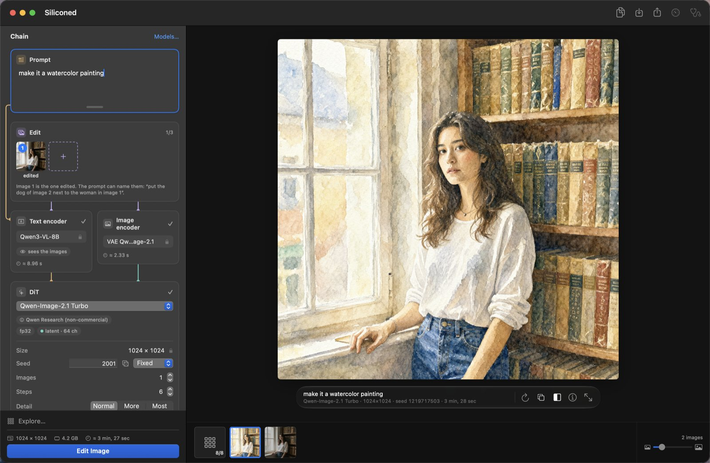

[English](APP.md) · Français

# L'app Siliconed

`Siliconed.app` génère des images à partir d'un prompt, les édite par instruction, et tient une file et un historique. Elle suit la langue du système (anglais, français, allemand, espagnol, italien ou japonais).


*La fenêtre, avec la photo de Krea 2 Turbo de la section [Les modèles](#les-modèles) : le rack montre la chaîne, les réglages et le temps de chaque étage ; l'historique court sous le canevas.*

Le moteur derrière elle, avec les mesures : [Le moteur de Siliconed](ENGINE.fr.md).

## Créer

- **Cinq modèles.** Krea 2 Turbo, Z-Image Turbo, Qwen-Image-2.1 Turbo, Anima Turbo et MOSS-Image, chacun sous sa propre licence ([Les modèles](#les-modèles)). Tous cinq lisent le prompt avec un modèle de langage.
- **La chaîne, visible.** Le rack montre le pipeline de haut en bas (prompt, encodeurs, débruiteur, décodeur), avec des fils typés et l'étage actif allumé ; chaque étage porte ses propres réglages.
- **Plus de détail** avec Z-Image et Qwen-Image-2.1 : « Détail : Normal · Plus · Maximum » ajoute de la texture fine, sans temps en plus.
- **Rendu plus rapide** (Réglages, allumé par défaut) : dès 1024 px de chaque côté, les premières évaluations sur une grille en demi-taille, le reste en pleine taille : d'un quart à un tiers de temps en moins (moins d'un dixième pour MOSS-Image), toujours 8 évaluations, une image un peu différente ([comment](ENGINE.fr.md#rendu-plus-rapide)).
- **Les variations** : des cousines d'une image, subtiles ou marquées, aux mêmes réglages.
- **Agrandir ×4** avec la super-résolution de macOS (macOS 26) : aucun prompt, rien d'ajouté, bords et textures affinés ; 1024² devient 4096² en une ou deux secondes.
- **Les LoRA** sur les cinq modèles.
- **Reproductible au bit près.** Même prompt, même graine, mêmes réglages, même version, sur le même Mac : la même image, octet pour octet. Une version peut changer les pixels : la 0.12 le fait, de quelques unités sur le dernier chiffre, maintenant que son arithmétique arrondit comme la référence.

Chaque côté doit être d'au moins 512 et multiple de 16 ; la surface n'a pas de plafond fixe : le budget mémoire décide. Ce qu'un format coûte se calcule sur les formes du modèle avant le premier calcul et se juge contre le budget mémoire du Mac ([comment](ENGINE.fr.md#la-mémoire-et-le-budget)) : un Mac qui ne peut pas le tenir le refuse, et dit lequel le peut. Le sélecteur de taille propose 1536² et 2048² à côté de 1024², et grise ce que le budget de ce Mac refuse ; toute autre taille se tape. Les formats au-delà de 1024×1536 sont chiffrés par les mêmes formules ; Anima Turbo en 2048² a été rendu sur le Mac de référence de 16 Go, avec un pic de 5,4 Go. Sous 512² les modèles sont hors de leur domaine. Qwen-Image-2.1 veut des multiples de 32 (son VAE divise par 16), et Anima au plus 2048 px de côté (les positions que sa référence calcule) ; l'un et l'autre sont refusés avant tout calcul, de même que tout côté au-delà de 8192 px.

## Éditer

- **L'édition par instruction** avec Qwen-Image-2.1 Turbo : donnez-lui 1 à 3 images et une phrase (« remplace le ciel nuageux par un ciel bleu ») ; son encodeur voit les images. Dans l'app, une édition est plafonnée à une surface de 1024².
- **Le rideau** : faites glisser une ligne sur deux images, ou sur une édition ou un agrandissement et son original, pour voir ce qui a changé ; zoomez vers le curseur pour regarder un détail.
- **Un historique comme dans Photos** : flèches, ⌫ et ⌘Z, sélection multiple, comparaison côte à côte, export, glisser-déposer, Partager.



*Qwen-Image-2.1 Turbo, Standard : « Convert this photo to a western comic book style with cel shading », la photo Krea 2 en image 1, 1248×832, graine 42, 215 s.*


*Une édition qui ne change que ce qu'on lui dit : « Replace her wetsuit with a white linen blouse. Keep her face, hair, surfboard, pose and the beach unchanged. », la photo Krea 2 en image 1, 203 s.*

## Explorer

Le panneau d'exploration construit une grille dans le canevas. Ses axes : les graines, les pas, la force d'une LoRA, des LoRA à essayer, les modèles, les variantes écrites entre accolades dans le prompt, chaque image d'une édition ou, en mode développeur, les solveurs. Chaque case est une esquisse, arrêtée après quelques pas, à 512 sur le petit côté (avec Qwen-Image-2.1, une image finie) ; dès qu'un modèle a rendu à cette taille, le panneau dit ce que la grille coûtera sur ce Mac avant de la lancer. « Finir cette image » rend la case choisie jusqu'au bout avec la même graine : l'image que son esquisse annonçait.


*Une exploration avec Anima Turbo et la LoRA inCase : la couleur de la combinaison écrite entre accolades dans le prompt (`{teal|coral red|mustard yellow|navy}`) en colonnes, inCase à 0, 0,5 et 1 en lignes ; des esquisses en 512×768, environ 16 s chacune sur un M1 Pro.*


*La case choisie, finie : Anima Turbo avec la LoRA inCase à 1, « A close-up portrait of a young Irish woman with long wavy auburn red hair, pale freckled skin and green eyes, laughing, wearing a navy shorty wetsuit, on a sunny cliff-top beach in the west of Ireland. Big Atlantic waves breaking into white spray below green sea cliffs, deep blue sky, bright sunlight, wind in her hair. », 512×768, graine 4001, 20,8 s.*

## La gestion des modèles

- **Rien n'est préinstallé.** Vous choisissez un modèle ; avant le premier octet téléchargé, l'app affiche sa licence et la place qu'il prend sur disque, et vous demande d'accepter. Chaque fichier est figé à une révision et vérifié par sha256.
- **Standard, Compact ou Légère.** Chaque modèle s'installe avec les poids de l'éditeur (Standard), avec des poids 8 bits publiés par des tiers (Compact, le défaut et celle que nous recommandons : 19,5 Go au lieu de 34,4 pour Krea 2, 11,7 Go au lieu de 20,4 pour Z-Image, 17,3 Go au lieu de 31,2 pour Qwen-Image-2.1, 4,10 Go au lieu de 5,65 pour Anima, 17,9 Go au lieu de 27,5 pour MOSS-Image ; une image légèrement différente), ou avec le transformeur en 4 à 6 bits tel qu'un tiers le publie (GGUF Q4_K_M ; Légère : 12,8 Go, 9,5 Go, 14,2 Go et 3,31 Go, le moins lu sur le disque à chaque pas ; un autre jeu de poids, une image qui peut se composer autrement). Pour Krea 2, Z-Image, Qwen-Image-2.1 et MOSS-Image, l'encodeur de texte de la Compact est lui aussi en 8 bits, et la Légère le reprend ; celui d'Anima reste le bf16 de l'éditeur dans les trois, faute de version 8 bits publiée. MOSS-Image n'a pas de Légère. La Légère est présélectionnée sur un Mac de 8 Go de mémoire, la Compact ailleurs ; vous choisissez avant d'installer. Une version à la fois : passer à l'autre la remplace ; l'installée continue de rendre jusqu'à ce que la nouvelle soit complète, puis libère sa place ; si le disque ne peut pas tenir les deux, l'app le dit avant l'acceptation.
- **Les imports Civitai et Hugging Face.** Les LoRA (formats Civitai, Comfy, kohya, diffusers) et le DiT d'un fine-tune (`.safetensors`, ou `.gguf` de Q4 à Q8_0), par glisser-déposer ou ⌘O ; un checkpoint Civitai d'une famille connue s'importe tel quel et emprunte l'encodeur et le VAE de sa famille. Déposé avant que sa famille soit installée, il ouvre l'installation de celle-ci — licence, encodeur et VAE, jamais le DiT de la famille — et s'importe une fois l'installation faite. Un fichier quantifié reste sur le disque tel que publié, jamais requantifié (Z-Image : 6,2 Go en 8 bits, environ 5 Go en GGUF Q4_K_M, au lieu de 12,3 Go ; chaque pas un peu plus lent, le calcul reste en fp32) ; sous 4 bits, le fichier est refusé. Une LoRA importée prend le nom de son fichier ; le nom donné par son auteur et ses mots déclencheurs s'affichent en infobulle.
- **Statistiques et diagnostic.** La palette des statistiques (⌥⌘I) est un bouton de la barre d'outils. « Mesurer ce Mac » (menu Aide, ou « Chaîne » en tête du rack, orange tant que ce Mac n'est pas mesuré) montre la carte de ce Mac : ce que calcule la puce, mesuré, et les chemins que prend le moteur.

Les modèles vivent dans `~/Library/Application Support/Siliconed` (modifiable avec `SILICONED_ROOT`). Pour libérer le disque interne, les Réglages les déplacent sur un autre — un disque externe, un partage réseau : chaque fichier est copié, vérifié, puis effacé du Mac. Siliconed ne copie alors sur le Mac que les modèles que vous rendez, le temps de la session, et les efface en quittant ; les licences acceptées et la mesure de ce Mac restent sur le Mac. Débranché, le disque est signalé : rien ne se rend avant son retour.


## Les modèles

Seulement des modèles récents dont l'encodeur de texte est un modèle de langage — ni Stable Diffusion, ni SDXL, ni Flux.1.

| Modèle | Éditeur | Ce qu'il fait | Licence |
|---|---|---|---|
| [Krea 2 Turbo](https://huggingface.co/krea/Krea-2-Turbo) | Krea | texte vers image (des images esthétiques, de la photographie à la peinture), LoRA | Krea 2 Community : usage commercial sous 1 M$ de chiffre d'affaires annuel, un filtre de contenu obligatoire au déploiement |
| [Z-Image Turbo](https://huggingface.co/Tongyi-MAI/Z-Image-Turbo) | Tongyi-MAI | texte vers image, LoRA | Apache 2.0 |
| [Qwen-Image-2.1 Turbo](https://huggingface.co/Qwen/Qwen-Image-2.1-Turbo) | Qwen | texte vers image, édition par instruction avec 1 à 3 images, LoRA | Qwen Research (non commerciale) |
| [Anima Turbo v1.1](https://huggingface.co/circlestone-labs/Anima) | CircleStone Labs × Comfy Org | texte vers image (illustration, peinture, anime ; pas de photoréalisme, par choix de l'éditeur), LoRA | CircleStone Labs Non-Commercial ; ses images sont utilisables commercialement |
| [MOSS-Image](https://huggingface.co/OpenMOSS-Team/MOSS-Image-SFT) | OpenMOSS, sous la LoRA 8 pas de lodestones | texte vers image, LoRA ; bêta | Apache 2.0 |

### Krea 2 Turbo, le plus gros des cinq

[Krea 2 Turbo](https://huggingface.co/krea/Krea-2-Turbo), de Krea, est le quatrième modèle, arrivé dans la 0.12 : un DiT de 12,9 milliards de paramètres, le plus gros des cinq, pour des images esthétiques, de la photographie à la peinture. Il lit le prompt avec Qwen3-VL-4B et fait toute sa recette de 8 évaluations en fp32 sur les poids bf16 de l'éditeur, avec le [rendu plus rapide](ENGINE.fr.md#rendu-plus-rapide) allumé par défaut (temps et écarts : [Les chiffres](ENGINE.fr.md#les-chiffres)), ses poids lus depuis le disque dans le budget mémoire. Il s'installe en Standard, Compact ou Légère (tailles : [La gestion des modèles](#la-gestion-des-modèles)), depuis des copies ouvertes prouvées identiques aux fichiers de Krea (voir plus bas), sous la licence Krea 2 Community (tableau ci-dessus).


*Krea 2 Turbo, Standard, 1248×832, 8 pas, graine 3001, 229 s sur un M1 Pro de 16 Go : « Editorial surf photograph, low angle, of a young Irish woman with long wavy auburn red hair, pale freckled skin and green eyes, in a short-sleeved shorty wetsuit, running out of the surf laughing, surfboard under her arm, on a rare sunny day in the west of Ireland. Golden late-afternoon backlight, sun flare, spray glowing in the light, turquoise water, deep blue sky, high contrast, vivid colors, sharp focus, shot on a 50 mm lens. »*

Krea 2 Turbo ne télécharge rien de [krea/Krea-2-Turbo](https://huggingface.co/krea/Krea-2-Turbo) : ce dépôt demande un compte Hugging Face, et l'app n'a pas de connexion. Chacun de ses fichiers vient d'une copie ouverte prouvée identique à celle de Krea : le DiT et l'encodeur de texte Qwen3-VL-4B en bf16 de [Comfy-Org/Krea-2](https://huggingface.co/Comfy-Org/Krea-2) (le DiT, le même fichier ; l'encodeur, égal tenseur pour tenseur), le VAE de [Qwen/Qwen-Image](https://huggingface.co/Qwen/Qwen-Image) (le VAE fp32 de Krea est ce bf16 élargi, valeur pour valeur), le tokenizer de [Qwen/Qwen-Image-2.1-Turbo](https://huggingface.co/Qwen/Qwen-Image-2.1-Turbo) (le même fichier) ; les fichiers de configuration de Krea sont embarqués tels que publiés. Sa Compact prend le DiT et l'encodeur de texte en int8 convrot de [Comfy-Org/Krea-2](https://huggingface.co/Comfy-Org/Krea-2) ; sa Légère, le GGUF Q4_K_M de [vantagewithai/Krea-2-Turbo-GGUF](https://huggingface.co/vantagewithai/Krea-2-Turbo-GGUF) avec l'encodeur de texte de la Compact.

### MOSS-Image, distillé par sa communauté

[MOSS-Image](https://huggingface.co/OpenMOSS-Team/MOSS-Image-SFT), de l'équipe OpenMOSS, est le cinquième modèle, arrivé dans la 0.16 : un DiT mono-flux de 5,1 milliards de paramètres qui lit le prompt avec Qwen3.5-9B — un modèle de langage hybride, trois couches sur quatre en attention linéaire (Gated DeltaNet) — et décode avec le VAE de FLUX.2. Son éditeur n'a pas publié de version rapide ; la communauté, si : Siliconed fait tourner MOSS-Image-SFT sous la [LoRA DMD de lodestones](https://huggingface.co/lodestones/MOSS-Image-SFT-8-steps-dmd) à force 1, 8 évaluations, sans CFG, la LoRA gardée à côté des poids en fp32 (fusionnée dans les poids bf16, ses petits deltas se perdraient dans l'arrondi). Les deux sont vérifiés contre la référence, LoRA comprise ([VERIFY.fr.md](VERIFY.fr.md)). Texte vers image, et vos LoRA par-dessus celle des 8 pas — le `qkv` fusionné de ComfyUI et d'ai-toolkit est séparé exactement, et les LoRA entraînées sur MOSS-Image Base s'appliquent aussi, comme la communauté s'en sert ; ni Détail, ni édition. Le [rendu plus rapide](ENGINE.fr.md#rendu-plus-rapide) n'y prend qu'une évaluation en demi-taille : dès la deuxième, MOSS-Image perd du détail fin (la peau, les dos de livres) là où les autres modèles le gardent. Il est marqué **bêta** dans l'app, parce que sa recette en 8 pas est celle de la communauté, pas celle de l'éditeur ; il sort de bêta quand OpenMOSS publie sa propre version rapide. Il s'installe en Standard ou en Compact (tailles : [La gestion des modèles](#la-gestion-des-modèles)), sous Apache 2.0, LoRA comprise.


*MOSS-Image, Compacte, 1248×832, 8 pas, graine 6001, 128 s sur un M1 Pro de 16 Go : « Close-up portrait of a young Irish woman with long wavy auburn red hair, pale freckled skin and green eyes, in a short-sleeved shorty wetsuit, the wind whipping wet strands of hair across her face, squinting and laughing. Hard low sunlight from the side just after a rain shower, dark storm clouds over the Atlantic behind her, raindrops on her skin, shot on Portra 400, shallow depth of field. »*

La Standard prend le DiT, l'encodeur de texte Qwen3.5-9B (son modèle de langage seul, sans la tour de vision), le VAE et le tokenizer d'[OpenMOSS-Team/MOSS-Image-SFT](https://huggingface.co/OpenMOSS-Team/MOSS-Image-SFT), et la LoRA de [lodestones/MOSS-Image-SFT-8-steps-dmd](https://huggingface.co/lodestones/MOSS-Image-SFT-8-steps-dmd). Sa Compact prend le DiT et l'encodeur de texte en int8 convrot de [Comfy-Org/MOSS-Image](https://huggingface.co/Comfy-Org/MOSS-Image), avec la même LoRA, le même VAE et le même tokenizer. Pas encore de Légère : un DiT en 4 bits est publié, mais pas encore vérifié ; sur un Mac de 8 Go, la Compact est présélectionnée, et son pic reste dans le budget de ce Mac.

### D'où viennent les fichiers

Les autres versions Compact utilisent des poids 8 bits publiés par des tiers : [unsloth/Z-Image-Turbo-GGUF](https://huggingface.co/unsloth/Z-Image-Turbo-GGUF), [Disty0/Z-Image-Turbo-SDNQ-int8](https://huggingface.co/Disty0/Z-Image-Turbo-SDNQ-int8), [unsloth/Qwen-Image-2.1-FP8](https://huggingface.co/unsloth/Qwen-Image-2.1-FP8), [Comfy-Org/Qwen-Image-2.1](https://huggingface.co/Comfy-Org/Qwen-Image-2.1) ; les versions Légères, le GGUF Q4_K_M de [unsloth/Z-Image-Turbo-GGUF](https://huggingface.co/unsloth/Z-Image-Turbo-GGUF) et d'[unsloth/Qwen-Image-2.1-Turbo-GGUF](https://huggingface.co/unsloth/Qwen-Image-2.1-Turbo-GGUF) avec l'encodeur de texte de la Compact. La Compact et la Légère d'Anima prennent le DiT en GGUF Q8_0 et Q4_K_M de [vanes430/Anima-Turbo-V1.1-GGUF](https://huggingface.co/vanes430/Anima-Turbo-V1.1-GGUF) et gardent l'encodeur de texte de l'éditeur en bf16. Les révisions et les sommes sha256 sont dans `Sources/Siliconed/Forge/Installation.swift`.

## Privé par construction

Le rendu se fait sur votre Mac. Le seul trafic réseau est le téléchargement du modèle que vous avez accepté ; le diagnostic copie son rapport et ouvre un formulaire d'issue GitHub que vous choisissez de soumettre ou non. Le cache de rendu ne dure qu'une session : il est vidé au lancement et à la fermeture. Avant chaque rendu, le moteur vérifie le modèle, sa licence, le format et la mémoire qu'il lui faut, et refuse d'emblée un rendu au-delà du budget de ce Mac. L'app ne censure aucun prompt et n'ajoute aucun filtre de contenu ; la licence de chaque modèle s'applique toujours, et celle de Krea 2 Community en demande un à qui déploie le modèle.

## Pour les agents IA et les scripts : silicontrol

Pilote l'app ouverte depuis un terminal. Elle est livrée dans `Siliconed.app/Contents/Helpers/silicontrol` ; Réglages → Avancé → Ligne de commande la lie dans `/usr/local/bin`. Ce que vous ajoutez apparaît dans la fenêtre de l'app, et il n'y a qu'une file, jamais deux rendus à la fois.

```
silicontrol help                 la référence complète (toujours commencer par là)
silicontrol models
silicontrol add --wait --out out "a woman posing in a library"
silicontrol status
```

Elle bascule aussi l'interrupteur du rendu plus rapide (`silicontrol set faster-rendering on|off`) et refait chez vous une série chronométrée de rendus (`silicontrol measure`) ; elle fait aussi des grilles, des variations, des agrandissements, suit un rendu pas à pas, et plus : `silicontrol help all` donne toutes les commandes. La sortie est en lignes JSON ; la dernière porte `"ok"`. Le dedans : [REMOTE-CONTROL.fr.md](REMOTE-CONTROL.fr.md).
