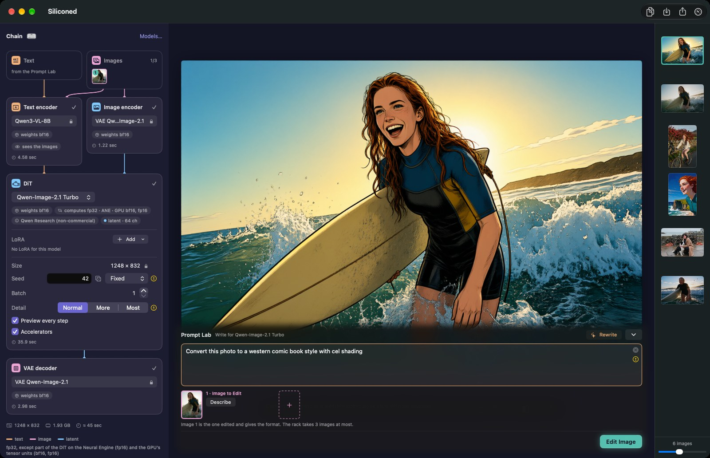
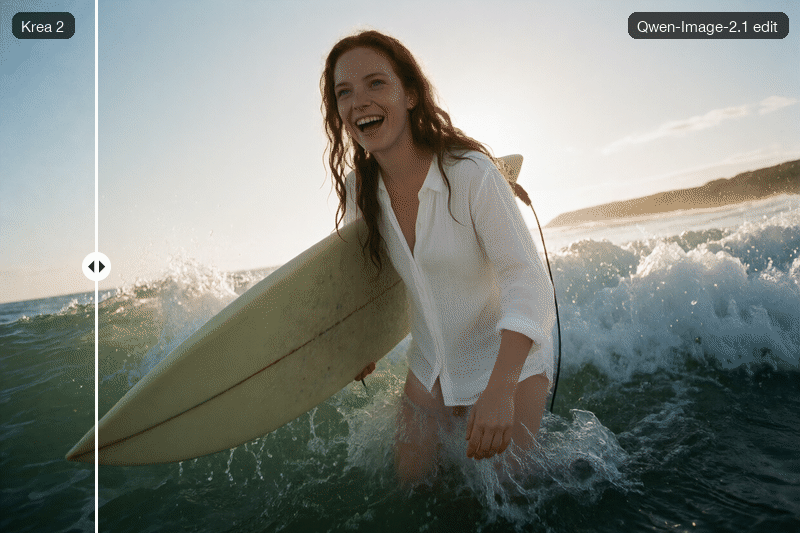

English · [Français](APP.fr.md)

# The Siliconed app

`Siliconed.app` turns a prompt into an image, edits images when you tell it what to change, and keeps a queue and a history of everything it does. It follows the system language (English, French, German, Spanish, Italian, Japanese or Simplified Chinese).


*The window, with the Krea 2 Turbo photo from the [Models](#models) section: the rack shows the chain, each stage's settings and time; the history runs below the canvas.*

The engine behind it, with the measurements: [The Siliconed engine](ENGINE.md).

## Create

- **Five models.** Krea 2 Turbo, Z-Image Turbo, Qwen-Image-2.1 Turbo, Anima Turbo and MOSS-Image, each under its own license ([Models](#models)). All five read the prompt with a language model.
- **The chain, visible.** No hidden pipeline: the rack shows it top to bottom (prompt, encoders, denoiser, decoder), with typed wires and the active stage lit; each stage holds its own settings and shows its time. Under the title, two small labels say what is stored and what computes: `weights int8` (or `Q8_0`, `Q4_K_M`, `bf16`…, read from what is installed) beside `computes fp32`. On the denoiser, `computes fp32 · ANE` means part of its products run on the Neural Engine; click the label to switch ([how](ENGINE.md#the-neural-engine)).
- **More detail** with Z-Image and Qwen-Image-2.1: “Detail: Normal · More · Most” adds fine texture, at no extra time.
- **Faster Rendering** (Settings › General, on by default): from 1024 px on each side, the first evaluations on a half-size grid, the rest at full size: a fifth to a third less time (under a tenth for MOSS-Image), still 8 evaluations, a slightly different image. Not with a LoRA, Detail or an edit ([how](ENGINE.md#faster-rendering)).
- **Variations**: cousins of an image, subtle or strong, with the same settings (the button under the image, or its context menu).
- **Enlarge ×4** with macOS's own super-resolution (macOS 26): no prompt, nothing added, edges and texture sharpened; 1024² becomes 4096² in a second or two once macOS's model is warm. It takes images up to 1920 px a side, and an enlarged image is not enlarged again. The original stays in the history.
- **LoRAs** on all five models.
- **Reproducible to the bit.** Same prompt, seed, settings and version on the same Mac, same image, byte for byte. Two things can change the pixels: a new version of the app (0.12 did, by a few units in the last place, once its arithmetic rounded as the reference does), and a new measure of this Mac, which may split the work in other rows ([Measure This Mac](#measure-this-mac)).

Each side must be at least 512 and a multiple of 16; there is no fixed ceiling on the area: the memory budget decides. What a format costs is computed from the model's shapes before the first computation and judged against the Mac's memory budget ([how](ENGINE.md#memory-and-the-budget)): a Mac that cannot hold it is refused, and told which one can. The size picker lists 1536² and 2048² beside 1024², and greys what this Mac's budget refuses; any other size is typed. Formats past 1024×1536 are priced by the same formulas; Anima Turbo at 2048² was rendered on the 16 GB reference Mac, peaking at 5.4 GB. Below 512² the models are outside their domain. Qwen-Image-2.1 needs multiples of 32 (its VAE divides by 16), and Anima at most 2048 px on a side (the positions its reference computes); both are refused before any computation, and so is any side past 8192 px.

## Edit

- **Editing by instruction** with Qwen-Image-2.1 Turbo: give it 1 to 3 images and a sentence (“replace the cloudy sky with a blue sky”); its encoder sees the images. In the app an edit is limited to an area of 1024².
- **Three ways to compare** two images, an edit or an enlargement and its original: pick Curtain, Switch or Side by Side in Settings › General › Comparison, or from the canvas toolbar.
  - **Curtain**: drag a line across the images to see what changed. Zoom in toward the pointer to look at a detail: pinch, or a mouse's wheel (a horizontal wheel still moves the image).
  - **Switch**: the same two images one at a time, at the same place and zoom; click the image, or press ← for the first and → for the second.
- **Named subjects** (Settings › Advanced, off by default): name a person or a thing from a photo, then cite it as `@name` in an edit.
- **A history like Photos**: arrows, ⌫ and ⌘Z, multiple selection, export, drag and drop, Share.



*Qwen-Image-2.1 Turbo, Standard: “Convert this photo to a western comic book style with cel shading”, the Krea 2 photo as image 1, 1248×832, seed 42, 215 s.*



*An edit that changes only what it is told: “Replace her wetsuit with a white linen blouse. Keep her face, hair, surfboard, pose and the beach unchanged.”, the Krea 2 photo as image 1, 203 s.*

## Write

The **Prompt Lab** (beta; Window › Prompt Lab, ⌥⌘L) is a window of its own where a language model writes the prompt for you.

- **Rewrite** turns a short prompt into one written for the model you pick (“Write for…”). **Describe** turns a dropped image into a prompt. **Send to Rack** puts the result in the rack's prompt, and ⌘Z in that field brings the old one back. Nothing is applied on its own.
- **The writer is a model you already have**: Qwen-Image-2.1's text encoder, Qwen3-VL-8B, made to write. Only its output layer is missing from the installed model, and “Install the Writer” downloads it from the same repository (1.25 GB, by byte range). It needs Qwen-Image-2.1 installed, in the Compact on a 16 GB Mac (the Standard asks for 24 GB); the window tells you what is missing.
- **Our instructions, one per model**, drawn from what each publisher says of its prompts. Every element of your prompt is kept, quoted text word for word; nothing is removed, softened or moralized.
- **Never during a render**: an image that starts stops the writer, and the lab waits. About 18 tokens a second on an M1 Pro, on the GPU. Its greedy output matches transformers' token for token ([VERIFY](VERIFY.md)).
- **Incognito**: texts and images stay in memory, with no file and no history; closing the window releases the writer. The lab works on this Mac only, not while you compute on another.

## Explore

The exploration panel builds a grid in the canvas. Its axes: seeds, steps, the strength of a LoRA, LoRAs to try, models, the alternatives written in braces in the prompt, each image of an edit, or, in Developer Mode, the solvers. Each cell is a sketch, stopped after a few steps, at 512 on the short side (with Qwen-Image-2.1, a finished image); once a model has rendered at that size, the panel shows what the grid will cost on this Mac before you start. “Finish This Image” renders the chosen cell to the end with the same seed: the image its sketch announced.


*An exploration with Anima Turbo and the inCase LoRA: the wetsuit's colour written in braces in the prompt (`{teal|coral red|mustard yellow|navy}`) across, inCase at 0, 0.5 and 1 down; 512×768 sketches, about 16 s each on an M1 Pro.*


*The chosen cell, finished: Anima Turbo with the inCase LoRA at 1, “A close-up portrait of a young Irish woman with long wavy auburn red hair, pale freckled skin and green eyes, laughing, wearing a navy shorty wetsuit, on a sunny cliff-top beach in the west of Ireland. Big Atlantic waves breaking into white spray below green sea cliffs, deep blue sky, bright sunlight, wind in her hair.”, 512×768, seed 4001, 20.8 s.*

## Model management

- **Nothing is preinstalled.** You pick a model; before the first byte is downloaded the app shows its license and the disk space it takes, and asks you to accept. Every file is pinned to a revision and checked by sha256.
- **Standard, Compact or Light.** Each model installs with the publisher's weights (Standard), with 8-bit weights published by third parties (Compact, the default and the one we recommend: 19.5 GB instead of 34.4 for Krea 2, 11.7 GB instead of 20.4 for Z-Image, 17.3 GB instead of 31.2 for Qwen-Image-2.1, 4.10 GB instead of 5.65 for Anima, 17.9 GB instead of 27.5 for MOSS-Image; a slightly different image), or with the transformer in 4 to 6 bits as a third party publishes it (GGUF Q4_K_M; Light: 12.8 GB, 9.5 GB, 14.2 GB and 3.31 GB, which reads the least from disk at each step; another set of weights, an image that may compose differently). For Krea 2, Z-Image, Qwen-Image-2.1 and MOSS-Image the Compact's text encoder is 8-bit too, and the Light uses it; Anima's text encoder stays the publisher's bf16 in all three, since no 8-bit version of it is published. MOSS-Image has no Light. The Light is preselected on a Mac with 8 GB of memory, the Compact elsewhere; you choose before installing. One version at a time: switching replaces the other, which keeps rendering until the new one is complete, then frees its space; if the disk cannot hold both, the app says so before you accept.
- **Civitai and Hugging Face imports.** LoRAs (Civitai, Comfy, kohya, diffusers layouts) and a fine-tune's DiT (`.safetensors`, or `.gguf` from Q4 to Q8_0), by drag and drop or ⌘O; a Civitai checkpoint of a known family imports as is and borrows its family's encoder and VAE. Dropped before its family is installed, it opens the family's installation — license, encoder and VAE, never the family's own DiT — and is imported once that is done. A quantized file stays as published on disk, never re-quantized (Z-Image: 6.2 GB in 8 bits, about 5 GB in GGUF Q4_K_M, instead of 12.3 GB; each step a little slower, the computation stays fp32); below 4 bits, the file is refused. An imported LoRA takes its file's name; the trainer's name and trigger words show in a tooltip.
- **Statistics.** A floating palette (⌥⌘I, Window › Statistics, or the toolbar button): where the render stands, what each stage cost, what remains for it and for the queue, and what the last render weighed. Nothing is estimated from a constant: a model or format never rendered here has no estimate, and the palette says so.

### Measure This Mac

Before its first render, and again after an update or a new macOS, Siliconed times what each engine of your Mac computes. It takes under a minute, needs no model, and gives a map every time: nothing is ever refused, and how sure the measure is of each figure is written beside it. You can open it whenever you like: Help › Measure This Mac…, the Chain title and the Mac's icon at the head of the rack (greyed until this Mac is measured), or Settings › Advanced › This Mac.

The sheet shows, with its columns titled: each route's speed, its share of the GPU's peak, whether its result matched the exact one (Exact ✓), what each engine keeps of its speed when they work together, the memory the measure held and how long it took. What it found is said in plain sentences, each with its effect on the plan. Sharing is an option, never the default: Share… ▸ Open a GitHub Issue, or Copy JSON.

A measure you ask for applies to the **next** render, never to one under way, so from then on one seed can give a slightly different image from before the measure. When a render ran more than 10 % off what the measure predicted, the sidebar says so, once, beside the button that measures again.

Models live in `~/Library/Application Support/Siliconed` (override with `SILICONED_ROOT`). To free the internal disk, Settings › General › Move Library… moves them to another one — an external disk, a network share: every file is copied, checked, then removed from the Mac. Siliconed then copies to the Mac only the models you render, for the session, and removes them when it quits; the licenses you accepted and this Mac's measurements stay on the Mac. Unplugged, the disk is flagged: nothing renders until it is back.


## Models

Only recent models whose text encoder is a language model — no Stable Diffusion, SDXL or Flux.1.

| Model | Publisher | What it does | License |
|---|---|---|---|
| [Krea 2 Turbo](https://huggingface.co/krea/Krea-2-Turbo) | Krea | text-to-image (aesthetic images, from photography to painting), LoRA | Krea 2 Community: commercial use under $1M annual revenue, a content filter required when deployed |
| [Z-Image Turbo](https://huggingface.co/Tongyi-MAI/Z-Image-Turbo) | Tongyi-MAI | text-to-image, LoRA | Apache 2.0 |
| [Qwen-Image-2.1 Turbo](https://huggingface.co/Qwen/Qwen-Image-2.1-Turbo) | Qwen | text-to-image, editing by instruction with 1 to 3 images, LoRA | Qwen Research (non-commercial) |
| [Anima Turbo v1.1](https://huggingface.co/circlestone-labs/Anima) | CircleStone Labs × Comfy Org | text-to-image (illustration, painting, anime; no photorealism, by its publisher's choice), LoRA | CircleStone Labs Non-Commercial; its images may be used commercially |
| [MOSS-Image](https://huggingface.co/OpenMOSS-Team/MOSS-Image-SFT) | OpenMOSS, under lodestones' 8-step LoRA | text-to-image, LoRA; beta | Apache 2.0 |

### Krea 2 Turbo, the largest of the five

[Krea 2 Turbo](https://huggingface.co/krea/Krea-2-Turbo), by Krea, is the fourth model, added in 0.12: a 12.9-billion-parameter DiT, the largest of the five, for aesthetic images from photography to painting. It reads the prompt with Qwen3-VL-4B and runs its whole 8-evaluation recipe in fp32 on the publisher's bf16 weights, with [Faster Rendering](ENGINE.md#faster-rendering) on by default (times and deviations: [Numbers](ENGINE.md#numbers)), its weights streamed from disk within the memory budget. It installs as Standard, Compact or Light (sizes: [Model management](#model-management)), from open copies proven to be identical to Krea's files (see below), under the Krea 2 Community license (table above).


*Krea 2 Turbo, Standard, 1248×832, 8 steps, seed 3001, 229 s on an M1 Pro with 16 GB: “Editorial surf photograph, low angle, of a young Irish woman with long wavy auburn red hair, pale freckled skin and green eyes, in a short-sleeved shorty wetsuit, running out of the surf laughing, surfboard under her arm, on a rare sunny day in the west of Ireland. Golden late-afternoon backlight, sun flare, spray glowing in the light, turquoise water, deep blue sky, high contrast, vivid colors, sharp focus, shot on a 50 mm lens.”*

Krea 2 Turbo downloads nothing from [krea/Krea-2-Turbo](https://huggingface.co/krea/Krea-2-Turbo): that repository asks for a Hugging Face account, and the app has no sign-in. Each of its files comes from an open copy proven identical to Krea's: the DiT and the Qwen3-VL-4B text encoder in bf16 from [Comfy-Org/Krea-2](https://huggingface.co/Comfy-Org/Krea-2) (the DiT the very same file, the encoder equal tensor for tensor), the VAE from [Qwen/Qwen-Image](https://huggingface.co/Qwen/Qwen-Image) (Krea's fp32 VAE is this bf16 one widened, value for value), the tokenizer from [Qwen/Qwen-Image-2.1-Turbo](https://huggingface.co/Qwen/Qwen-Image-2.1-Turbo) (the same file); Krea's own configuration files are embedded as published. Its Compact takes the DiT and the text encoder in int8 convrot from [Comfy-Org/Krea-2](https://huggingface.co/Comfy-Org/Krea-2); its Light, the GGUF Q4_K_M of [vantagewithai/Krea-2-Turbo-GGUF](https://huggingface.co/vantagewithai/Krea-2-Turbo-GGUF) with the Compact's text encoder.

### MOSS-Image, distilled by its community

[MOSS-Image](https://huggingface.co/OpenMOSS-Team/MOSS-Image-SFT), by the OpenMOSS team, is the fifth model, added in 0.16: a single-stream DiT of 5.1 billion parameters that reads the prompt with Qwen3.5-9B — a hybrid language model, three layers in four of linear attention (Gated DeltaNet) — and decodes with FLUX.2's VAE. Its publisher released no fast version; the community did: Siliconed runs MOSS-Image-SFT under [lodestones' DMD LoRA](https://huggingface.co/lodestones/MOSS-Image-SFT-8-steps-dmd) at strength 1, 8 evaluations, no CFG, the LoRA kept beside the weights in fp32 (merged into the bf16 weights, its small deltas would be lost to rounding). Both are checked against the reference, the LoRA included ([VERIFY.md](VERIFY.md)). Text to image, and your LoRAs on top of the 8-step one — ComfyUI's and ai-toolkit's fused `qkv` is split exactly, and LoRAs trained on MOSS-Image Base apply too, as the community uses them; no Detail, no edit. [Faster Rendering](ENGINE.md#faster-rendering) takes a single half-size evaluation: from the second, MOSS-Image loses fine detail (skin, book spines) where the other models keep it. It is marked **beta** in the app, because its 8-step recipe is the community's, not the publisher's; it leaves beta when OpenMOSS releases its own fast version. It installs as Standard or Compact (sizes: [Model management](#model-management)), under Apache 2.0, the LoRA included.


*MOSS-Image, Compact, 1248×832, 8 steps, seed 6001, 128 s on an M1 Pro with 16 GB: “Close-up portrait of a young Irish woman with long wavy auburn red hair, pale freckled skin and green eyes, in a short-sleeved shorty wetsuit, the wind whipping wet strands of hair across her face, squinting and laughing. Hard low sunlight from the side just after a rain shower, dark storm clouds over the Atlantic behind her, raindrops on her skin, shot on Portra 400, shallow depth of field.”*

The Standard takes the DiT, the Qwen3.5-9B text encoder (its language model alone, the vision tower left out), the VAE and the tokenizer from [OpenMOSS-Team/MOSS-Image-SFT](https://huggingface.co/OpenMOSS-Team/MOSS-Image-SFT), and the LoRA from [lodestones/MOSS-Image-SFT-8-steps-dmd](https://huggingface.co/lodestones/MOSS-Image-SFT-8-steps-dmd). Its Compact takes the DiT and the text encoder in int8 convrot from [Comfy-Org/MOSS-Image](https://huggingface.co/Comfy-Org/MOSS-Image), with the same LoRA, VAE and tokenizer. No Light yet: a 4-bit DiT is published but not yet checked; on a Mac with 8 GB the Compact is preselected, and its peak stays within that Mac's budget.

### Where the files come from

The other Compact versions use 8-bit weights published by third parties: [unsloth/Z-Image-Turbo-GGUF](https://huggingface.co/unsloth/Z-Image-Turbo-GGUF), [Disty0/Z-Image-Turbo-SDNQ-int8](https://huggingface.co/Disty0/Z-Image-Turbo-SDNQ-int8), [unsloth/Qwen-Image-2.1-FP8](https://huggingface.co/unsloth/Qwen-Image-2.1-FP8), [Comfy-Org/Qwen-Image-2.1](https://huggingface.co/Comfy-Org/Qwen-Image-2.1); the Light versions, the GGUF Q4_K_M of [unsloth/Z-Image-Turbo-GGUF](https://huggingface.co/unsloth/Z-Image-Turbo-GGUF) and [unsloth/Qwen-Image-2.1-Turbo-GGUF](https://huggingface.co/unsloth/Qwen-Image-2.1-Turbo-GGUF) with the Compact's text encoder. Anima's Compact and Light take the DiT in GGUF Q8_0 and Q4_K_M from [vanes430/Anima-Turbo-V1.1-GGUF](https://huggingface.co/vanes430/Anima-Turbo-V1.1-GGUF) and keep the publisher's text encoder in bf16. The revisions and sha256 sums are in `Sources/Siliconed/Forge/Installation.swift`.

## Render on another Mac

- **One Mac renders for another on the same network.** The MacBook in the living room computes on the Mac mini in the next room: **Render › Compute On** moves the whole window there — its queue, progress, preview, history, models, library, licenses and measure are the other Mac's — while the form, your selection, exports and the clipboard stay on yours. An “On:” menu beside Chain says where you compute, and the rack wears a blue edge while connected; one menu brings you back. Never two views at once.
- **Pair once.** On the Mac that lends itself: Settings › Other Macs › Lend This Mac, then Pair a Mac…. On yours: Settings › Other Macs › Pair With a Mac…, and choose it. Both screens show six digits; accept on the lending Mac only if they are the same. Both Macs must run the same version of Siliconed. Nothing connects before a pairing is accepted, and Forget undoes one on either side.
- **Encrypted, nothing in clear.** TLS 1.2 with a key per paired Mac, kept in the Keychain. macOS asks once for the local network, the first time you lend this Mac or pair it; a Mac that never does either is never asked.
- **Everything works there**: renders, edits with your references, variations, grids and explorations, enlarging and cropping, named subjects, undo; installing a model or importing a LoRA on the lending Mac, measuring it. Removing a model waits for a click on that Mac. Each Mac sees only its own jobs and images, and the lending Mac stays within its own memory budget. `silicontrol` follows Compute On ([REMOTE-CONTROL.md](REMOTE-CONTROL.md)).

## Settings

Siliconed › Settings… (⌘,), three tabs.

- **General**: Faster Rendering; Comparison (Curtain, Switch, Side by Side); where the models live, with Move Library…, Open Library… and Move Back to This Mac.
- **Other Macs**: lend this Mac, pair with another ([Render on another Mac](#render-on-another-mac)).
- **Advanced**: Command Line (installs `silicontrol`, below); This Mac (the measure); and “For Testing”, off by default and liable to change: Developer Mode (adds the solvers Euler a, DPM++ 2M and UniPC), Named Subjects, Negative LoRA Strengths (sliders from −1.5 to 1.5, for “slider” LoRAs; an ordinary LoRA is damaged by a negative strength).

While you compute on another Mac, the Faster Rendering switch and the measure are that Mac's, and the window says so.

## Private by construction

Rendering happens on your Mac. The only network traffic is the model download you accepted, the one request to GitHub for the latest version number when you choose Siliconed › Check for Updates…, and, if you turn it on (Settings › Other Macs), the encrypted link to another Mac of your network; the diagnostic copies its report and opens a GitHub issue form that you choose to submit or not. The render cache lasts one session: it is emptied at launch and at quit. Before each render the engine checks the model, its license, the format and the memory it needs, and refuses up front a render beyond this Mac's budget. The app censors no prompt and adds no content filter; each model's license still applies, and Krea 2 Community's asks whoever deploys the model for one.

## For scripts and agents: silicontrol

Drives the running app from a terminal. It ships in `Siliconed.app/Contents/Helpers/silicontrol`; Settings › Advanced › Command Line links it into `/usr/local/bin`. What you add appears in the app's window, and there is one queue, never two renders at once.

```
silicontrol help                 the full reference (always start here)
silicontrol models
silicontrol add --wait --out out "a woman posing in a library"
silicontrol status
```

It also flips the Faster Rendering switch (`silicontrol set faster-rendering on|off`) and repeats a timed series of renders on your Mac (`silicontrol measure`); it grids, varies, enlarges, follows a render step by step, and more: `silicontrol help all` lists every command. Output is JSON lines; the last one carries `"ok"`. How it works inside: [REMOTE-CONTROL.md](REMOTE-CONTROL.md).
