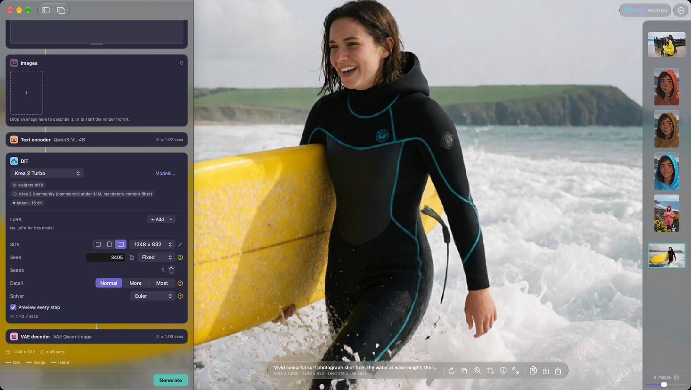
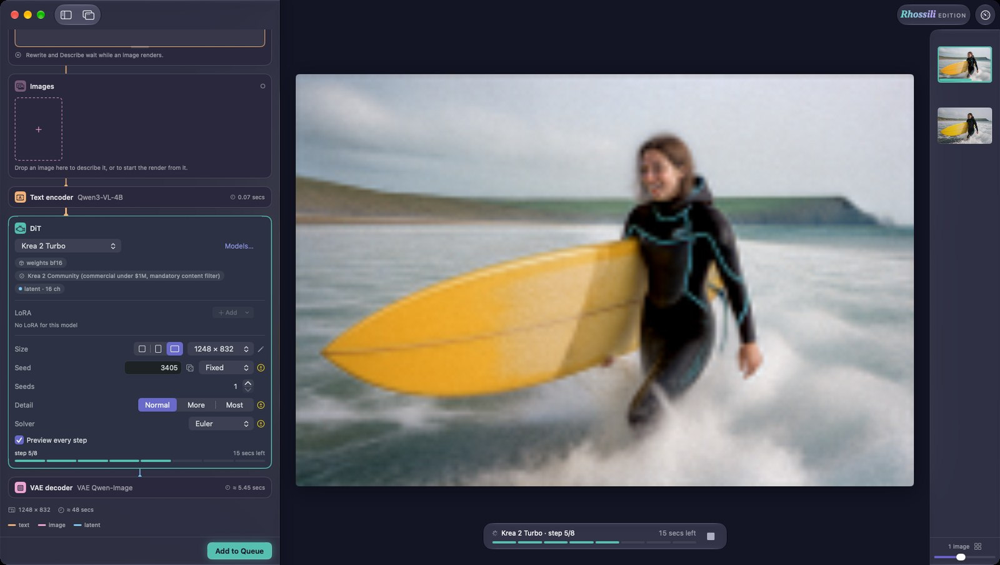
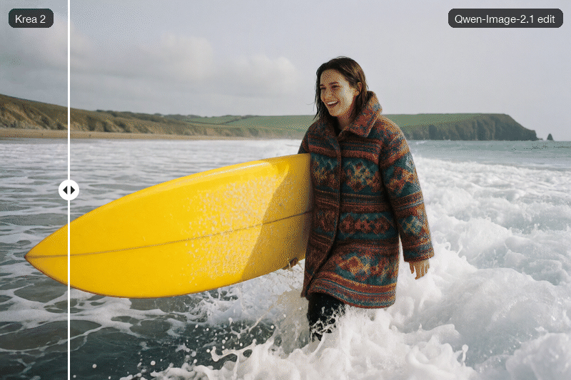
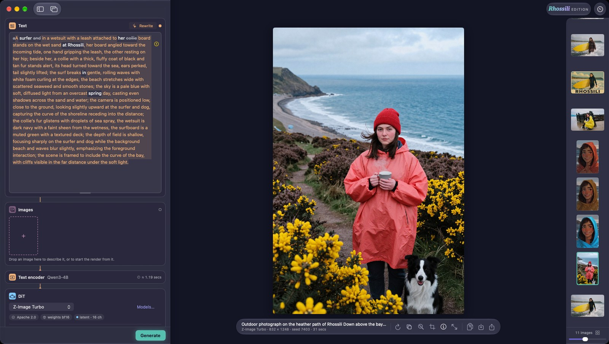
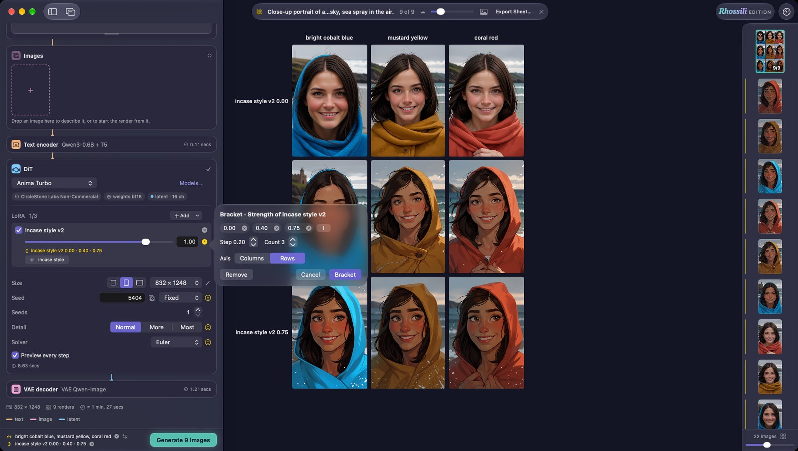
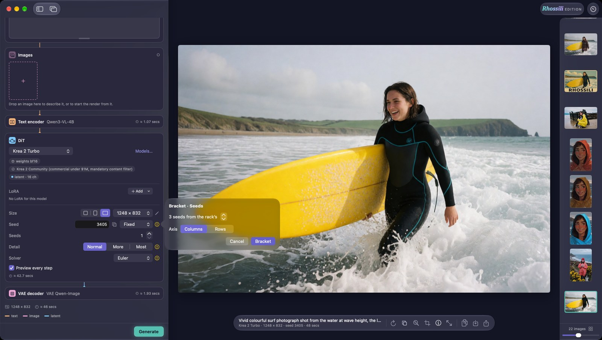

English · [Français](APP.fr.md)

# The Siliconed app

`Siliconed.app` turns a prompt into an image, edits images when you tell it what to change, and keeps a queue and a history of it all. No account, no cloud, no spinner that waits for a server somewhere. Just your Mac, working hard and telling you what it is doing. It follows the system language (English, French, German, Spanish, Italian, Japanese or Simplified Chinese).

![The window: on the left the rack — the Images box, the Qwen3-VL-4B text encoder, the DiT with Krea 2 Turbo and its settings (1248 × 832, seed 3405, Detail Normal, Euler), the VAE decoder, each stage with its time — and Generate at its foot; in the middle a Krea 2 Turbo photo of Angharad, a young Welsh woman in a black hooded winter wetsuit with teal trim, laughing as she wades out of the surf at Rhossili with a yellow surfboard under her arm, the green headland of Worms Head behind her; on the right the history, the edition's name above it](images/window.jpg)

*The window, with the Krea 2 Turbo photo from the [Models](#models) section: the rack shows the chain, each stage's settings and time; the history is on the right.*

The engine behind it, with the measurements: [The Siliconed engine](ENGINE.md).

## The window

Three planes, one role each.

- **The image has the window**: it is the background, from edge to edge. Fitted, it holds whole in the room the columns leave, nothing over it; zoomed in, it slides under them to the window's edges, and so do the curtain and a series' grid. The zoom stays from one image to the next of the same size — the same detail, seed after seed —, and starts fitted on another size. It goes up to 16 points of the screen for one pixel of the image; past one point a pixel, the pixels are drawn as squares (nearest neighbour), not smoothed into a blur.
- **On the left, the chain: where things are set.** One column from the idea to the button, top to bottom: the Text and Images boxes (the Prompt Lab, [Prepare](#prepare-and-let-a-model-do-the-typing)), the encoders, the DiT with its settings, the VAE, and **Generate** pinned at its foot. It hides — the toolbar's button beside the window's lights, or ⌥⌘R (View › Hide Chain) — and its right edge drags. The button after it detaches the column into a floating window of its own, beside the image or on another screen, the image taking the whole window; closing that window docks the column back.
- **On the right, time**: the queue, as ghost tiles above the render under way, then the history, newest first — a column that starts under the top band, whose right end holds the edition's name and the Chain inspector's button. The history widens into a grid over the image (⌥⌘G, Window › History Grid, or the button at its foot); a click chooses an image there, a drag across the images selects several (⌘ or ⇧ adds to the selection), and its head then exports, copies or removes them; a double click, Esc, ⌥⌘G or the large **Back to the Image** at the grid's foot brings back the image.



*Zoomed in, the image slides under the columns to the window's edges, and shows through their glass. Krea 2 Turbo, 1248 × 832, seed 3405.*

What is read and not set: **the image's details**, a popover of the ⓘ under the image (⌘I) — its settings, and each stage's time, memory and the unit that computed it —; and **the Chain inspector**, a floating panel (⌥⌘I), the render stage by stage ([below](#model-management)). A click on an encoder or the VAE in the rack opens Chain at that stage.

**Glass.** The two columns are glass over the image: a zoomed image shows through them. Settings › General › Window › Glass turns it off, and the columns are opaque: glass composes again whenever an image moves under it, which costs a little time (+0.4 % of a 1024² render on an M5 Pro, median of three; more on a small GPU).

**Space moves the components aside**: the columns and the bar under the image go, the image takes the window; Space, Esc or the button left at the foot of the window brings them back (Image › Move the Components Aside, ⌥⌘F). There is no separate full screen any more. The window is at least 1140 × 680 points.

## Create

- **Five models.** Krea 2 Turbo, Z-Image Turbo, Qwen-Image-2.1 Turbo, Anima Turbo and MOSS-Image, each under its own license ([Models](#models)). All five read the prompt with a language model.
- **The chain, visible.** No hidden pipeline: the rack, the left column, shows it top to bottom (text, images, encoders, denoiser, decoder), with typed wires and the active stage lit; each stage holds its own settings and shows its time. The Text and Images boxes head it, each the column's width, their wires running down to the encoders they feed: there the next render's text is written and its images chosen ([Prepare](#prepare-and-let-a-model-do-the-typing)). Every model renders in the 8 steps it is distilled for; a Steps line shows in the denoiser's box only when something else set another count (a PNG's settings reused, `silicontrol add --steps`), with a ✕ back to 8; with the Beta option Choose Steps on (Settings › Advanced › Beta), the line is always there, for a LoRA distilled to fewer steps. Qwen-Image-2.1 renders in 8 steps only: any other count is refused before any computation. Scrolled down to the denoiser's settings, the chain stays at the top in small, under the text's first words, lit the same way, each stage's time under it; a click brings its boxes back. Under the denoiser's title, small labels say what is installed: `weights int8` or `weights bf16`, read from the files, and the model's license.
- **More detail**, with every model: “Detail: Normal · More · Most” adds fine texture and small details, at no extra time. Each model has its own setting, and they do not all gain as much: Krea 2 the least, MOSS-Image the most.
- **Variations**: cousins of an image, subtle or strong, with the same settings (the button under the image, or its context menu). **Render Again (Same Seed)**, ⌘R, is the other direction: the same settings and the same seed. A seed is diffusers' seed on all five models (the same starting noise, bit for bit). How many you get at once is the rack's **Seeds**, from 1 to 8. The seed's field has **Fixed** beside it, and the dice: Fixed off, each render draws its seed, which the field then shows greyed, selectable to copy (« — » before the first); Fixed on, the field's seed is kept from one render to the next.
- **Enlarge ×4** with macOS's own super-resolution: no prompt, nothing added, edges and texture sharpened; 1024² becomes 4096². It takes images up to 1920 px a side, and an enlarged image is not enlarged again. macOS downloads its own model, once. The original stays in the history.
- **LoRAs** on all five models, in the denoiser's box: Add lists the model's LoRAs, then Import…; a file is also imported with File › Import a Model or LoRA…, with the Import… button of the Models window, or dropped on the window ([Model management](#model-management)). A LoRA is added in the computation, beside the weights: no file of the model is rewritten. Each one is a card: a box to switch it off without losing it, its strength (a slider, or the figure typed), and its trigger words, when its file states them, as a button that puts them at the head of the prompt. Right-click: Replace With, Reset to 0.8, Remove. Three at most.
- **Same seed, same start.** Same prompt, seed and settings: the same starting noise, and the same recipe applied. The image is not promised identical to the bit for all that: the computation is Core AI's, whose bits may change with macOS ([Core AI](ENGINE.md#core-ai)).



*A render under way, Preview Every Step on: the active stage is lit, its steps and the time left under it; the image forms in place.*


*Scrolled down to the denoiser's settings, the chain stays at the top in small, lit the same way.*

Each side must be at least 512 and a multiple of 16; there is no fixed ceiling on the area: the memory limit decides. The engine plans every render under the Mac's memory limit, never exceeded ([how](ENGINE.md#memory-and-the-budget)): when room is short, it keeps in memory the weights that fit, reads the others from disk in turn while it computes, and decodes the image by bands — the same image, more time —, and the journal at the column's foot says so. What does not fit even then is refused, with the memory it would need and this Mac's limit. **The engine runs beside the app, in a process of its own** (`silicore-worker`, inside the bundle): the limit bounds it alone, and the engine's own guard, which reads its footprint as the system counts it, stops it from inside the moment it holds more. The app never stops: the render fails with a sentence that says so, the renders waiting behind it go on, and the next one starts a new engine. The size picker lists 1536² and 2048² beside 1024²; any other size is typed. Below 512² the models are outside their domain. Qwen-Image-2.1 needs multiples of 32 (its VAE divides by 16), and Anima at most 2048 px on a side (the positions its reference computes); both are refused before any computation, and so is any side past 8192 px.

**Size in Two Scales** (Settings › Advanced › Beta, off by default) splits the rack's Size menu in two: a proportion (1:1, 4:5, 3:4, 2:3, 9:16 and, turned, 5:4, 4:3, 3:2, 16:9), then a resolution, 1K (about 1 megapixel) or 2K (about 4); the app works out the pixels, always multiples of 32 so that every model takes them. Each model's limits are unchanged, and the default menu stays the default.

| Proportion | 1K | 2K |
|---|---|---|
| 1:1 | 1024 × 1024 | 2048 × 2048 |
| 4:5 | 896 × 1120 | 1792 × 2240 |
| 3:4 | 864 × 1152 | 1728 × 2304 |
| 2:3 | 832 × 1248 | 1664 × 2496 |
| 9:16 | 768 × 1344 ≈ | 1440 × 2560 |

The landscapes are the same sizes turned (3:2 is 1248 × 832 at 1K). The ≈: at 1K an exact 9:16 is out of reach: an exact 9:16 in multiples of 32 comes only in steps of 288 × 512 (576 × 1024, 864 × 1536), so 1K keeps 768 × 1344, which is really a 4:7 (1.6 % off) and is shown “≈ 9:16”; the same goes for 16:9 lying down. At 2K, 1440 × 2560 is an exact 9:16. Anima stops at 2048 px on a side, so its 2K is the square alone and the other 2K sizes are greyed with that reason. `silicontrol add` and `grid` take the same sizes as `3:4@2K`, Beta option on or off ([Remote control](REMOTE-CONTROL.md)).

## Edit

- **Editing by instruction** with Qwen-Image-2.1 Turbo: give it 1 to 3 images and a sentence (“replace the cloudy sky with a blue sky”); its encoder sees the images. In the app an edit is limited to an area of 1024².
- **Three ways to compare** two images, an edit or an enlargement and its original: pick Curtain, Switch or Side by Side in the bar under the image.
  - **Curtain**: drag a line across the images to see what changed. Zoom in toward the pointer to look at a detail: pinch, or a mouse's wheel (a horizontal wheel still moves the image).
  - **Switch**: the same two images one at a time, at the same place and zoom; click the image, or press ← for the first and → for the second.
- **Named subjects**: name a person, an object or a style from a photo, then cite it as `@name` in the Prompt Lab's text (see Prepare, below); the render receives the prompt translated and the images numbered.
- **A history like Photos**, in a column on the right, the queue above it as ghost tiles (each with its place, its estimate and a ✕; Stop All at their head), the slider and the grid at its foot: arrows, ⌫, the ✕ of a hovered thumbnail and ⌘Z, multiple selection, export, drag and drop, Share. From a terminal: `silicontrol remove`, `undo`, `crop`, `again`, `reuse`, `save` (PNG, JPEG, HEIC).


*Qwen-Image-2.1 Turbo, Standard: “Turn this photo into a 1930s railway travel poster: flat colours, lithograph texture, bold simple shapes, with the word RHOSSILI in large capitals at the bottom”, the Krea 2 photo as image 1, 1248 × 832, seed 8802.*



*An edit that changes only what it is told: “Replace her wetsuit with a Welsh tapestry wool coat with a red and teal geometric pattern. Keep her face, hair, surfboard, pose and the beach unchanged.”, the Krea 2 photo as image 1, 1248 × 832, seed 8812.*


*Subjects: a yellow raincoat, Mot the border collie and Angharad, named from one photo (a Z-Image Turbo render by a shipwreck on Rhossili's sand, 1248 × 832, seed 9402), then cited by name. Qwen-Image-2.1 Turbo, Standard, the Krea 2 photo as image 1, seed 8832.*


*The same subjects without an image to edit: “A wide landscape photograph: @angharad, full body and small in the frame, walking away from the camera with @mot trotting beside her along the long rocky causeway that leads out to the headland of Worms Head at low tide…”, a new picture, 1248 × 832, seed 8844.*

## Prepare (and let a model do the typing)

The **Prompt Lab** is the head of the chain: the Text box and the Images box, at the top of the left column, where the next render's text and images are prepared; under them come the encoders they feed, the denoiser and the decoder, and **Generate** is pinned at the column's foot. The field grows with its text, and its bottom edge drags to make it taller; the height is kept. **Generate** is also ⌘↩ from anywhere in the window; when something stops it, ⌘↩ shows the column, where the reason is said beside the button. Above Generate, the column's foot holds what varies and how many images the render will not read; what the engine reports and what went wrong are said there too. What the render costs (size, number of renders, time) is the chain's, under it; the time is learned on this Mac, and a model never rendered here has none yet. The queue is on the right, above the history. The text is the rack's prompt and the images are the rack's inputs: nothing to copy or carry, and the rack shows what will go.

- **Images**: the box shows first the images the render reads, in their numbers, then the others; the grip under the tiles gives it more rows, or fewer. Drop them on the Images box or the canvas, paste one (⌘V), open them (+), or send one from the history (its menu: Send to the Prompt Lab, or Edit with Qwen-Image-2.1, which sends it as the image to edit). Each image has a role, in its menu. With Qwen-Image-2.1 an image takes the next place: the first is the **Image to Edit** (image 1, which gives the format), the next ones are **References**, three images at most with the subjects the text cites; with no image to edit, references and subjects make a new image at the size chosen in the rack; full, a newcomer comes in with **No Role** and says so. With Z-Image, Anima, Krea 2 and MOSS-Image an image comes in with no role and two buttons: **Describe**, and **Start From This Image** (img2img). The render then starts from it instead of noise and keeps its composition, and its **strength** (0 to 100 %; to begin with 65 % on Krea 2, 75 % on Z-Image and Anima, 80 % on MOSS-Image), set on its tile and read in the rack, says how far it moves away; the size takes the format nearest its proportions (any other is still yours: the centre is kept). The PNG writes the strength, not the image.
- **A change of model never gives a role, nor turns one into another**: a reference keeps its role under Z-Image, without effect (its tile says so), and works again back on Qwen-Image-2.1; the image Qwen edits never becomes the start of an img2img. At the column's foot, “1 image of the Prompt Lab not used” counts what the next render will not read. Right-click an image: Crop…, Replace…, Name…, Reuse These Settings (for a PNG Siliconed wrote: dropping one does not change the rack by itself), Remove.
- **Subjects**: Name… gives an image a name, a kind and a frame, and the text cites it as `@name` (completed as you type). A subject goes to the render only when the text cites it, after the images the roles send, in the order the text names them. The text keeps its `@names`: they are translated into “image N” when the render is queued, and the PNG keeps both. Subjects live in memory only (nothing is written to disk, as in the history). `silicontrol subjects` acts on the same ones.
- **What is greyed does not go.** Under a model that reads no image, a subject's `@name` is greyed and left out of what the model reads (any other `@` stays text: Anima's artists); so is a reference to an image the render does not carry (`<image3>`, `image 3` or `Picture 3` with two images). The hover says why; the text keeps them for a model that reads them.
- **Text**: one text, always yours to edit; the ✕ in its corner clears it (⌘Z brings it back). **Rewrite** turns it into a text written for the rack's model, which its button's tooltip names, and keeps your `@names` (one it loses is said, never dropped in silence); the additions and removals are marked, and a click in the text puts the marks away. **Describe**, on an image, writes what it shows into the text: it fills an empty text, otherwise it goes where the caret is or replaces the selection (at the end when the text is not on screen). Both write into the text as the writer goes. ⌘Z undoes any gesture of the model. A `@name` cannot sit inside a `{a|b}` group. `silicontrol rewrite` and `silicontrol describe` are the same two gestures for a terminal (same writer, same instructions, same protection of the `@names`, same waits); the text comes back on the socket; `silicontrol lab rewrite` and `lab describe N` write it into the Text box, marks included, as the buttons do. `silicontrol lab` reads and changes the two boxes: the text, the images, their roles.
- **Following another Mac** (see below): Rewrite and Describe are off and say so; the images, the roles and the subjects fill the rack you see, which sends its references to the Mac that renders.
- **Rewrite and Describe are the only gestures that need the writer** (below): during a render, or without the writer, only they wait, and the rest of the lab works.
- **The writer is a model you already have**: Qwen-Image-2.1's text encoder, Qwen3-VL-8B, made to write. Nothing else to download: it needs Qwen-Image-2.1 installed, and the window says so when it is missing. It fits the memory limit as a render does: when the Standard version does not, the app offers to install the Compact to write on this Mac.
- **Our instructions, one per model**, drawn from what each publisher says of its prompts. Every element of your prompt is kept, quoted text word for word; nothing is removed, softened or moralized.
- **Never during a render**: an image that starts stops the writer, and Rewrite and Describe wait. Describe reads the image first, then writes.
- **Incognito**: texts, images and subjects stay in memory, with no file and no history; the writer gives its weights back after every gesture, so the Mac's memory is free between two.


*The Prompt Lab, in the light appearance: Z-Image Turbo, Standard, 832 × 1248, seed 7403, on Rhossili Down.*



*Rewrite: a one-line idea, “a surfer and her collie at Rhossili in spring”, written out for Z-Image Turbo in 268 tokens, what was added marked in the text.*


*Describe: the writer reads the image and writes what it shows into the text as it goes. The photo: Z-Image Turbo, 1248 × 832, seed 9402.*

## Series (bracket, then choose)

Anything that varies makes a series, and everything that can vary carries the same yellow ± at its right: outlined it offers, filled it varies, its values written under it with the arrow of their axis (↔ columns, ↕ rows). A `{red|blue}` group in the prompt is one, drawn as a yellow chip with a dot between its words: a click on it opens its bubble, and the ± at the right of the text, under its ✕ — or Vary This Word… at the head of the right-click menu — turns the selected word, or the word at the caret, into one. Seeds is another: above 1, consecutive seeds from the rack's, its ± on the Seed line — its bubble sets how many seeds and on which axis, the same count as the Seeds stepper. The knobs are the rest, by their ± or right-click › Bracket…: a LoRA's strength, LoRAs compared (the ± of the LoRA title, or Add › Compare LoRAs…, where the model has two LoRAs or more: one added per image, and the image without), the starting image's strength, Detail and, with More Solvers on, the solver. The bubble offers three values around the knob's (a LoRA ±0.2, the starting image ±15 points), a step and a count to make them again, and the axis they take, columns or rows; placed where another axis is, it replaces it, and says which before you click. A series is two values or more. Two axes at most, Seeds one of them: at the column's foot, above Generate, a line per axis with its ✕, and ⇄ to swap them; a third thing that varies keeps Generate off and says why. Generate then queues one finished image per cell, the very image it would render alone, into the history one by one, and the canvas lays them out as a grid while they render. Seeds alone is a series too, its cells still rendered in one pass.

Every series of the session is kept. In the history, its tile — its grid in small, how many cells are done, a bar while it renders — stands at its place in time, its cells under it: ordinary images of the history, which its chevron folds away (the arrows then skip them). A click on the tile shows its grid again; its menu holds Show the Grid, Export Sheet… and Copy Sheet, Reuse This Grid, Fold the Cells, Stop and Remove Series from History (⌘Z brings its cells back). A grid opens with its cells as large as the canvas lets them be, all in sight; its controls — the cells' size, Stop, Export Sheet…, the way back to the image — are in the window's top band. While a series rendered in one pass runs, each cell keeps its last preview in its place until its image comes. On the grid, a click on a cell says its settings, a double click shows its image. **The sheet is an export**, the cells side by side and labelled, as a PNG file or on the pasteboard, never an image of the history; a cell taken out of the history is drawn empty there, with why. Models, steps and each image of an edit vary from a terminal: `silicontrol grid` (its axes become the window's series where the window has them) and `silicontrol sheet g2 FILE|FOLDER`.


*A series with Anima Turbo and the inCase LoRA, under way: the poncho's colour written as a group in the prompt (`{bright cobalt blue|mustard yellow|coral red}`) across, inCase bracketed at 0, 0.4 and 0.75 down; 832 × 1248, seed 5404, nine finished images, one cell after another.*


*What varies, where it varies: inCase's ± in the rack, one line per axis at the column's foot.*



*The bubble of a knob: its values, a step and a count to make them again, and the axis they take.*



*The Seeds bubble: how many consecutive seeds from the rack's (here 3405), and on which axis.*

## Model management

- **Nothing is preinstalled.** You pick a model; before the first byte is downloaded the app shows its license and the disk space it takes, and asks you to accept. Every file is pinned to a revision, with its size and its sha256 sum, and checked. A download stops and resumes; the Models window lists those left on the way, to finish or to discard.
- **Standard or Compact.** Each model installs with the publisher's bf16 weights (Standard) or with 8-bit weights published by third parties (Compact, preselected and the one we recommend: 18.62 GB instead of 35.42 for Krea 2, 10.79 GB instead of 20.53 for Z-Image, 17.29 GB instead of 32.45 for Qwen-Image-2.1, 4.11 GB instead of 5.64 for Anima, 16.62 GB instead of 30.93 for MOSS-Image; a slightly different image). For Krea 2, Z-Image, Qwen-Image-2.1 and MOSS-Image the Compact's text encoder is 8-bit too; Anima's stays the publisher's bf16 in both, since no 8-bit version of it is published. You choose before installing. The two versions live side by side: once both are installed, switching from one to the other downloads nothing, and each is removed on its own. If the disk cannot hold both, the other one is removed before the download, and the app says so before you accept.
- **Your models and your LoRAs.** A `.safetensors` file is imported with File › Import a Model or LoRA…, with the Import… button of the Models window, dropped on the window, or with `silicontrol import`. The app recognizes it by its tensors, not by its name. A model is the DiT of a fine-tune of one of the five families, in bf16, in fp32, in fp16 or in ComfyUI's int8, also under a ComfyUI checkpoint's prefixes; it borrows its family's text encoder and VAE. An import downloads nothing: without its family installed it is refused, the app offers to install it, and the file is imported afterwards. An undistilled base model is refused. A LoRA is read in the diffusers (PEFT) and kohya layouts; LoKr, LoHa and DoRA, text-encoder LoRAs and ranks that change from one module to the next are refused, and the app says why. An imported LoRA takes its file's name; the trainer's name and trigger words show in a tooltip. Imported models have their own list in the Models window, with Use and the trash.
- **An old library.** The files left by version 0.21 are listed apart in the Models window, with **Free…**: nothing of them is reused, and the button gives their room back after confirmation.
- **The Chain inspector.** A floating panel (⌥⌘I, Window › Chain Inspector, or the toolbar button): where the render stands, then one line per stage — its module, its weights and latent, its time, what Core AI compiled for it (“Core AI compilation: …”, a model's or a size's first render), its memory — the base its plan wrote before it allocated anything (“base”), its footprint at its most (“peak”) and the memory limit (“limit”, set in Settings › Macs): past the base, the engine keeps weights in memory while the limit leaves room —, how many of its groups of weights stayed in memory, the others read from the disk at each use, and a bar of who computed it: the GPU's and the Neural Engine's shares of its work, as the model counts it, not estimated —, what remains for the queue, the last image and the session. The memory is the process's footprint while the engine's stages lived, read as the system counts it. Nothing is estimated from a constant: a model or format never rendered here has no estimate, and the panel says so. What the engine learns of this Mac — what Core AI holds for a function never run here, the Neural Engine's share of a stage — it learns within a model's first render, at that render's pace; while Core AI compiles a function, the render reads “Core AI compilation…”. The last image has the same bar for the whole render.

Models live in `~/Library/Application Support/Siliconed` (override with `SILICONED_ROOT`). To free the internal disk, Settings › Move Library… moves them to another one — an external disk, a network share: every file is copied, checked, then removed from the Mac. Siliconed then copies to the Mac only the models you render, for the session, and removes them when it quits; the licenses you accepted and this Mac's settings stay on the Mac. Unplugged, the disk is flagged: nothing renders until it is back. From a terminal: `silicontrol library move DIR` (without `--yes`, it says what would be copied and the room there is).


*The Models window, here with a library moved to `~/Pictures/Siliconed` and both versions of each model installed side by side: each line's size is the two together (the sizes of each version are those of the text above).*

## Models

Only recent models whose text encoder is a language model — no Stable Diffusion, SDXL or Flux.1.

| Model | Publisher | What it does | License |
|---|---|---|---|
| [Krea 2 Turbo](https://huggingface.co/krea/Krea-2-Turbo) | Krea | text-to-image (aesthetic images, from photography to painting), starting image, LoRA | Krea 2 Community: commercial use under $1M annual revenue, a content filter required when deployed |
| [Z-Image Turbo](https://huggingface.co/Tongyi-MAI/Z-Image-Turbo) | Tongyi-MAI | text-to-image, starting image, LoRA | Apache 2.0 |
| [Qwen-Image-2.1 Turbo](https://huggingface.co/Qwen/Qwen-Image-2.1-Turbo) | Qwen | text-to-image, editing by instruction with 1 to 3 images, LoRA | Qwen Research (non-commercial) |
| [Anima Turbo v1.1](https://huggingface.co/circlestone-labs/Anima) | CircleStone Labs × Comfy Org | text-to-image (illustration, painting, anime; no photorealism, by its publisher's choice), starting image, LoRA | CircleStone Labs Non-Commercial; its images may be used commercially |
| [MOSS-Image](https://huggingface.co/OpenMOSS-Team/MOSS-Image-SFT) | OpenMOSS, under lodestones' 8-step LoRA | text-to-image, starting image, LoRA; beta | Apache 2.0 |

### Krea 2 Turbo, the largest of the five

[Krea 2 Turbo](https://huggingface.co/krea/Krea-2-Turbo), by Krea, has the largest DiT of the five, for aesthetic images from photography to painting. It reads the prompt with Qwen3-VL-4B and runs its 8-evaluation recipe on the publisher's bf16 weights (times and deviations: [Numbers](ENGINE.md#numbers)), within this Mac's memory limit. It installs as Standard or Compact (sizes: [Model management](#model-management)), from open copies proven to be identical to Krea's files (see below), under the Krea 2 Community license (table above).


*Krea 2 Turbo, Standard, 1248 × 832, 8 steps, seed 3405: “Vivid colourful surf photograph shot from the water at wave height, the light behind the camera: a young Welsh woman in her late twenties with shoulder-length dark brown hair, hazel eyes, a few freckles and cold-reddened cheeks, in a black hooded winter wetsuit with bright teal trim, walking out of the shore break laughing, her bright yellow surfboard under her arm, at Rhossili Bay on a cold spring morning. Behind her the long beach and the green headland of Worms Head under a pale grey sky with white clouds. Deep saturated North Atlantic ocean blue sea, bright white foam, crisp clear light on her face and on the water, rich colours, Kodak Ektar 100, 35 mm.”*

Krea 2 Turbo downloads nothing from [krea/Krea-2-Turbo](https://huggingface.co/krea/Krea-2-Turbo): that repository asks for a Hugging Face account, and the app has no sign-in. Each of its files comes from an open copy proven identical to Krea's: the DiT and the Qwen3-VL-4B text encoder in bf16 from [Comfy-Org/Krea-2](https://huggingface.co/Comfy-Org/Krea-2) (the DiT the very same file, the encoder equal tensor for tensor), the VAE from [Qwen/Qwen-Image](https://huggingface.co/Qwen/Qwen-Image) (Krea's fp32 VAE is this bf16 one widened, value for value), the tokenizer from [Qwen/Qwen-Image-2.1-Turbo](https://huggingface.co/Qwen/Qwen-Image-2.1-Turbo); the configuration Krea published is embedded as is. Its Compact takes the DiT and the text encoder in int8 convrot from [Comfy-Org/Krea-2](https://huggingface.co/Comfy-Org/Krea-2).

### MOSS-Image, distilled by its community

[MOSS-Image](https://huggingface.co/OpenMOSS-Team/MOSS-Image-SFT), by the OpenMOSS team, reads the prompt with Qwen3.5-9B — a hybrid language model, where linear attention (Gated DeltaNet) alternates with ordinary attention — and decodes with FLUX.2's VAE. Its publisher released no fast version; the community did: Siliconed runs MOSS-Image-SFT under [lodestones' DMD LoRA](https://huggingface.co/lodestones/MOSS-Image-SFT-8-steps-dmd) at strength 1, 8 evaluations, the LoRA added in the computation beside the weights, in fp32, never merged into the files. The checks against the reference include it ([Verification](ENGINE.md#verification)). Text to image, starting image, Detail, and your LoRAs on top of the 8-step one; no edit, and the Euler solver alone. It is marked **beta** in the app, because its 8-step recipe is the community's, not the publisher's. It installs as Standard or Compact (sizes: [Model management](#model-management)), under Apache 2.0, the LoRA included.


*MOSS-Image, Standard, starting from the Krea 2 photo (Start From This Image, strength 85 %), 1216 × 832, 8 steps, seed 6603: “Dramatic surf photograph in a violent winter storm at Rhossili Bay: a young Welsh woman in her late twenties with shoulder-length dark brown hair, hazel eyes, a few freckles and cold-reddened cheeks, laughing, soaked, in a black hooded winter wetsuit with bright teal trim, wading out of the sea with her bright yellow surfboard under her arm. Huge dark grey breaking waves towering behind her, heavy driving rain in streaks, spray torn off the crests by the gale, a dark stormy sky, the headland of Worms Head half hidden in the rain, deep saturated North Atlantic ocean blue sea, Kodak Ektar 100, 35 mm.” The composition holds; the weather turns.*

The Standard takes the DiT and the Qwen3.5-9B text encoder in bf16 from [Comfy-Org/MOSS-Image](https://huggingface.co/Comfy-Org/MOSS-Image), the VAE and the tokenizer from [OpenMOSS-Team/MOSS-Image-SFT](https://huggingface.co/OpenMOSS-Team/MOSS-Image-SFT), and the LoRA from [lodestones/MOSS-Image-SFT-8-steps-dmd](https://huggingface.co/lodestones/MOSS-Image-SFT-8-steps-dmd). Its Compact takes the DiT and the text encoder in int8 convrot from the same Comfy-Org repository, with the same LoRA, VAE and tokenizer.

### Where the files come from

Siliconed ships no weights: every file is downloaded as published. Z-Image takes its DiT, in bf16 and in int8 convrot alike, from [Comfy-Org/Z-Image-Turbo](https://huggingface.co/Comfy-Org/Z-Image-Turbo), its tokenizer and VAE from [Tongyi-MAI/Z-Image-Turbo](https://huggingface.co/Tongyi-MAI/Z-Image-Turbo); its text encoder comes from Tongyi-MAI in Standard, from [Disty0/Z-Image-Turbo-SDNQ-int8](https://huggingface.co/Disty0/Z-Image-Turbo-SDNQ-int8) in Compact. Qwen-Image-2.1 takes its DiT and its Qwen3-VL-8B text encoder, in bf16 and in int8 convrot alike, from [Comfy-Org/Qwen-Image-2.1](https://huggingface.co/Comfy-Org/Qwen-Image-2.1), its tokenizer and VAE from [Qwen/Qwen-Image-2.1-Turbo](https://huggingface.co/Qwen/Qwen-Image-2.1-Turbo). Anima takes its DiT and its text encoder from [circlestone-labs/Anima](https://huggingface.co/circlestone-labs/Anima), its tokenizers and VAE from [circlestone-labs/Anima-Base-v1.0-Diffusers](https://huggingface.co/circlestone-labs/Anima-Base-v1.0-Diffusers); its Compact takes the DiT in int8 convrot from [Bedovyy/Anima-INT8](https://huggingface.co/Bedovyy/Anima-INT8) and keeps the publisher's text encoder in bf16. The revisions, sizes and sha256 sums are in each model's folder, under `App/Sources/Siliconed/`.

## Render on another Mac

- **One Mac renders for another on the same network.** The MacBook in the living room computes on the Mac mini in the next room: **Render › Compute On** moves the whole window there — its queue, progress, preview, history, models, library and licenses are the other Mac's — while the form, your selection, exports and the clipboard stay on yours. An “On:” menu at the top of the window, beside the chain's fold, says where you compute, and the rack wears a blue edge while connected; one menu brings you back. Never two views at once. From a terminal: `silicontrol macs` and `silicontrol compute NAME|this`.
- **Pair once.** On the Mac that lends itself: Settings › Macs › Lend This Mac, then Pair a Mac…. On yours: Settings › Macs › Pair With a Mac…, and choose it. Both screens show six digits; accept on the lending Mac only if they are the same. Both Macs must run the same version of Siliconed. Nothing connects before a pairing is accepted, and Forget undoes one on either side.
- **Encrypted, nothing in clear.** TLS 1.2 with a key per paired Mac, kept in the Keychain. macOS asks once for the local network, the first time you lend this Mac or pair it; a Mac that never does either is never asked.
- **Nearly everything works there**: renders, edits with your references, variations, grids and series, enlarging and cropping, undo; the Prompt Lab fills the rack you see (images, subjects and Carry; Rewrite and Describe stay off, and the starting image is not offered there); installing a model or importing a LoRA on the lending Mac. Removing a model waits for a click on that Mac. Each Mac sees only its own jobs and images, and the lending Mac stays within its own memory limit. `silicontrol` follows Compute On ([REMOTE-CONTROL.md](REMOTE-CONTROL.md)).

## Settings (few, on purpose)

Siliconed › Settings… (⌘,), four tabs chosen by their icons; each setting says in one line what it does or where it stands, and the whole sentence on hover.

- **General**: where the models live, what they weigh and what their disk has left, with Show in Finder, Move Library…, Open Library… and Move Back to This Mac. From a terminal: `silicontrol import`, `uninstall` (with `--yes`) and `library`. Then **Save Every Image To…**, off by default: the history stays in memory, as everywhere else in the app. Turned on, it asks for a folder, and each new image (a render, a variation, an edit, a series' cell, a crop, an enlargement) is also saved there as a PNG with its prompt, seed and model, under the name Save… gives it, never over another file. A failure to write is said like a failed Save…. From a terminal: `silicontrol set save-images FOLDER|off`. **Neural Engine**, in its own group, is a switch, on by default: the engine gives the Neural Engine the work it does faster on this Mac; off, the GPU computes alone. Either way a render's values lie as close to their references. The engine alone decides how much it gives: it measures each stage's share once on this Mac, both units timed side by side, and keeps the Neural Engine only where the stage is faster with it. The Prompt Lab's writer leaves the switch aside: it always computes the model's own arithmetic. A render lent to another Mac follows the switch of the Mac that computes it. From a terminal: `silicontrol set neural-engine [on|off]`. Last, **Glass** (Window), on by default: the chain and the history let a zoomed image show through them; off, they are opaque and nothing is composed again under them ([The window](#the-window)). From a terminal: `silicontrol set glass [on|off]`. And **Check at Launch** (Updates), on by default: each launch asks GitHub for the number of the latest version, and a newer one is said in a small panel — its number, a button that downloads its disk image, another that opens the site; up to date or offline, nothing shows. Siliconed › Check for Updates… asks at any time. From a terminal: `silicontrol set updates [on|off]`.
- **Macs**: this Mac, its chip and memory; then the other Macs: lend this one, pair with another, each paired Mac with its state ([Render on another Mac](#render-on-another-mac)).
- **Prompt Lab**: the instructions the writer is sent before each Rewrite and each Describe, one per model and gesture, ten in all, in English as they are sent. Choose the model and the gesture, and rewrite the text as you like: yours is sent in place of Siliconed's for that model and gesture only; Restore brings Siliconed's back, and what you leave untouched follows Siliconed's from version to version. When the model the Prompt Lab writes for has one of yours, the Text box says so (Your Instruction), and a click opens it here. From a terminal: `silicontrol instructions`.
- **Advanced**, in this order: Command Line (installs `silicontrol`, below); and **Beta**, off by default and liable to change: More Solvers (adds the solvers Euler a, DPM++ 2M and UniPC to the denoiser's box and to the series; Euler, the default, is the one the models were distilled for), Choose Steps (adds the step count to the denoiser's box, for a LoRA distilled to fewer steps; off, every render takes the model's own count), Size in Two Scales (the rack's Size becomes a proportion and a resolution, above), Negative LoRA Strengths (strengths from −1.5 to 1.5, for “slider” LoRAs; an ordinary LoRA is damaged by a negative strength). `silicontrol set beta` flips them like the switches.


*Settings › Macs: this Mac and its memory limit, 46 GB by default on 64 GB, what Core AI compiled for it, and the other Macs.*


*Settings › Prompt Lab: Krea 2's Rewrite instruction with a line of your own (a photographer's brief), sent in place of Siliconed's; Restore brings ours back.*

## Keyboard

Lost? The Help menu holds Siliconed Help (this guide), Remote Control Help (the `silicontrol` guide) and Report a Problem…; Window › Show Siliconed brings the window back if you closed it. The menus hold the full list of keys; these are the ones worth knowing. ⌘ is Command, ⌥ Option, ⌃ Control.

| Keys | Does |
|---|---|
| ⌘↩ | Generate |
| ⌘R | Render Again (Same Seed) |
| ⌘. · ⌥⌘. | Stop Render · Clear Queue and Stop |
| ⌘S · ⇧⌘E | Save Image… · Export Images… |
| ⇧⌘C | Copy Image |
| ⇧⌘M | Models… |
| ⌘+ · ⌘− · ⌘0 | Zoom In · Zoom Out · Zoom to Fit (a series: its cells back to the window) |
| ⌥⌘F | Move the Components Aside · Bring Back the Components |
| ⌥⌘← · ⌥⌘→ | Previous · Next Image, from anywhere |
| ⌥⌘A | Select All Images |
| ⌘I · ⌥⌘I | Image Details · Chain Inspector |
| ⌥⌘R · ⌥⌘G | Show, Hide Chain · History Grid |
| ⌘, · ⌘W | Settings · Close Window |

And without ⌘, once nothing is being typed in a field and the history is not empty: **← →** walk the history (with ⇧ they extend the selection; with the curtain shown they move its line, with Switch they show A or B), **Home** and **End** jump to the newest and the oldest image, **Space** moves the components aside and brings them back, **⌫** removes the selected images from the history, **C** opens the crop (Return crops, Esc leaves), **Esc** narrows the history grid back, brings the components back, leaves a comparison or clears a multiple selection, ⌘A selects all, ⌘V pastes an image into the Images box. Esc also leaves the field you are typing in, and folds nothing. A slider, a stepper or a button you reached with Tab keeps its own keys.

## Private by construction (nobody's looking)

Rendering happens on your Mac. The app's only network traffic is the model download you accepted, the one request to GitHub for the latest version number at launch (Settings › General › Updates turns it off) or when you choose Siliconed › Check for Updates…, and, if you turn it on (Settings › Macs), the encrypted link to another Mac of your network; Report a Problem… opens a GitHub issue form in the browser, with nothing attached, that you choose to submit or not. macOS, for its part, downloads its super-resolution model once for Enlarge. The render cache lives in the engine's memory only, and ends with the app: nothing of it is written to disk. Before each render the app checks the model, its license and the format; the engine then plans under this Mac's memory limit, and refuses what does not fit. The app censors no prompt and adds no content filter; each model's license still applies, and Krea 2 Community's asks whoever deploys the model for one.

## For scripts and agents: silicontrol

Drives the running app from a terminal. It ships in `Siliconed.app/Contents/Helpers/silicontrol`; Settings › Advanced › Command Line links it into `/usr/local/bin`. What you add appears in the app's window, and there is one queue, never two renders at once. Edit › Copy as Terminal Command puts on the pasteboard the `silicontrol` command for the form as it stands: handy for turning a render you like into a script.

```
silicontrol help                 the full reference (always start here)
silicontrol models
silicontrol add --wait --out out "a woman posing in a library"
silicontrol status
```

It does what the window does, by the same functions as its buttons: it flips the Beta options and sets the Neural Engine, the Glass and the check at launch (`silicontrol set beta`, `set neural-engine`, `set glass`, `set updates`), rewrites and describes with the Prompt Lab's writer (`silicontrol rewrite`, `describe`), and repeats a timed series of renders on your Mac (`silicontrol measure`); it removes and undoes, crops, renders an image again at its seed (even from a PNG of another day), exports a series' sheet (`silicontrol remove`, `undo`, `crop`, `again`, `sheet`), installs and uninstalls models, imports models and LoRAs, switches Compute On to a paired Mac and moves the library (`silicontrol install`, `import`, `uninstall`, `compute`, `library`; what removes or moves needs `--yes`); it grids, varies, enlarges, follows a render step by step, and more: `silicontrol help all` lists every command. Output is JSON lines; the last one carries `"ok"`. How it works inside: [REMOTE-CONTROL.md](REMOTE-CONTROL.md).
