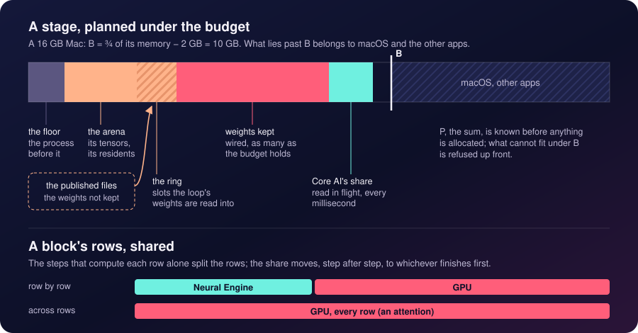

[English](ENGINE.md) · Français

# Le moteur de Siliconed

Sur quoi Siliconed calcule, comment il reste dans son budget de mémoire et comment il prouve ses résultats. Pour ce que fait l'app, voir [L'app Siliconed](APP.fr.md).

## Core AI

**Un seul runtime : Core AI, celui d'Apple, arrivé avec macOS 27.** Le moteur, `SiliCore` (`Engine/`), écrit des fonctions Core AI de formes fixes, opération par opération, en Swift — produits, attentions, normes, convolutions — et les appelle dans une boucle qui est celle du modèle, en Swift elle aussi. Une fonction ne contient aucun poids : les poids sont ses arguments, des vues d'une arène où le moteur les lit. Core AI compile chaque fonction une fois par Mac et l'exécute sur le GPU ou sur le Neural Engine ; ce que la puce préfère se mesure sur la puce, jamais dans une table.

**La frontière.** Le moteur connaît des tenseurs, des poids par groupes, des fonctions, des octets et des secondes ; chaque modèle (une *famille*, dans `App/`) déclare ce qu'il lui faut dans ces mots-là et garde les siens. Le moteur ne contient aucun mot du domaine de l'image, et un test échoue s'il en apprend un.

**L'arithmétique est celle de la famille**, écrite dans ses fonctions : codes int8 multipliés int8 × int8 au GPU (W8A8) et déquantifiés dans la fonction sur le Neural Engine (W8A16, sur une copie des codes disposée comme il les lit), poids bf16 arrondis une fois en f16 à leur lecture là où la Standard partage ses rangées avec le Neural Engine, f16 tenu dans sa plage par des facteurs explicites, f32 là où une famille le demande. Le bruit de départ est celui de `torch.randn`, au bit près.

**La compilation.** Core AI compile une fonction pour ses formes, et la garde. Le premier rendu d'un modèle à une taille neuve, dans une version (Standard ou Compact) pas encore lancée, ou avec un LoRA d'un rang neuf, compile d'abord et le paie une fois (son temps entre parenthèses sous [Les chiffres](#les-chiffres)). Chaque rendu suivant, à cette taille, démarre aussitôt.

**Les bits appartiennent au système.** Le calcul est celui de Core AI : une mise à jour de macOS peut déplacer un arrondi. Une même graine donne la même image à l'œil, pas forcément le même fichier octet pour octet d'un macOS à l'autre. Ce que Siliconed garantit, c'est l'écart à la référence, étage par étage, et vous pouvez le remesurer chez vous ([VERIFY.fr.md](VERIFY.fr.md)).

## L'interface

Une famille se sert d'une poignée de types, tous publics, chacun avec ses tests :

| | |
|---|---|
| `Aicode` | l'écriture, opération par opération, du bytecode d'une fonction, et les formes que prennent le GPU comme le Neural Engine (`Aicode.Block` : les produits, la norme, la rotation) |
| `SharedWeights` | ce que lisent les produits de ces formes : les codes int8 de la Compact, ou les poids de la Standard en f16 là où elle partage ses rangées avec le Neural Engine |
| `Functions` | l'asset d'une fonction, écrit quand ses octets changent, et chargé pour le GPU ou le Neural Engine |
| `Arena` | un tas Metal par étage, chaque tenseur sur une page ; un tampon à part pour la sortie d'un étage ; des surfaces pour le Neural Engine |
| `Weights`, `Recipe`, `SafeTensors` | les fichiers publiés (un seul, ou les morceaux d'un index) lus tels quels, chaque tenseur converti une fois en entrant dans l'arène ; les parties d'un produit jointes |
| `Stage` | un étage déclaré, planifié sous le budget, puis exécuté : son arène, ses poids gardés ou lus d'avance, ses fonctions |
| `ThisMac` | ce que ce Mac a mesuré, gardé par Mac et par système |
| `Block` | la boucle d'un transformeur telle que sa famille la déclare, exécutée par le moteur : ses appels mis d'avance au GPU, ses rangées partagées avec le Neural Engine |
| `Bands`, `BandStage` | un réseau de couches sur des plans (un décodeur, un encodeur), chaque couche une fonction appelée bande après bande le long des rangées de son plan, deux appels en vol, les bandes dimensionnées et les plans disposés par le moteur |
| `Layers` | une pile de couches (un encodeur de texte, le rédacteur du Labo de prompts), sur tout le prompt d'un coup ou un jeton à la fois à travers chaque couche |
| `Memory`, `FootprintWatch` | l'empreinte du processus, lue comme le système la compte ; le fusible |

**Un étage** se déclare par sa famille : ses tenseurs (dans le tas, à part, ou en surfaces), les poids qu'il tient tout du long, ceux qu'il peut garder ou lire à tour de rôle par groupes, l'ordre dans lequel sa boucle utilise les groupes, les fonctions qu'il charge. Un étage peut venir sous plusieurs formes, les appels ou les bandes les plus hauts d'abord (les hauteurs de `Block`, les positions de `Bands`) : chacune est planifiée, et le moteur prend la première dont P et ce que Core AI tiendra sous ses fonctions sur ce Mac (lu avant, ou borné d'après ce qui a été lu : plus bas) tiennent sous le budget (`Stage.choose`).

## La mémoire et le budget

Siliconed ne s'accorde jamais plus que son budget : par défaut ¾ de la mémoire du Mac moins 2 Go, 4 Go sur un Mac de 8 Go, 10 Go sur 16 Go, 46 Go sur 64 Go, réglable dans l'app. Ce que tiennent les autres applications leur appartient.

<p align="center"></p>

**Chaque étage est planifié avant toute allocation**, à l'octet : P = l'empreinte du processus avant lui + l'arène telle que Metal l'allouera (ses tenseurs, ses poids résidents, les emplacements d'un anneau). Les poids qu'une boucle répète sont lus depuis le disque dans cet anneau, sur un fil à eux, pendant que la boucle calcule sur les autres ; ce que l'étage en garde en mémoire se décide pendant les premières passes, une fois la part de Core AI lue. L'empreinte se lit une fois rendues au noyau les pages que `malloc` a libérées (`Memory.floor`) : macOS compte une page libérée jusqu'à ce que le noyau la reprenne, et un plancher qui les compterait grandirait d'un rendu au suivant. Ce qu'aucun plan ne peut faire tenir est refusé d'emblée, avec le chiffre qui manque. **Le décodeur d'un rendu est jugé avant que son DiT démarre** (`BandStage.admit`), sur le plancher que le DiT rendra : un décodage qui ne peut pas tenir est refusé avant les minutes du DiT, pas après.

**Ce que Core AI tient pour ses fonctions ne se compte pas sur le papier** : il se lit donc pendant que l'étage tourne, l'empreinte au-delà du plancher et de l'arène, relevée chaque milliseconde (la mémoire de travail d'un appel va et vient pendant l'appel). Dès le signal de la boucle, le lecteur garde un groupe de poids dans un tas à lui tant que l'empreinte à la crête de cette part, le groupe, ce qui reste à venir de la part (ce dont elle a crû après le signal la fois d'avant) et une marge tiennent sous le budget, et tant que le système laisse le processus le câbler ; sinon le groupe passe par l'anneau. Chaque poids placé est câblé (`mlock`) jusqu'à la fin de son étage, partout où le système laisse le processus le câbler (au-delà de sa limite, un poids reste non câblé) : non câblé, un poids que la boucle lit une fois par pas est une page laissée seule entre deux lectures, que macOS compresse sous pression, et chaque appel qui la lit paie alors la décompression (Z-Image Compact en 1024² sur un M1 Pro de 16 Go, un navigateur ouvert : 83 à 86 s avec 6 Gio gardés, 79 s câblés). La plus haute part lue sous chaque ensemble de fonctions est gardée sur le Mac, sous une clé qui porte ses fonctions, leur unité et le nombre d'appels d'une même fonction en vol (`Stage.key`), et seulement si elles ont été appelées : elle choisit la fois suivante la hauteur des appels ou des bandes d'un étage, et une part du Neural Engine ne se déplace que si ses fonctions tiennent.

**Une forme jamais lue se borne d'après sa parenté** — les mêmes fonctions à une autre taille, une autre hauteur ou une autre part du Neural Engine, quel que soit le build du moteur qui les a écrites, pourvu qu'il écrive les mêmes opérations (`Stage.Extent`, `Block.extent`) : la plus petite de leurs lectures fois ce que ses appels tiennent de plus, jamais sous la lecture elle-même, avec une marge pour ce qui a tourné avant dans le processus (`Stage.estimates(extents:)`). Bornée d'après une forme qui tient moins (une taille plus grande que toutes celles que ce Mac a rendues), la borne est une prévision, environ 10 % au-dessus de ce que tiennent les appels : au-delà du budget, la forme est refusée avant que rien ne tourne. Bornée seulement par une forme qui tient plus (un budget abaissé sous toutes les formes lues), la borne ne dit rien de combien moins : la forme part comme sur un Mac sans lecture. Sans rien de lu dans sa parenté, un étage prend sa forme la plus sobre, sur le papier.

**Le fusible.** Une veille lit l'empreinte chaque milliseconde et arrête le processus à l'instant où il passe B (`FootprintWatch`). C'est une dernière garde, qu'un plan bien écrit ne déclenche jamais : B n'est jamais dépassé, et un rendu que le fusible a arrêté est une faute dont on trace la cause, pas une façon d'apprendre pour le moteur. Les fonctions ouvertes en dernier quand il a sauté sont marquées sur le Mac, et le moteur qui a pris la marque (son binaire) ne les reprend plus sous un budget qui n'est pas plus grand que celui sous lequel elles ont tourné : une version neuve, ou un budget plus grand, les essaie une fois de plus. Une forme plus haute qu'une forme marquée tient plus, et n'est jamais prise. Si le fusible arrête malgré tout un décodage, les latents que son DiT a laissés sont gardés : le rendu est confié une fois à un worker neuf, qui les décode seuls, sans relancer le DiT.

**Ce que le moteur a appris de Core AI dessine l'arène** : un tenseur hors d'une page est copié à chaque appel, une vue transposée aussi, et une fonction garde les tampons de son dernier appel jusqu'à ce qu'on l'appelle de nouveau ou qu'on la lâche. Chaque tenseur commence donc sur une page, les poids d'un produit sont écrits une fois dans la disposition que le produit de Core AI lit telle quelle (les codes de la Compact en `[morceaux, out, in / morceaux]` pour le produit entier du GPU, les poids bf16 tels que le fichier les donne, ou en `[in, out]` là où un produit s'écrit x · W), la sortie d'un étage est à part de son tas, et un étage lâché lâche son arène avant les fonctions qui la lisent, puis attend que l'empreinte soit redescendue avant que le suivant commence. Un bloc attend un appel avant de rappeler sa fonction : un second appel en vol prend une seconde mémoire de travail. Un étage de bandes garde deux appels sur le flux, chacun encodé pendant que le précédent tourne (un à la fois, le GPU restait au repos pendant que le CPU encodait chacun) ; leur second jeu d'intermédiaires fait partie de la part de Core AI, et la clé sous laquelle une lecture est gardée le dit. Chacun de ces faits est un test exécuté sur le GPU du Mac (`RunTests`).

**Le Neural Engine à côté du GPU.** Un étage peut confier une part de son travail au Neural Engine, ses poids étant alors sur des surfaces que les deux unités lisent : les premières rangées d'un bloc, par groupes, pour les étapes qui calculent chaque rangée seule, pendant que le GPU prend les rangées au-delà et, sur toutes les rangées, les étapes qui lisent à travers elles (une attention) ; le moteur ordonne les appels des deux unités, chacune n'attendant que les rangées qu'elle lit. La part se trouve en vol, pendant le rendu : les appels de chaque pas sont chronométrés et, au pas suivant, la part va à celle qui est prédite finir la première, phase par phase dans l'ordre des appels, si elle gagne au moins 3 % ; le rendu suivant repart d'où le dernier l'a laissée. Les rangées que prend un appel du Neural Engine (son unité) se décident une fois par bloc sur le Mac, essayées à sa première exécution, et ne changent plus ensuite.

**Le Neural Engine n'est gardé que là où il aide.** Allumé, chaque bloc se chronomètre aussi au GPU seul, un rendu chacun, une fois par modèle et par taille sur le Mac, et le plus rapide se garde (`Block.choose`, `ThisMac.paces`) : le GPU calcule une rangée plus lentement à côté du Neural Engine que seul, ce que les appels à côté de lui ne prédisent pas. Les deux façons de la Standard sont ses poids en f16 partagés avec le Neural Engine et son bf16 au GPU seul : sur un GPU qui calcule le bf16 aussi vite que la f16 (le Mac mini M5 Pro), la f16 ne gagne que là où le Neural Engine apporte assez. Les premiers rendus d'un modèle à une taille neuve sur un Mac essaient chacun une façon avant que la plus rapide se garde.

**La Compact sur un seul chemin.** Ses codes sont rangés comme le fichier range leurs rangées, coupés le long de leurs entrées en morceaux égaux de 4096 au plus, multiples de 64 (`Weights.pieces`). Le GPU les multiplie en int8 × int8 (W8A8, `w8a8`) : chaque morceau de l'entrée ramené en int8 sous l'échelle de sa rangée, les sommes en int32 par le noyau entier de Core AI, les échelles appliquées après, dans un ordre qui garde chaque somme dans la f16 — la recette de la référence int8 de la Compact, activations quantifiées par rangée. Le Neural Engine ne lit ses codes qu'en `[1, in, out]`, ses propres poids int8 déquantifiés dans sa fonction (W8A16, `q64`) : le CPU écrit chaque code dans une copie à ce rangement, à l'étape du GPU qui précède les étapes du Neural Engine qui la lisent, chaque appel du Neural Engine d'avant terminé, si bien que la copie ne tourne jamais à côté du Neural Engine ni ne change ses surfaces ; cette copie est une surface dans P, là seulement où le Neural Engine prend des rangées.

**Gardé par Mac et par système.** Ce qu'un Mac a mesuré — les parts de Core AI lues et ce que leurs appels tenaient, les marques du fusible avec le moteur et le budget sous lesquels elles ont été prises, la part du Neural Engine de chaque bloc et son unité, l'allure de chaque façon — est gardé sous le modèle du Mac et le build du système, et remesuré après une mise à jour de macOS. L'app le garde dans son propre espace sur le Mac (`engine/this-mac.json`, que macOS ne purge jamais et qui reste sur le Mac quand la bibliothèque déménage) ; les assets des fonctions, qui peuvent toujours s'écrire de nouveau, vivent dans les caches de l'utilisateur.

## Les chiffres

Les cinq modèles à 1024², 8 pas, graine 42, réglages par défaut de l'app, sous le budget par défaut. Le temps est celui du rendu, le modèle chargé ; le premier rendu à une taille compile aussi (plus haut), son temps entre parenthèses là où il a été pris.

| | Mac mini M5 Pro, 64 Go · Standard | Mac mini M5 Pro, 64 Go · Compact | M1 Pro, 16 Go · Compact, 0.30 |
|---|---:|---:|---:|
| Z-Image Turbo | 23,1 s | 18,3 s | 75,9 s (93,5) |
| Anima Turbo | 7,9 s | 9,1 s | 33,6 s (45,8) |
| Krea 2 Turbo | 39,6 s | 30,5 s | 128,1 s (149,6) |
| MOSS-Image | 23,0 s | 19,7 s | 76,4 s (99,3) |
| Qwen-Image-2.1 Turbo | 32,4 s | 24,0 s | 97,7 s (120,7) |

La colonne du M1 Pro est encore celle de la 0.30, jusqu'à sa mesure en 0.31.

**La Compact lit moitié moins d'octets que la Standard**, sur le disque comme en mémoire, et là où le GPU multiplie l'int8 en int32, elle calcule aussi plus vite : au Mac mini, un pas de son DiT à 1024² va de 10 à 40 % plus vite qu'en 0.30, son int8 × int8 contre le W8A16 de la 0.30. Là où le budget ne tient pas les poids de la Standard, c'est la version qui lit le moins.

Les autres Mac, ceux de 8 Go d'abord, attendent les rapports des machines elles-mêmes ; `silicontrol measure` prend les vôtres ([REMOTE-CONTROL.fr.md](REMOTE-CONTROL.fr.md)), et [ce formulaire](https://github.com/gwenn-ha-dev/Siliconed/issues/new?template=times.yml) les apporte ici.

## Face aux autres outils

- **[ComfyUI](https://github.com/comfyanonymous/ComfyUI) ou [diffusers](https://github.com/huggingface/diffusers) en Python** : les mêmes modèles, les mêmes fichiers, sans environnement Python ni graphe de nœuds à câbler. Siliconed les implémente en natif et se vérifie contre diffusers et [transformers](https://github.com/huggingface/transformers) ; `silicontrol` couvre les scripts et l'automatisation.

## La vérification

Chaque étage (tokenizer, encodeur de texte, débruiteur, VAE) est comparé à l'implémentation de référence, diffusers et transformers, sur la même entrée. L'écart se mesure canal par canal, chaque canal rapporté à sa propre norme, pour qu'une faute confinée à un canal ne se cache pas dans un chiffre global.

- **La Standard se juge contre la référence exécutée en bf16**, l'arithmétique de ses poids. Là où un calcul fp64 du même étage existe, il sert de témoin : le moteur ne doit pas s'en écarter de plus que la référence bf16, plus 25 %.
- **La Compact se juge au débruiteur, contre les produits int8 de ComfyUI** sur les mêmes poids. Son rendu est contrôlé comme une image finie, son écart à l'image fp32 affiché sans être jugé : huit pas libres en 8 bits bifurquent, et juger la bifurcation ne dirait rien du calcul.
- **Ce qui est exact le reste** : le tokenizer, le bruit de la graine, le calendrier des σ, au bit près.

**Ces modèles vivent à la limite du bf16, et les contrôles le montrent.** Deux calculs bf16 fidèles s'écartent l'un de l'autre autant que chacun de la référence fp32, et le pire canal d'un pas varie de 0,7 à 2 fois d'un tirage à l'autre. Quelques mesures dépassent donc leur barre de quelques pour cent, et nous ne déplaçons pas la barre pour les faire passer : elles sont listées, avec leurs chiffres, dans [VERIFY.fr.md](VERIFY.fr.md). Ce qui arrêterait une version : une erreur globale nettement au-dessus de celle de la référence bf16, un étage exact qui ne l'est plus, une image fausse.

La comparaison est livrée : les scripts d'oracle de `App/tools/oracle/` et la commande `siliconed check` la refont sur votre Mac, étape par étape, avec les empreintes de nos références pour y comparer les vôtres ; [VERIFY.fr.md](VERIFY.fr.md) dit comment, et ce que ça coûte. La mémoire est tenue à la même discipline : chaque contrôle dit aussi si la session a tenu dans ce que son plan annonçait. Le rédacteur de l'Atelier de prompts est contrôlé de même : ses logits contre ceux de transformers sur les mêmes jetons, puis son décodage (`siliconed check qwen-image-2.1 writer`).

## Construire depuis les sources

macOS 27 ou plus, Apple silicon, Xcode 27 ou plus. Les seuls Command Line Tools ne suffisent pas : leur SDK n'a pas les macros de SwiftUI, et les phrases de l'app sont compilées par `xcstringstool`, que seul Xcode fournit (`tools/app.sh` le dit et s'arrête).

Le dépôt tient deux paquets : `Engine/`, le moteur, et `App/`, l'app, qui en dépend.

```
cd Engine && swift build && swift test     le moteur et ses tests purs
cd App && swift build -c release           l'app, silicontrol et siliconed
cd App && swift test                       les tests purs de l'app, sans aucun poids
cd App && tools/app.sh                     construit .build/Siliconed.app et l'ouvre
cd App && tools/app.sh --no-open           construit seulement
cd App && tools/dmg.sh                     emballe l'app construite en .build/Siliconed-<version>.dmg
```

`swift test` ne demande rien d'autre : ni poids, ni Python. Les tests du moteur qui passent par le GPU de ce Mac sont à part : `cd Engine && SILICORE_METAL=1 swift test -c release --filter RunTests`.

Par défaut, l'app est signée ad hoc : elle tourne sur le Mac qui l'a construite. Pour la distribuer, signez-la avec votre Developer ID :

```
cd App && tools/app.sh --sign "Developer ID Application: <nom> (<équipe>)"
```

Si `SILICONED_NOTARY_PROFILE` nomme un profil de trousseau `notarytool`, l'app est aussi notariée et agrafée ; `tools/dmg.sh` signe et notarie alors l'image disque avec la même identité.
