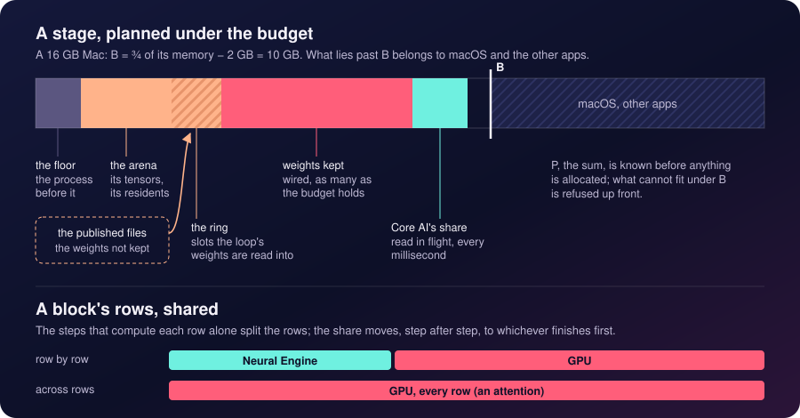

English · [Français](ENGINE.fr.md)

# The Siliconed engine

What Siliconed computes on, how it stays within its memory budget and how it proves its results. For what the app does, see [The Siliconed app](APP.md).

## Core AI

**One runtime: Core AI, Apple's own, which arrived with macOS 27.** The engine, `SiliCore` (`Engine/`), writes Core AI functions of fixed shapes op by op, in Swift — products, attentions, norms, convolutions — and calls them in a loop that is the model's own, also in Swift. A function holds no weight: weights are its arguments, views of an arena that the engine reads them into. Core AI compiles each function once per Mac and runs it on the GPU or on the Neural Engine; what the chip prefers is measured on the chip, never written in a table.

**The frontier.** The engine knows tensors, weights by groups, functions, bytes and seconds; each model (a *family*, in `App/`) declares what it needs in those words and keeps its own. The engine holds no word of the image domain, and a test fails if it learns one.

**The arithmetic is the family's**, written in its functions: int8 codes dequantized inside the function (W8A16) or multiplied on the Neural Engine, bf16 weights rounded once to f16 as they are read where the Standard shares its rows with the Neural Engine, f16 kept in range by explicit factors, f32 where a family asks for it. The starting noise is `torch.randn`'s, bit for bit.

**Compilation.** Core AI compiles a function for its shapes, and keeps it. The first render of a model at a new size, in a version (Standard or Compact) not yet run, or with a LoRA of a new rank compiles first and pays for it once: Z-Image Compact at 1024² on a 16 GB M1 Pro takes 93 s the first time, 76 s afterwards. Every render after it, at that size, starts at once.

**The bits belong to the system.** The computation is Core AI's: a macOS update can move a rounding. The same seed gives the same picture to the eye, not necessarily the same file byte for byte from one macOS to the next. What Siliconed guarantees is the deviation from the reference, stage by stage, and you can measure it again at home ([VERIFY.md](VERIFY.md)).

## The interface

A family uses a handful of types, all public, each with its tests:

| | |
|---|---|
| `Aicode` | the op-by-op writer of a function's bytecode |
| `Functions` | a function's asset, written when its bytes change, and loaded for the GPU or the Neural Engine |
| `Arena` | one Metal heap per stage, every tensor on a page; a buffer apart for a stage's exit; surfaces for the Neural Engine |
| `Weights`, `Recipe`, `SafeTensors` | the published files (one, or the shards of an index) read as they are, each tensor converted once as it enters the arena; a product's parts joined |
| `Stage` | a stage declared, planned under the budget, then run: its arena, its weights kept or read ahead, its functions |
| `ThisMac` | what this Mac measured, kept by Mac and by system |
| `Block` | a transformer's loop as its family declares it, run by the engine: its calls put ahead of the GPU, its rows shared with the Neural Engine |
| `Bands` | a network of layers over planes (a decoder, an encoder), each layer one function called band after band down its plane's rows, the bands sized and the planes laid out by the engine |
| `Layers` | a stack of layers (a text encoder, the Prompt Lab's writer), over the whole prompt at once or one token at a time through every layer |
| `Memory`, `FootprintWatch` | the process's footprint, read as the system counts it |

**A stage** is declared by its family: its tensors (in the heap, apart, or as surfaces), the weights it holds all along, the weights it can keep or read in turn by groups, the order its loop uses the groups in, the functions it loads. A stage may come in several forms, the tallest calls or bands first (`Block`'s heights, `Bands`' positions): each is planned, and the engine takes the first whose P and what Core AI was read to hold under its functions on this Mac hold under the budget; where nothing was read yet, the soberest whose socle holds (`Stage.choose`).

## Memory and the budget

Siliconed never grants itself more than its budget: ¾ of the Mac's memory minus 2 GB by default, 4 GB on an 8 GB Mac, 10 GB on 16 GB, 46 GB on 64 GB, adjustable in the app. What other applications hold is theirs.

<p align="center"></p>

**Every stage is planned before anything is allocated**, to the byte: P = the process's footprint before it + the arena as Metal will allocate it (its tensors, its resident weights, the slots of a ring). The weights a loop repeats are read from disk into that ring, on a thread of their own, while the loop computes on the others; what of them the stage keeps in memory is decided during the first passes, once Core AI's share is read. What no plan can fit is refused up front, with the number it is short by.

**What Core AI holds for its functions cannot be counted on paper**, so it is read while the stage runs: the footprint past the floor and the arena, sampled every millisecond (a call's working memory comes and goes within the call). From the loop's signal, the reader keeps a group of weights in a heap of its own while the footprint at that share's peak, the group, what is still to come of the share (what it grew past the signal last time) and a margin hold under the budget, and while the system lets the process wire it; otherwise the group rides the ring. Every weight placed is wired (`mlock`) until its stage closes, wherever the system lets the process wire it (past its limit, a weight stays unwired): unwired, a weight the loop reads once a step is a page left alone in between, which macOS compresses under pressure, and every call that reads it then pays the decompression (Z-Image Compact at 1024² on a 16 GB M1 Pro, a browser open: 83 to 86 s with 6 GiB kept, 79 s wired). Each set of functions' largest share is kept on the Mac: it chooses the next time how tall a stage's calls or bands are (never read, the soberest; read for another height, scaled by the rows), and a share of the Neural Engine moves only where its functions hold. A watch stops the process past the budget, and the functions it ran under are never taken again on that Mac.

**What the engine learned of Core AI shapes the arena**: a tensor off a page is copied at every call, a transposed view as well, and a function holds its last call's buffers until it is called again or let go. So every tensor starts on a page, a product's weights (int8 codes or bf16) are written once in the layout Core AI's product reads as it lies (int8 codes `[in, out]`, bf16 weights as the file has them), a stage's exit lies apart from its heap, and a stage let go waits until the footprint has come down before the next one starts. Each of these facts is a test run on the Mac's GPU (`RunTests`).

**The Neural Engine beside the GPU.** A stage can give part of its work to the Neural Engine, its weights then on surfaces both units read: the first rows of a block, in groups, for the steps that compute each row alone, while the GPU takes its tiles past them and the steps that read across rows (an attention) on every row; the engine orders the two units' calls, each waiting only for the rows it reads. The share is found in flight, within the render: each step's calls are timed, and at the next step the share moves to the one predicted to finish first, phase by phase as the calls are ordered, if it gains 3 % at least; it starts the next render where the last one left it. A first render on a Mac is therefore paid at nearly its pace (+3 % on the Mac mini, Z-Image Compact at 1024²). The Standard has one more choice: its bf16 on the GPU alone, or its weights in f16 shared with the Neural Engine. Each is timed once on the Mac, a render each, for each model and size, and the faster is kept: on a GPU that computes bf16 as fast as f16 (the Mac mini M5 Pro), the f16 wins only where the Neural Engine brings enough.

**Kept by Mac and by system.** What a Mac measured — the shares Core AI was read at, the Neural Engine's share of each block and its unit — is kept beside the functions' assets under the Mac's model and the system's build, and measured again after a macOS update.

## Numbers

The five models at 1024², 8 steps, seed 42, the app's default settings, under the default budget. The time is the render's, the model loaded; the first render at a size also compiles (above), its time in brackets where it was taken.

| | Mac mini M5 Pro, 64 GB · Standard | Mac mini M5 Pro, 64 GB · Compact | M1 Pro, 16 GB · Compact |
|---|---:|---:|---:|
| Z-Image Turbo | 23.8 s | 23.8 s | 75.9 s (93.5) |
| Anima Turbo | 7.9 s | 10.2 s | 33.6 s (45.8) |
| Krea 2 Turbo | 43.2 s | 46.9 s | 128.1 s (149.6) |
| MOSS-Image | 25.7 s | 24.7 s | 76.4 s (99.3) |
| Qwen-Image-2.1 Turbo | 29.7 s | 32.2 s | 97.7 s (120.7) |

**The Compact buys memory, not always time.** It reads half the bytes of the Standard, from disk and in memory. On the Mac mini, whose GPU computes bf16 as fast as f16, that saves no time: the Compact is as fast as the Standard or slower (Anima, Krea 2, Qwen-Image-2.1). Where the budget cannot hold the Standard's weights, it is the version that reads the least.

Other Macs, the 8 GB ones first, await reports from the machines themselves; `silicontrol measure` takes your own ([REMOTE-CONTROL.md](REMOTE-CONTROL.md#what-gets-measured)), and [this form](https://github.com/gwenn-ha-dev/Siliconed/issues/new?template=times.yml) brings them here.

## Next to other tools

- **[ComfyUI](https://github.com/comfyanonymous/ComfyUI) or [diffusers](https://github.com/huggingface/diffusers) in Python**: the same models, the same files, with no Python environment and no node graph to wire. Siliconed implements them natively and checks itself against diffusers and [transformers](https://github.com/huggingface/transformers); `silicontrol` covers scripts and automation.

## Verification

Every stage (tokenizer, text encoder, denoiser, VAE) is compared with the reference implementation, diffusers and transformers, on the same input. The deviation is measured channel by channel, each channel relative to its own norm, so a fault confined to one channel cannot hide in a global figure.

- **The Standard is judged against the reference run in bf16**, the arithmetic of its weights. Where an fp64 computation of the same stage exists, it is the witness: the engine must be no further from it than the bf16 reference, plus 25 %.
- **The Compact is judged at the denoiser, against ComfyUI's int8 products** on the same weights. Its render is checked as a finite image, its deviation from the fp32 image shown and not judged: eight free steps in 8 bits fork, and judging the fork would say nothing about the computation.
- **What is exact stays exact**: the tokenizer, the seed's noise, the σ schedule, bit for bit.

**These models live at the edge of bf16, and the checks show it.** Two faithful bf16 computations deviate from each other as much as each does from the fp32 reference, and a step's worst channel varies from 0.7 to 2 times from one draw to the next. So a few measurements pass their bar by a few percent, and we do not move the bar to let them through: they are listed, with their numbers, in [VERIFY.md](VERIFY.md). What would stop a release: a global error clearly above the bf16 reference's, an exact stage that no longer is, a wrong image.

The comparison ships: the oracle scripts in `App/tools/oracle/` and the `siliconed check` command redo it on your Mac, step by step, with the fingerprints of our references to compare yours with; [VERIFY.md](VERIFY.md) says how, and what it costs. Memory is held to the same discipline: each check also says whether the session stayed within what its plan announced. The Prompt Lab's writer is checked likewise: its logits against transformers' on the same tokens, then its decoding (`siliconed check qwen-image-2.1 writer`).

## Building from source

macOS 27 or later, Apple silicon, Xcode 27 or later. The Command Line Tools alone are not enough: their SDK lacks SwiftUI's macros, and the app's phrases are compiled by `xcstringstool`, which only Xcode ships (`tools/app.sh` says so and stops).

The repository holds two packages: `Engine/`, the engine, and `App/`, the app, which depends on it.

```
cd Engine && swift build && swift test     the engine and its pure tests
cd App && swift build -c release           the app, silicontrol and siliconed
cd App && swift test                       the app's pure tests, with no weights at all
cd App && tools/app.sh                     builds .build/Siliconed.app and opens it
cd App && tools/app.sh --no-open           builds only
cd App && tools/dmg.sh                     packages the built app as .build/Siliconed-<version>.dmg
```

`swift test` needs nothing else: no weights, no Python. The engine's tests that go through this Mac's GPU are apart: `cd Engine && SILICORE_METAL=1 swift test -c release --filter RunTests`.

By default the app is signed ad hoc: it runs on the Mac that built it. To distribute it, sign it with your Developer ID:

```
cd App && tools/app.sh --sign "Developer ID Application: <name> (<team>)"
```

If `SILICONED_NOTARY_PROFILE` names a `notarytool` keychain profile, the app is also notarized and stapled; `tools/dmg.sh` then signs and notarizes the disk image with the same identity.
